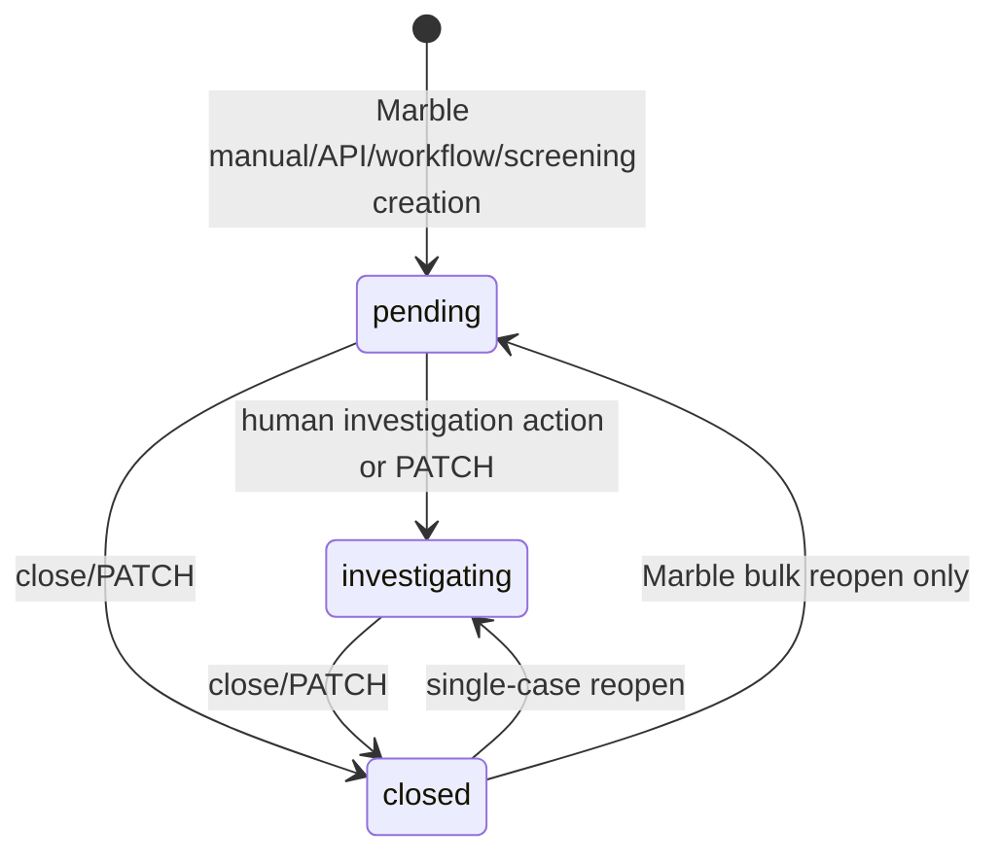
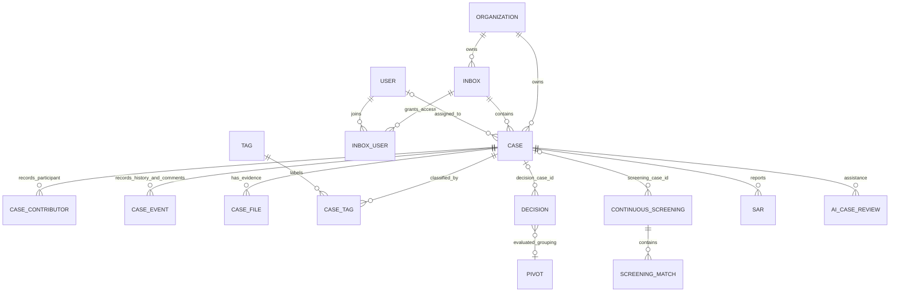

# Case management implementation plan

## Detection selection and case creation — 2026-10-13

Authorized scope: select decisions on the Detection table and create one case in
an accessible active inbox using a modal. Existing-case bulk attachment is excluded.

- [x] Add a bounded, human-authorized batch membership read (maximum 100 IDs),
  returning case details only for accessible inboxes and a generic unavailable
  result for inaccessible/missing decisions. Reuse indexed owner references.
- [x] Bound manual creation to 100 decision IDs and add optional actor-bound
  operation receipts to the existing atomic creation command. Replays reauthorize
  current case access; changed payloads conflict. Preserve existing callers.
- [x] Resolve Detection session on the server and use the configured workspace tenant; add page-local
  row/header selection, truthful case cells, and an accessible create-case modal.
  Clear selection on page/filter/session changes; preserve identical retry payload
  after uncertain responses. Use the existing same-origin case proxy.
- [x] Verify backend atomicity, replay/concurrency, tenant/inbox denial and bounded
  query behavior; verify browser selection, modal, errors, retry and navigation.
- [x] Record actual checks and limitations here and in the investigator contract.

Status: implemented and verified locally. The [contract](backend/case-manager-service/INVESTIGATOR_CONTRACT.md)
documents payloads, authorization, receipts and rollout. Source changes include
the server-authenticated Detection page/client workspace, selectable table,
accessible modal, one batch membership query, and optional manual-create receipts.
Cancel preserves the table selection and returns keyboard focus to its trigger.

Tenant configuration correction: Detection and the default Cases route now prefer
`NEXT_PUBLIC_DATA_MODEL_TENANT_ID`, matching Data Model and Detection detail pages.
If unset, these server pages fall back to the session tenant. Explicit case-link
tenant parameters remain supported. The local root `.env` was corrected to the
requested `73900736-1141-4883-8fa9-58f4ef324ee5` tenant. Public configuration is baked
into the frontend build, so a frontend rebuild is required. This does not change
the authenticated tenant or grant access: a session for another tenant still receives
an authorization failure. Auth now supports `AUTH_DEFAULT_TENANT_ID` for ordinary
logins, wired in Compose to the same workspace setting. It checks current active
membership before creating a session and does not rewrite old sessions. Rebuilding
Auth and signing out/in are required to use the configured tenant. The target
account's three admin roles in tenant `739...` were confirmed by a read-only query.
Auth verification: `go test ./...` passed with database tests skipped; `go vet ./...`
passed. `TestConfiguredLoginTenant` and `TestPlatformSessionsAndPermissions` passed
against an isolated PostgreSQL 18 instance (10.008s), covering selected tenant,
missing/inactive membership, suspended tenant, failed-login rollback, current case
authorization and preservation of existing sessions. No live browser login has
been verified after this Auth change; rebuilding Auth and a new sign-in are pending.
Correction verification: production build with the requested tenant and scoped
ESLint passed. All three `configured-tenant.spec.ts` browser checks passed against
that build: configured Detection requests with foreign-session denial, configured
Cases default with explicit-link preservation, and My Account case navigation.
These use the controlled service fixture, not a real login to the target tenant.

Verification on 2026-10-13:

- Case Manager `go test ./...` passed with PostgreSQL tests skipped before the
  dedicated test cluster was available. `go vet ./...` passed.
- Isolated PostgreSQL 18: all **15 focused tests** passed (213.238s), including
  existing membership/transfer/lifecycle regressions, signed HTTP requests,
  concurrent same-operation creation, conflicting payload/actor, unauthorized
  replay, tenant/private-case denial, bounds, receipt rollback and no partial case
  after conflicting attachment. The command used
  `go test ./internal/store/postgres -run 'TestDecisionSelections|TestManualCreateReceipt|TestPostgresHTTPIdentityBoundary|TestDecisionMembership|TestDecisionTransfer|TestPostgresLifecycle' -count=1 -timeout=15m -v`.
- The actual membership SQL was captured and explained against 50,000 decision
  links. Batches of 1/25/100 each issued one membership statement. The 100-row plan
  used `decisions_pkey`, `case_decisions_primary_unique` and
  `inbox_users_access_idx`; sampled execution was 8.995 ms. This is local query-plan
  evidence, not a production throughput or multi-inbox workload certification.
- Frontend production build/TypeScript passed on the final revision; focused
  ESLint had no errors and two existing unused-component warnings in the relocated
  Detection workspace. Fixture syntax and whitespace checks passed.
- **32 browser tests passed** through the real Next proxy (new selection tests
  plus existing workspace regressions). After final lazy-inbox-loading and
  cancel/focus refinements, the four selection tests passed again against the
  rebuilt frontend. They cover selection, linked/private rows, removal, focus,
  scope reset, multi-decision payload, navigation, revoked access and identical
  lost-response retry with one history event. The modal screenshot was inspected.

Limitations and failed checks: the full PostgreSQL test run hit its
default 10-minute timeout during an existing fixture's migration setup; it is not
reported as passing. The focused run above completed with a longer allowance.
The first browser attempt could not find its expected bundled browser; subsequent
runs used installed Chrome. An exact-label dropdown test locator was corrected to
the accessible combobox role. Windows sandbox restrictions prevented database
startup/shutdown and browser-server cleanup; those operations were completed
outside the sandbox. Browser owner/auth responses remain controlled fixtures,
separate from real PostgreSQL/HTTP authorization tests. The isolated cluster was
stopped after verification. No application data or deployment was changed. Deploy
the accepting Case Manager API before the frontend; no new migration is required.

2026-10-09 workflow authoring increment: the scenario Workflow page now saves
complete case rules atomically, selects real inboxes/tags, checks current platform
and inbox permissions, and supports explicit enable/disable. Stable retry IDs,
optimistic edit conflicts and audit snapshots are implemented. Legacy workflow
configuration routes require a private operator credential. See
[workflow editor contract and rollout](backend/decision-engine-service/documentation/workflows.md).
Local rollout completed on 2026-10-09: Decision Engine migration 000020, Auth v3,
private credentials and rebuilt APIs/workers/frontend are active. Readiness and
access-boundary probes passed. Existing roles/rules were preserved; an account
administrator must explicitly grant platform access before workflow editing.
Signed-in decision-to-case acceptance remains pending; no live rule was enabled.

2026-10-09 associated-decision increment: each explored record now lists matching
decisions and permitted cases with independent keyset pagination. Investigators
can explicitly attach an unlinked decision to the current case after confirming;
the backend revalidates the navigation path and applies existing attachment,
single-primary membership and audit rules. Hidden cases and their linked decision
summaries are omitted. [Contract and verification](backend/case-manager-service/INVESTIGATOR_CONTRACT.md).
The updated Case Manager/frontend were deployed locally with the workflow rollout;
signed-in acceptance remains pending. Graph-wide search and automatic collection
are not added.

2026-10-09 connection explorer increment: linked decisions now expose a
case-authorized live-record navigator with forward/reverse links, navigation
options, direct pivots, pivot paths, breadcrumbs and save-trail notes. See
[contract, limits and rollout](backend/case-manager-service/INVESTIGATOR_CONTRACT.md).
This advances object investigation; it does not complete a graph UI, historical
snapshots, per-field access policies or general related-resource discovery.
Verification and remaining deployment scope are recorded in that contract.

Reviewed: 2026-10-05 (repository research); original implementation baseline: 2026-09-29.

**Progress tracking:** use the [active TODO tracker](#active-case-management-todo) for current completion status, dependencies, pending decisions and the next implementation slice. Research completion and one verified slice do not mean the whole system is complete.

Implementation updated: 2026-10-05 (approved lifecycle, continuous-screening intake, single-primary decision membership/transfer, and decision-linked screening intake slices). The assessment and confirmed issues below retain the original review baseline; use the phase checklists, [lifecycle increment](#lifecycle-increment-2026-10-05), [continuous-screening increment](#screening-intake-increment-2026-10-05), [decision membership increment](#decision-membership-increment-2026-10-05), and [decision-linked intake increment](#decision-screening-intake-increment) for current implementation status. Earlier implementation increments remain dated 2026-09-30.

The [2026-10-05 evidence-based research and revised delivery plan](#research-2026-10-05) below is the implementation roadmap. It contains the feature inventory, frontend/backend traces, lifecycle, data model, API catalog, comparison matrix, new requirements, and implementation order. The later approved lifecycle increment supersedes the research snapshot where noted. Earlier completion notes are retained as historical records, not fresh test results. The research itself changed documentation only; subsequent implementation and verification are recorded separately.

Current assessment: core case operations, authenticated workspace APIs, native evidence, River maintenance/delivery, bulk operations, internal reports, scoped analytics, close/reopen enforcement, continuous and decision-linked screening pre-review intake, and single-primary decision membership with audited transfer are implemented in source. They do not establish complete Marble parity or operational readiness. Remaining priorities include screening-specific closure rules, intended-environment membership preflight, actual investigator decision/match actions, and frontend workflow gaps. Identity provisioning and live-stack acceptance remain open. Manual creation starting in `investigating` is a standalone policy difference: Marble's inspected manual creation path inserts the database default `pending`.

## Purpose and review scope

Workspace UX update (2026-10-06): removed the tenant-ID input and switch action from queue/analytics screens. Queue filters now open from a collapsed Filters button with an active-filter count, keyboard-accessible expansion, and preserved draft inputs when collapsed. Existing URL filter persistence and server-side tenant authorization remain enforced. Production builds, targeted lint and all five affected queue/analytics browser tests passed.

Runtime correction (2026-10-06): an empty tenant exposed nullable inbox/tag collections that the case queue rendered as arrays, causing the generic page error screen despite successful API requests. The [frontend API boundary](frontend/src/lib/case-manager-api.ts) now normalizes explicit null collections for inboxes, tags and the case queue to empty arrays while retaining HTTP error handling. The [browser regression](frontend/tests/cases/workspace.spec.ts) reproduces the original error and verifies the empty queue and create form after the fix. Production frontend build, targeted ESLint and all 34 Case Management/auth browser tests passed. No schema, tenant membership or authorization changes were required.

Complete case management in `New-fraud-system`, using the existing Marble implementation in `../api` and `../front` as the behavioral reference. This plan covers cases, inboxes, investigation, routing, evidence, automation, and their decision-engine and screening integrations. It does not propose replacing the new service architecture with Marble's monolith.

This is a source-code review, not a runtime certification. The service, database migrations, worker, HTTP handlers, frontend Cases page, Compose configuration, and producer-side integration clients were inspected. No running stack or end-to-end behavior was tested for this review. “Present” below means code exists; it does not mean production-ready.

## Standing architecture and quality requirements

All services use the same logical PostgreSQL database. The separate services retain ownership of their tables and business rules; database boundaries are not per-service deployment boundaries. Follow [the workspace engineering requirements](AGENTS.md): maintainable implementations, no quick hacks, and performance considered during design and verified where relevant.

Cross-service reference validation must evaluate direct tenant-scoped database queries or stable read views alongside service APIs. Select and document the appropriate contract; do not assume an HTTP round trip is required for data already in the shared database. Coordinate cross-schema constraints with migration ordering and ownership. Shared data access never replaces authorization.

Connection limits, worker concurrency, locks, migration duration, and query load must be assessed across every service and replica using this database. Disposable test databases remain appropriate for isolation; production services share the application database.

## Historical assessment (2026-09-29 baseline)

The new system has a useful case-management backend foundation. It is not yet a usable end-to-end investigation product. Most basic mutations exist, but transaction safety, access control, integration reliability, and the frontend remain unfinished. Several database tables and HTTP endpoints are scaffolds only.

The recommended first release is a reliable manual investigation flow plus reliable decision-to-case routing. Advanced AI review, suspicious activity reports, and analytics should follow that release rather than block it.

## Historical implementation and gaps (before the increments below)

| Capability | Current evidence | Remaining work |
| --- | --- | --- |
| Service and persistence | Standalone Go service; migrations; `case_manager` schema; API and worker entrypoints | Enable runtime wiring and meaningful worker execution; expand operational documentation |
| Case creation/detail/update | Implemented handlers, service methods, repositories | Transaction boundaries, validation, authorization, reliable relationship loading, concurrent-update protection |
| Lifecycle and outcomes | Pending, investigating, closed; four outcomes including unset; transition helper and database checks | Validate enums before writing, action side effects, contributors, explicit close/reopen behavior in UI |
| Case list | Name/status/inbox/assignee/snooze filters; bounded SQL limit | Cursor pagination, unassigned/date/tag/review filters, counts, next-case navigation, frontend |
| Inboxes | Create/list/get/update; escalation/assignment/review settings stored | Membership APIs and authorization, archive rules, nullable-setting clearing, SLA settings, settings UI |
| Assignment | Manual assign/unassign endpoints | Assignee eligibility, previous-value audit, self-assignment on investigation actions, automatic assignment |
| Snooze | Set/clear timestamp and list exclusion | Input/state rules, expiry processing, attention flags and UI |
| Escalation | Endpoint delegates to ordinary inbox update with caller-provided inbox ID | Configured destination, eligibility checks, dedicated event, assignment/attention side effects |
| Comments/events | Comments and events stored and listed | Atomic audit trail, complete history pagination, contributors, actor integrity |
| Tags | Create/list and attach/detach routes; repository update/delete methods | Expose supported tag administration, validate targets/ownership, UI |
| Files | File metadata and add-file endpoint | Actual upload/download lifecycle, storage ownership validation, UI |
| Workflow intake | Create-case and pivot-based reuse logic; decision-engine HTTP dispatcher | Shared action contract, idempotency, concurrency-safe grouping, metadata hydration, reliable routing |
| Screening integration | Review callback, screening links, screening publisher client | Deterministic routing, durable delivery, match identity, functional evidence callback and investigation UI |
| Automatic assignment | Settings/table and internal endpoint exist | Endpoint currently acknowledges only; worker has no assignment logic |
| AI review | Inbox flags, review-level field, table, internal endpoint | Queue, provider integration, results/history/feedback APIs and UI; endpoint currently acknowledges only |
| Suspicious activity reports | Table exists | Service/repository/API, document storage, export and UI |
| Outbound events | Outbox table and publisher URL config exist | Transactional enqueue, delivery worker, retry/deduplication and observability |
| Frontend | `/cases` renders three hardcoded rows | Typed client, query integration, list, detail, actions and inbox settings |
| Testing | Case service has one domain test file covering transitions/review levels | Service, repository, HTTP, integration, concurrency and browser coverage |

## Original confirmed issues (retain as review history; see current matrix)

1. **Case management is disabled in the default stack.** Case migration, API, worker, and relevant producer URLs are commented out in `docker-compose.yml`.
2. **Writes and audit events are not atomic.** The service ignores errors from many relationship/event writes. `UpdateCase` creates some events before all validation and the final update. A failed update can leave misleading events; a successful mutation can lack its event. Detail loading also suppresses relationship-read failures.
3. **Tenant filtering is not authorization.** Middleware checks an optional shared token; tenant selection comes from request input and actor identity from `X-Actor-ID`. Inbox membership is not enforced. Foreign keys reference resource IDs without enforcing matching tenant IDs, and service methods do not consistently validate referenced resources. Shared-token callers therefore need an explicit trusted identity and tenant boundary.
4. **Workflow retries can create duplicate cases.** `WorkflowExecutionID` is accepted but never used for deduplication. Pivot lookup and case creation are separate operations without a grouping lock.
5. **Producer and consumer action types disagree.** The decision-engine workflow model permits `create_case`, `add_tag`, and `emit_event`; case intake also branches on `add_to_case` and `add_to_case_if_possible`. Other action types can fall through to case creation when an inbox is supplied. Reject unsupported actions and route each supported action deliberately.
6. **Escalation is currently just a move.** It does not resolve the source inbox's configured escalation destination or reject closed cases/inactive destinations.
7. **Screening callbacks are incomplete.** Review handling scans at most 500 non-snoozed cases for a decision and otherwise uses the first inbox. A missed match can create another case. Link uniqueness is per screening per case, although callbacks include a match ID. The evidence callback returns `202` without saving anything. The screening service ignores publication errors, and its case/inbox HTTP clients do not send the token required by case-manager token mode.
8. **Worker-backed behavior is not implemented.** The worker only logs each cycle; auto-assignment and AI routes return `202` without durable work acceptance. Existing snooze filtering does make expired cases visible again, but it does not implement wake-up events or attention processing.
9. **Validation and error handling need hardening.** Pending-to-arbitrary-status passes the domain helper and relies on a database check; invalid inbox filter UUIDs are silently dropped; assignment/snooze writes do not check affected-row counts; most errors become raw `400` responses. Empty review-level clearing conflicts with the database constraint, while nullable escalation settings cannot be explicitly cleared through the current pointer-only update model.

## Delivery order

Priority meanings: **P0** protects correctness/access and enables delivery; **P1** completes the investigator workflow; **P2** supplies advanced parity.

Dependencies: Phase 1 precedes enabling operational traffic. Phase 2 depends on Phase 1's identity and transaction contracts. Phase 3 depends on the stable core APIs and working decision routing. Phase 4 builds on Phases 1–3. Phase 5 follows the core release.

### Identity-provider dependency: deferred for development

Proceed with Phase 4 and independent Phase 5 implementation without provisioning an identity provider. The existing identity contract remains required: user JWT verification, tenant isolation, inbox membership, and trusted audit actors must remain enforced. Controlled test identities and test signing keys can verify these contracts locally; they do not establish production sign-in readiness.

- [x] Separate provider provisioning from implementation of queue operations, evidence, bulk actions, tags, reporting, analytics, and exports.
- [ ] Integrate a real identity provider or trusted identity gateway, stable user subjects, and the browser session flow before enabling live investigator access.
- [ ] Complete the Phase 3 investigator journey against the running stack with that identity source. Keep this acceptance item open while later implementation proceeds.

Provider integration is a release dependency, not a reason to disable authorization or mark unverified acceptance checks complete. AI execution and evidence storage have their own provider/storage dependencies; deferring identity does not resolve those dependencies.

### Phase 1 — Make the backend trustworthy (P0)

Primary files: `backend/case-manager-service/internal/{service,ports,store/postgres,httpapi,domain/case}` and new forward migrations.

Implementation progress (2026-09-29): Phase 1 backend functionality is implemented and verified locally. This includes transaction-scoped commands, narrow row locks, atomic audit/outbox writes, validation and nullable PATCH handling, typed errors, verified JWT identity, inbox membership authorization, assignee eligibility, shared-database reference validation, and investigation side effects. Existing review findings above describe the original baseline. Deployment-specific operational verification remains explicitly open below; this is not a production-readiness claim.

Identity contract: investigator routes require RS256 JWTs from a configured issuer/audience and pinned public keys, with tenant, subject, issued/expiry times, and case roles. Service integration routes use a separate token boundary with an explicit tenant allowlist. Neither actor headers nor callback reviewer fields establish a human identity. Configuration, memberships, database ownership contracts, and pool allocation are documented in the [service README](backend/case-manager-service/README.md).

Shared-database review follow-ups (required before operational readiness):

- [x] Replace broad transaction-scoped inbox `FOR UPDATE` reads with explicit lock modes appropriate to validation versus mutation. Shared validation locks permit unrelated creates; moves/settings use ordered inbox locks. Concurrent archive/create and archive/move tests pass.
- [x] Batch case-list tag enrichment instead of issuing a query per case. Tests cover 10/100/500 case queues with three tags per case and assert two queries; reference lookup EXPLAIN uses the decision-link index.
- [x] Replace screening's bounded case scan with indexed relationship lookups. The integration test locates a snoozed case beyond a 1,200-case queue without creating a duplicate.
- [x] Define API/worker pool allocation and bounded request, statement, lock, and idle-transaction timeouts. Verify pool ceilings, canceled acquisition waits, lock timeouts, and concurrent shared-schema workloads locally. The worker remains disabled; its future allocation is included in the documented budget.
- [ ] Validate the deployment's actual replica/pool allocation and measure pool/lock waits under concurrently running service APIs and workers. Local synthetic database contention across five owner pools is covered, but is not a deployed multi-service load test.
- [x] Verify reference-validation contracts and all-service migration compatibility against the shared database. Integration fixtures apply all current data-model, ingestion, decision-engine, screening, and case migrations to the same disposable database, and exercise tenant-scoped cross-schema references and migration preflight/down/up.

- [x] Introduce transaction-scoped repositories/unit of work. Commit case changes, links, contributors, events, and outbound notification records together. Injected failures roll back the command; delivery remains Phase 2/4 work.
- [x] Validate command values and referenced resources before writing. Validate names, status/outcome/type/review enums, UUIDs, snooze dates, tags, active inboxes, and supported action types. Workflow metadata is checked against its decision before case creation. Invalid commands leave no persisted changes/events; nullable PATCH semantics are explicit.
- [x] Protect simultaneous mutations using row locks or a version/conditional-update contract. Avoid overwriting a concurrent assignment when saving an unrelated case field.
- [x] Return typed validation, not-found, forbidden, conflict, and internal errors; do not expose raw database errors. Check rows affected on case assignment/snooze operations.
- [x] Establish a trusted actor/tenant context from authenticated identity. Separate service integration permissions from human investigator permissions. Forged actor headers, invalid JWTs, wrong tenants, and use of service tokens on user routes are tested.
- [x] Implement inbox memberships using `inbox_users`; enforce tenant and inbox access on lists, reads, writes, links, files, and destination changes. Assignees must be members; revocation and reopening eligibility are tested.
- [x] Validate local tenant relationships and authoritative decision/screening/match/file ownership through shared-database reads. Local composite foreign keys include escalation destinations. Preflight rejects orphan/cross-tenant historical links. New file attachments require a verified screening `source_file_id`; arbitrary blob keys are rejected.
- [x] Implement contributor recording and shared investigation-action side effects: pending-to-investigating, eligible self-assignment, and attention clearing. Manual creation starts investigating; automated creation remains pending. Explicit assignment/unassignment preserves the requested assignee. All effects share the command transaction.
- [x] Fix partial detail reads: fail explicitly or expose a documented partial-response contract; do not silently present failed reads as empty evidence.

Acceptance:

- [x] A forced event/link/contributor/outbox failure rolls back its case mutation, and failed validation persists no events.
- [x] Tenant A cannot read or attach Tenant B's cases, inboxes, tags, files, decisions, or screenings; users without inbox membership cannot access its cases.
- [x] Concurrent name edits and assignment changes do not silently overwrite each other.
- [x] Invalid command values produce validation errors; missing resources return not-found; nullable fields clear correctly.

Verification evidence: `go test ./...` with `CASE_MANAGER_TEST_DATABASE_URL` runs real PostgreSQL tests, including signed HTTP requests. Queue reads remain two queries at 10/100/500 records with tags; the measured reference lookup uses `case_decisions_lookup_idx`. A local shared-schema contention test completes 300 commands across five two-connection pools and records pool acquisition waits without exceeding its ten-connection workload ceiling. These are local correctness/contention checks, not production throughput measurements. See [completion tests](backend/case-manager-service/internal/store/postgres/phase1_completion_integration_test.go), [access tests](backend/case-manager-service/internal/store/postgres/phase1_access_integration_test.go), and [shared-schema load test](backend/case-manager-service/internal/store/postgres/shared_load_integration_test.go).

### Phase 2 — Wire runtime and reliable alert intake (P0)

Implementation progress (2026-09-29): Phase 2 code and configuration are implemented and verified locally. The case API/migrations and dedicated screening callback worker are wired in Compose; the placeholder case worker remains disabled. See [the intake contract](backend/case-manager-service/INTAKE_CONTRACT.md) for payloads, grouping, receipts, delivery recovery, and migration sequencing. These implementation ticks do not establish full-stack or deployment readiness.

Primary files: `docker-compose.yml`, case service integration handlers/repositories, decision-engine workflow domain/dispatcher, screening clients and service.

- [x] Enable the case migration and API services with health checks, dependency ordering, documented port configuration, and matching database credentials. Enable the worker only once it executes real jobs.
- [x] Wire `WORKFLOW_ACTION_URL` for the decision API and worker, plus `CASE_SERVICE_URL` and `INBOX_SERVICE_URL` for screening producers. Cover database-scale deployment configuration where services are used separately.
- [x] Define a shared workflow payload contract and update producer validation, documentation, and any workflow editor. Support create versus reuse explicitly; keep add-tag/event behavior explicit and reject unrelated action types.
- [x] Persist a receipt keyed by tenant and workflow execution ID, including resulting case ID and payload identity. Atomically deduplicate retries; reject conflicting reuse of an ID.
- [x] Serialize pivot lookup/create using a transaction lock with a documented tenant/pivot/inbox scope. Handle `any_inbox` consistently with inbox-specific grouping. Define deterministic case selection and closed-case exclusion.
- [x] Resolve authoritative decision object/scenario/pivot metadata, rather than depending on callers to populate trusted linkage fields. Specify case title/template behavior and verify it against Marble workflows.
- [x] Replace the screening case scan with indexed decision/screening/match lookups and explicit configured inbox routing. Persist the intended relationship between a screening and its matches without losing match-level history.
- [x] Give screening callbacks stable event IDs and durable retry delivery; remove ignored publication failures. Add service authentication to the screening case/inbox clients. Treat an absent URL as a documented disabled feature or configuration error, not silent successful delivery.
- [x] Make evidence callbacks persist a relationship and audit event, or report an explicit unsupported response until implemented. Return `202` only after durable acceptance.
- [x] Document the actual stack and case endpoints in the root/service READMEs; the root README still describes the frontend as a placeholder despite the wider application.

Acceptance:

- [ ] A fresh local stack migrates and serves case health checks. A real decision workflow creates a case with correct decision metadata. Both Compose configurations validate, but Docker Desktop's daemon is unavailable on this host; fresh-container startup and an end-to-end decision-worker dispatch remain unverified. PostgreSQL-backed HTTP intake and dispatcher contract tests pass separately.
- [x] Replaying one execution produces one logical case/action; concurrent alerts for the same grouping key follow the declared grouping policy.
- [x] Screening callbacks find a linked case beyond 500 records and when snoozed; retrying callbacks does not create duplicate cases/events.
- [x] Token-protected producer/receiver contract tests succeed; simulated HTTP failure/recovery delivers queued work with stable IDs and observable retry state. The real PostgreSQL tests also cover lease recovery/fencing and rollback of the review if enqueue fails. Container-level outage/restart verification remains part of the open full-stack acceptance check.

Verification: `go test ./...` and `go vet ./...` pass for case-manager, screening, and decision-engine; case/screening tests use isolated PostgreSQL databases. Six database-scale suite tests pass. Default and database-scale Compose configuration validation passes using placeholder configuration. Evidence callbacks deliberately return 501; evidence persistence remains Phase 4 work. Existing decision-status callback delivery is outside this case-intake increment.

### Phase 3 — Ship the investigator experience (P1)

Implementation progress (2026-09-29): Phase 3 workspace code is implemented and locally verified. The Cases UI now uses live authorized APIs through a same-origin server boundary, with paginated queues/history, investigator actions, owner-service evidence, inbox administration, configured escalation, and permission-filtered related cases. See [the investigator contract](backend/case-manager-service/INVESTIGATOR_CONTRACT.md). The user identity provider/gateway must still establish the signed HttpOnly session; provider details have been requested. The existing login form is not a completed authentication integration.

Primary areas (now present): `frontend/src/app/(authenticated)/cases`, `frontend/src/components/cases`, `frontend/src/lib/case-manager-api.ts` and query helpers; corresponding case read/mutation APIs.

- [x] Follow `frontend/AGENTS.md` and read the installed Next.js guides relevant to routes/data loading before implementation. Reuse the existing UI and query conventions.
- [x] Add typed case/inbox/tag/event contracts and tenant-aware query keys. Choose an authenticated same-origin/server boundary for service credentials; never publish shared service tokens to the browser. Wire service URLs and Docker build/runtime settings accordingly.
- [x] Replace the hardcoded Cases page with live inbox queues, loading/error/empty states, search, filters, stable sorting, and cursor pagination. Remove sample severity/stage labels unless backed by a defined domain field.
- [x] Extend APIs with date/tag/review/unassigned filtering, queue counts, paginated events and decision links, and deterministic next-case navigation. Batch tag enrichment instead of a query for each case.
- [x] Build case detail with lifecycle/outcome, inbox, assignee, contributors, tags, linked decisions/screenings, comments, evidence, and a chronological activity timeline.
- [x] Hydrate decision details/rule evidence and screening matches from their owning services. Distinguish unavailable upstream data from “no evidence.” Reuse existing decision-detail navigation where useful.
- [x] Add manual create, rename, assign/unassign, move, comment, tag, snooze/unsnooze, close with outcome/comment, and reopen controls. Refresh affected detail, queue, and counts after success; display actionable mutation errors.
- [x] Add inbox settings for membership, archive/restore policy, escalation destination, and supported options. Hide or mark unsupported automation options until their jobs work.
- [x] Expose dedicated escalation behavior: resolve the configured active destination in the same tenant, disallow closed cases, record `case_escalated`, and apply assignment/attention policy. Preserve the authorized escalation exception for users without destination inbox membership.
- [x] Add related cases by pivot/object and customer/object navigation with server-enforced permissions.

Acceptance:

- [ ] Verify the complete investigator journey against a running deployment and live identity provider. The UI controls are implemented; browser fixtures verify evidence, findings, close/reload/reopen, while PostgreSQL tests independently verify real mutations and escalation. Provider integration and full-stack runtime verification remain open.
- [x] Reload preserves state/history in browser contract tests; real PostgreSQL tests page through 620 cases and 620 history entries with tied timestamps without duplicates/omissions. Browser tenant switching does not expose another tenant's cached cases.
- [x] The UI distinguishes lifecycle (`pending`, `investigating`, `closed`) from derived snoozed/waiting-for-action state and investigation outcome.
- [x] Four Chromium browser tests pass through the real Next.js proxy with a controlled HTTP service fixture: permitted/denied inboxes, evidence hydration, failed writes, empty queues, tenant isolation, close/reload/reopen, missing sessions, and cross-origin write denial. These are contract tests, not a live identity-provider test.

Verification: case-manager `go test ./...` with isolated PostgreSQL and `go vet ./...` pass. The production frontend build, TypeScript checks, targeted ESLint checks, and four browser tests pass. Default/database-scale Compose configurations validate. Migration `000005_workspace_indexes` is tested up/down/up, with representative queue index use. Existing Phase 1/2 deployment checks remain open. Evidence upload/download and complete customer/KYC enrichment remain in their later phases.

### Phase 4 — Complete queue operations and evidence (P1)

- [x] Implement automatic assignment with eligible inbox members, per-user capacity, stable tie-breaking, atomic claiming, audit events, and retry safety. Periodic state reconciliation picks up create/close/unassign/move/configuration changes; capacity is per inbox membership and enforced across manual assignment and reopening too.
- [x] Implement snooze expiry processing with one wake-up event, attention boost, and safe concurrent handling. Document how new alerts, reassignment, and escalation affect snoozed cases and queue ordering. Closing clears snooze.
- [x] Add inbox SLA configuration and due-date calculation. Creation time plus the current inbox SLA uses fixed UTC days; moves and SLA edits change the derived deadline. Add urgency display and an overdue filter.
- [x] Implement real file upload, finalize, and authorized download for native case evidence. Validate ownership, size/type, metadata, and completion; handle abandoned uploads. Bounded PostgreSQL storage supplies actual bytes because the screening blob client is a placeholder. Existing screening-source metadata remains visible; its callback/download integration is still dependent on owner storage, as documented below.
- [x] Complete transactional outbox writes and delivery with leases, retries/backoff, delivery identity, failure visibility, and replay. Keep persisted case events as investigation history, distinct from outbound delivery state. The operator outbox command supports status inspection and replay.
- [x] Replace the logging-only worker with tested River jobs. Separate maintenance and delivery queues prevent a slow receiver from delaying case operations. Update `backend/RIVER_QUEUE_MIGRATION_PLAN.md`; enable the worker in both Compose configurations without implying it is deployed.
- [x] Add mass close/reopen/assign/move operations and UI with per-case authorization, 1–100-case batches, explicit partial-failure results, one audit record per successful case, and operation-ID retry receipts.
- [x] Finish tag update/archive APIs and UI using the existing repository methods, preserving historical case references. Archived tags remain visible on existing cases and cannot be newly attached.

Acceptance:

- [x] Concurrent-worker PostgreSQL tests enforce investigator capacity and exactly one snooze-expiry event. A 10,000-case full-inbox backlog does not starve another eligible inbox; workload counting uses the assignment index.
- [x] Native uploaded evidence requires current tenant/inbox access, survives service/browser reload, and finalizes once under concurrent retries. Tests cover ownership, incomplete data, audit/outbox rollback, and retention during abandoned-upload cleanup.
- [x] Bulk actions report individual failures and preserve audit history. Tests exercise all four operations, destination denial, replay/payload conflicts, and rollback. Outbox tests verify lease recovery, stale completion rejection, backoff, stable-ID replay and real HTTP delivery. Consumers must deduplicate redelivery.
- [x] SLA dates follow the documented UTC policy, with offset/date boundaries, leap day, daylight-saving boundary dates, moves and policy-edit tests.

Verification: the full case-manager Go suite passes with isolated PostgreSQL, as does `go vet ./...`. The production frontend build (including TypeScript), targeted ESLint, and seven Chromium contract tests pass. Default/database-scale Compose configurations validate. Migrations 000006–000008 are tested in forward/down/up order; evidence downgrade refuses retained data. Real River tests verify recurring work and continued maintenance while outbound HTTP is blocked. Runtime policies and recovery commands are in [the investigator contract](backend/case-manager-service/INVESTIGATOR_CONTRACT.md#phase-4-queue-operations).

Remaining release/integration checks (not implied complete by implementation):

- [ ] Apply migrations and verify the API/workers, connection budget, storage growth, and mixed-service load in the target deployment.
- [ ] Configure and verify the actual outbound consumer. Without its URL, delivery is explicitly disabled and events remain pending.
- [ ] Integrate investigator sign-in and perform live full-stack acceptance, deferred by agreement.
- [ ] Complete screening-owned source storage and its evidence callback/download integration. Native case uploads work; the existing screening evidence callback still returns 501 and source files expose metadata only. This dependency is not silently treated as successful storage.

### Phase 5 — Advanced Marble parity (P2)

- [ ] AI assistance: durable review requests, job execution, provider configuration, status/error handling, stored results/history, human feedback, and manual/create/escalation triggers. Keep model recommendations separate from human case outcomes.
- [x] Suspicious activity reports: use the existing table to implement draft/completed state, report/document attachment, retrieval/export, access checks, history, and UI. Define supported report format; do not imply external regulatory submission exists.
- [x] Case analytics: backlog/status/outcome by inbox and date, assignment workload, time-to-close, snooze/escalation and SLA metrics, with documented event/time semantics.
- [ ] Case export: authorized evidence and history export with completeness and large-case handling.
- [ ] Review secondary dependencies for exact Marble parity: decision review operations, customer/KYC enrichment, rule-snooze history, and case-outcome feedback to scoring. Implement against the owning services rather than duplicating their data models.

Phase 5 report increment (2026-09-30):

- [x] Migration `000009_reports` adds lifecycle versions, actor/completion provenance, valid-state checks, and indexed cursor pagination. Unknown legacy payloads remain downloadable without invented provenance; incompatible legacy reports cannot be edited through the new format. Downgrade refuses reports created or changed through the new workflow.
- [x] Tenant/inbox-authorized draft creation, versioned editing, immutable completion, retrieval, and private JSON download. Completion snapshots case metadata and selected finalized native evidence IDs, names, sizes, media types, and SHA-256 hashes. Report content changes, contributor updates, history, and outbox writes share one transaction. Completing a report does not change the case outcome.
- [x] Investigator report editor with attachment selection, UTC activity dates, required completion fields, pagination, visible errors, and download. Supported format is `internal_sar_v1`, an internal report rather than a regulator-specific submission.
- [x] Verification: full case-manager Go/PostgreSQL suite, `go vet`, frontend production build, targeted case/frontend lint, and browser report create/edit/complete/reload/download flow. The seven existing browser scenarios also passed. PostgreSQL tests cover conflicting edits, completion/create retries, audit rollback, revoked access, tenant/inbox isolation, attachment validation, legacy upgrade/rollback, and index-backed pagination over 10,000 reports.
- [ ] Remaining Phase 5 implementation: AI review workflow/provider configuration, full case evidence/history export, and secondary owner-service integrations. Report JSON download does not represent the complete case export. Live identity-provider and deployment gates remain open; no live AI provider or external regulatory filing has been configured.

Phase 5 analytics increment (2026-09-30):

- [x] Authorized `/case-analytics` API and `/cases/analytics` investigator page: inbox/date filters, current lifecycle/outcome totals, open backlog and assignment workload, daily UTC creation groups, snooze/escalation activity, current SLA/overdue counts, and audited time-to-close with explicit missing-history counts.
- [x] Documented semantics in `backend/case-manager-service/INVESTIGATOR_CONTRACT.md`: select cases created in `[from,to)`; show current status/current inbox, not historical backlog. Bulk closes and reopenings are accounted for; missing close history does not use `updated_at` as a substitute. All aggregates and membership checks use one database statement snapshot.
- [x] Migration `000010_analytics` adds creation-range and relevant-event indexes with reversible, data-preserving rollback. Queries require a positive date interval of at most 366 days and reject more than 1000 inbox/assignment groups without silently truncating totals.
- [x] Verification: full case-manager Go/PostgreSQL suite and `go vet`, frontend build and targeted lint, eight existing browser scenarios plus the analytics filter/validation/empty/access-loss scenario. PostgreSQL checks reconcile known histories, regular/bulk close/reopen, date boundaries, tenant/private-inbox isolation, revoked membership and moved cases, future timestamps, forged authorization scope, migration rollback, and oversized-group rejection. The exact production query used both indexes on a selective range against 10,000 older cases/events.
- [ ] Analytics release checks: apply migration to the running environment and verify representative wide-range/shared-database load. The local index-plan test is not a production capacity measurement. Identity-provider and deployed full-stack acceptance remain open.

Acceptance:

- AI work has observable queued/running/completed/failed behavior and never reports success without saved results.
- Reports and exports retain tenant/inbox authorization and reproducible source references.
- Analytics totals reconcile to fixtures and known case-event histories.

## Data and contract decisions to settle during implementation

These are design tasks, not reasons to delay Phases 1–2 preparation:

| Decision | Recommended starting point |
| --- | --- |
| Identity provider and user directory | Integrate the system's chosen identity source; case-manager owns inbox membership, not credentials. Establish this before production access. |
| Decision membership | Accepted single primary case per tenant/decision; multiple decisions per case, idempotent same-case attachment, cross-case conflict, retained closed membership and explicit audited transfer. Migration 000012 enforces uniqueness; intended-environment preflight is still required. See R05 increment. |
| Screening/match identity | Keep screening linkage and match review history distinct; use stable source event IDs for retries. |
| Grouping selection | Document a deterministic policy and compare with Marble's `findBestMatchCase`; the new code currently selects the newest matching case. |
| Close requirements | Define allowed unset outcomes for each case type, required comments, and unresolved screening behavior before finalizing UI validation. |
| Queue implementation | Align with the existing River migration direction after checking actual adoption; avoid a second ad hoc retry mechanism. |
| Files and retention | Choose the shared blob/storage interface and retention policy before enabling uploads. |
| First release boundary | Phases 1–3 provide the first functional investigation release. Phase 4 completes operational workflows; Phase 5 is advanced parity. |

Use forward migrations rather than rewriting `000001_init` for databases already initialized. Preflight existing orphan/cross-tenant/duplicate relationships, then add constraints and indexes. Include rollback and compatibility notes for each schema/API change.

## Verification and release gates

The following checks are release targets. The original document-only review did not run them. The Phase 1 increment above adds and runs the core unit/HTTP and isolated PostgreSQL checks; Phase 2 adds producer/consumer contract and durable-delivery tests; browser and full-stack release checks remain pending.

1. Service tests: validation, complete rollback on injected failures, authorization, mutation side effects, idempotency and concurrent updates.
2. PostgreSQL integration tests: fresh and upgraded schemas, tenant-consistent foreign keys, pagination, grouping locks, assignment claims, and query plans at realistic case volumes.
3. Producer/consumer contract tests: decision workflow dispatch, authenticated screening callbacks, missing configuration, retry/replay and evidence persistence.
4. Browser tests: inbox setup, manual/automatic creation, investigation evidence, comment/tag/assignment, snooze/escalate, close/reopen, inaccessible cases and tenant switching.
5. Operational checks: Compose startup, readiness, graceful worker shutdown, database/service outages, retry visibility, and audit/outbox reconciliation.

For subsequent code changes, run `go test ./...` from each changed Go service with the isolated PostgreSQL test configuration, and `go vet ./...`. Use the frontend's existing lint/build checks and the now-present `npm run test:cases` browser harness. Inspect skipped tests: PostgreSQL tests skip without `CASE_MANAGER_TEST_DATABASE_URL`. Avoid treating passing domain tests or HTTP fixtures alone as proof that case management works.

First release gate: no hardcoded case rows; no silent relationship/audit failures; correct tenant/inbox access; replay-safe workflow intake; working decision-to-case-to-closure journey in the default local stack. Advanced options must not appear operational until their handlers and workers are implemented.

## Source map

Paths below are relative to this document. Frontend workspace files and the River worker now exist; the original scaffold descriptions elsewhere refer to the historical baseline.

- [New case domain](backend/case-manager-service/internal/domain/case/model.go) and [existing tests](backend/case-manager-service/internal/domain/case/model_test.go).
- [Business operations](backend/case-manager-service/internal/service/case_service.go), [repositories](backend/case-manager-service/internal/store/postgres/repositories.go), and [initial schema](backend/case-manager-service/internal/migrations/metadata/000001_init.up.sql).
- [Routes](backend/case-manager-service/internal/httpapi/router.go), [case handlers](backend/case-manager-service/internal/httpapi/handlers/cases.go), [integration handlers](backend/case-manager-service/internal/httpapi/handlers/integrations.go), [authentication](backend/case-manager-service/internal/httpapi/middleware.go), and [actor/error helpers](backend/case-manager-service/internal/httpapi/handlers/helpers.go).
- [Worker entrypoint](backend/case-manager-service/cmd/worker/main.go), [River implementation](backend/case-manager-service/internal/worker/maintenance.go), and [Compose wiring](docker-compose.yml).
- [Current Cases page](frontend/src/app/(authenticated)/cases/page.tsx) and [frontend instructions](frontend/AGENTS.md).
- [Decision workflow model](backend/decision-engine-service/internal/domain/workflow/model.go) and [dispatcher](backend/decision-engine-service/internal/clients/dispatch/http_client.go).
- [Screening case client](backend/screening-service/internal/clients/case/http_client.go), [inbox client](backend/screening-service/internal/clients/inbox/http_client.go), and [screening publisher call sites](backend/screening-service/internal/service/screening_service.go).
- [Marble lifecycle model](../api/models/case.go), [business rules](../api/usecases/case_usecase.go), [automatic grouping](../api/usecases/decision_workflows/actions_case.go), [automatic assignment](../api/usecases/auto_assignment_usecase.go), and [case access checks](../api/usecases/security/enforce_security_case.go).
- [Marble frontend operation surface](../front/packages/app-builder/src/repositories/CaseRepository.ts).

## Evidence-based research and revised delivery plan — 2026-10-05

### Reading this assessment

This is a source-level investigation of the checked-out repository, including untracked `New-fraud-system` content. It is not a certification of the running application. Existing historical test-pass reports above were not rerun for this documentation change. Conclusions below distinguish **Marble behavior**, **standalone behavior**, and **recommended behavior**. A feature being present means its implementation was located and traced; it does not mean every path was executed.

The reference is spread across two frontend component families (`Cases` and `CaseManager`), TanStack routes/server functions, the Go core API, the separate public API, usecases, repositories, migrations, and workers. Searching only `case-manager-service` or only filenames containing `case` misses screening-triggered creation, entity annotations, workflow evaluation, scoring, and permissions.

Deliverable navigation:

- A–D, feature inventory and frontend/backend analysis: source map and feature traces below.
- E–F, data model and lifecycle: dedicated model and lifecycle sections.
- G, API inventory: core/public/standalone API catalogs.
- H, gap analysis: capability matrix and behavioral decisions.
- I–J, revised plan and implementation order: requirements R01–R16 and delivery sequence.

### Evidence map

Paths in this section are relative to this document. Identifiers are used throughout the analysis so findings can be checked without relying on filenames alone.

| Evidence | Sources and responsibilities |
| --- | --- |
| M1 | [Domain](../api/models/case.go), [events](../api/models/case_event.go), [DTOs](../api/dto/case_dto.go): persisted statuses versus enriched response status; types, outcomes, review levels, filters and request shapes. |
| M2 | [Core routes](../api/api/routes.go), [handlers](../api/api/handle_cases.go), [error presenter](../api/api/present_error.go): routing, binding, identity extraction, response envelopes/status codes. |
| M3 | [Case usecase](../api/usecases/case_usecase.go): `CreateCase`, `UpdateCase`, `PerformCaseActionSideEffects`, assignment, comments/tags/files, decision review, related cases, escalation and mass update. |
| M4 | [Case repository](../api/repositories/case_repository.go), [case/decision queries](../api/repositories/case_and_decisions.go), [mass update SQL](../api/repositories/case_mass_update_repository.go): actual SQL ordering, pivot counting, defaults and update semantics. |
| M5 | [Workflow actions](../api/usecases/decision_workflows/actions_case.go), [decision usecase](../api/usecases/decision_usecase.go): post-decision workflow execution, create/reuse, template evaluation, tags, locks and review triggers. |
| M6 | [Case authorization](../api/usecases/security/enforce_security_case.go), [role permissions](../api/models/role_permission.go), [inbox reader](../api/usecases/inboxes/inboxes.go), [inbox usecase](../api/usecases/inboxes_usecase.go): organization, permission and inbox boundaries. |
| M7 | [Automatic assignment](../api/usecases/auto_assignment_usecase.go), [assignment repository](../api/repositories/auto_assignment_repository.go): organization queue limit, eligible users/cases and assignment events. |
| M8 | [Monitored-object flow](../api/usecases/continuous_screening/monitored_object.go), [screening review](../api/usecases/continuous_screening/screening.go), [delta worker](../api/usecases/continuous_screening/worker_apply_delta_file.go), [decision screening](../api/usecases/screening_usecase.go): creation on screening results, match adjudication and investigation effects. |
| M9 | [SAR usecase](../api/usecases/suspicious_activity_report_usecase.go), [AI review](../api/usecases/ai_agent/ai_case_review.go), [AI worker](../api/usecases/ai_agent/async_case_review.go), [AI model](../api/models/ai_case_review.go): reports, review history/feedback, provider execution and saved output. |
| M10 | [Analytics handler](../api/api/handle_case_analytics.go), [usecase](../api/usecases/case_analytics_usecase.go), [SQL](../api/repositories/case_analytics_repository.go), [cache](../api/usecases/case_analytics_cache.go): query families, permissions, licensing and time semantics. |
| M11 | [Webhook model](../api/models/webhook.go), [event creation](../api/usecases/webhooks/events_usecase.go): investigation events are distinct from outbound webhook events and product tracking. |
| M12 | [Public routes](../api/pubapi/v1/routes.go), [public case handlers](../api/pubapi/v1/cases.go), [public DTO](../api/pubapi/v1/dto/case.go): external API shapes and linear pagination differ from the core UI API. |
| F1 | [Case repository adapter](../front/packages/app-builder/src/repositories/CaseRepository.ts), [server functions](../front/packages/app-builder/src/server-fns/cases.ts), [schemas](../front/packages/app-builder/src/schemas/cases.ts): camelCase UI to snake_case HTTP, auth, validation and multi-request actions. |
| F2 | [Queue](../front/packages/app-builder/src/components/Cases/InboxPage.tsx), [list](../front/packages/app-builder/src/components/Cases/Inbox/CasesList.tsx), [query](../front/packages/app-builder/src/queries/cases/get-cases.ts): filters, selection, page navigation and refresh behavior. |
| F3 | [Detail middleware](../front/packages/app-builder/src/middlewares/case-detail-middleware.ts), [layout](../front/packages/app-builder/src/components/CaseManager/PageLayout.tsx), [principal](../front/packages/app-builder/src/components/CaseManager/PrincipalPage.tsx), [clients](../front/packages/app-builder/src/components/CaseManager/ClientsPage.tsx), [continuous-screening page](../front/packages/app-builder/src/components/CaseManager/ContinuousScreeningPage.tsx): the active investigator screens. |
| F4 | [Alerts](../front/packages/app-builder/src/components/Cases/CaseAlerts.tsx), [decision panel](../front/packages/app-builder/src/components/Cases/DecisionPanel/DecisionPanel.tsx), [timeline](../front/packages/app-builder/src/components/Cases/CaseEvents.tsx), [comment form](../front/packages/app-builder/src/components/Cases/AddComment.tsx): alert evidence, actions and investigation history. |
| F5 | [Overview](../front/packages/app-builder/src/components/Cases/Overview/OverviewPage.tsx), [analytics](../front/packages/app-builder/src/components/Cases/Analytics/AnalyticsPage.tsx), [AI card](../front/packages/app-builder/src/components/CaseManager/AiReview/AiReviewCard.tsx): configuration, reporting and assistance. |
| S1 | [Router](backend/case-manager-service/internal/httpapi/router.go), [JWT verification](backend/case-manager-service/internal/access/jwt.go), [access rules](backend/case-manager-service/internal/service/access.go), [error mapping](backend/case-manager-service/internal/httpapi/handlers/helpers.go). |
| S2 | [Core service](backend/case-manager-service/internal/service/case_service.go), [transaction wrappers](backend/case-manager-service/internal/service/mutations.go), [workspace commands](backend/case-manager-service/internal/service/workspace.go), [validation](backend/case-manager-service/internal/service/validation.go), [unit of work](backend/case-manager-service/internal/store/postgres/transactions.go). |
| S3 | [References](backend/case-manager-service/internal/store/postgres/references.go), [receipts](backend/case-manager-service/internal/service/intake.go), [intake contract](backend/case-manager-service/INTAKE_CONTRACT.md): tenant-scoped owner reads, grouping and durable callbacks. |
| S4 | [Domain](backend/case-manager-service/internal/domain/case/model.go), [initial migration](backend/case-manager-service/internal/migrations/metadata/000001_init.up.sql), [tenant integrity](backend/case-manager-service/internal/migrations/metadata/000002_tenant_integrity.up.sql), [workspace SQL](backend/case-manager-service/internal/store/postgres/workspace.go). |
| S5 | [Worker](backend/case-manager-service/internal/worker/maintenance.go), [maintenance SQL](backend/case-manager-service/internal/store/postgres/maintenance.go), [assignment SQL](backend/case-manager-service/internal/store/postgres/auto_assignment.go), [capacity migration](backend/case-manager-service/internal/migrations/metadata/000007_assignment_sla.up.sql). |
| S6 | [Uploads](backend/case-manager-service/internal/service/uploads.go), [bulk](backend/case-manager-service/internal/service/bulk.go), [reports](backend/case-manager-service/internal/service/reports.go), [analytics SQL](backend/case-manager-service/internal/store/postgres/analytics.go), [investigator contract](backend/case-manager-service/INVESTIGATOR_CONTRACT.md). |
| N1 | [Queue UI](frontend/src/components/cases/case-queue.tsx), [detail UI](frontend/src/components/cases/case-detail.tsx), [query hooks](frontend/src/lib/case-manager-query.ts), [API types](frontend/src/lib/case-manager-api.ts). |
| N2 | [Server proxy](frontend/src/lib/server/case-proxy.ts), [evidence UI](frontend/src/components/cases/evidence.tsx), [object view](frontend/src/components/cases/case-object.tsx), [inbox UI](frontend/src/components/cases/inbox-settings.tsx). |
| T1 | [Marble browser tests](../front/packages/tests/e2e/cases.spec.ts), [public API tests](../api/pubapi/tests/specs/v1/cases.go), [screening tests](../api/usecases/continuous_screening/screening_test.go), [analytics tests](../api/repositories/case_analytics_repository_test.go). |
| T2 | [Standalone PostgreSQL tests](backend/case-manager-service/internal/store/postgres/phase1_integration_test.go), sibling phase1–phase5 integration suites, [browser scenarios](frontend/tests/cases/workspace.spec.ts), [HTTP fixture](frontend/tests/cases/service-fixture.mjs). |

### Marble feature-by-feature investigation

#### 1. Entry, inbox queues, search and navigation

`routes/_app/_builder/cases` contains index/overview/analytics/inbox routes, generic case-ID routes and two detail families. Generic case detail dispatches decision cases to `/cases/s/$caseId` and continuous-screening cases to `/cases/m/$caseId`. URLs use short UUIDs; middleware converts/validates them before repository calls. Invalid IDs redirect to inboxes. Failed case reads produce a toast and return to the originating inbox, or My Inbox. Detail middleware also checks that the loaded case inbox exists in the caller's available inbox list. This is frontend navigation behavior, not a substitute for backend authorization. [F3]

`InboxPage` combines navigation tabs, inbox selector, filter chips, favorite inbox, ID jump, search, create panel, selectable rows and pagination. My Inbox forces the authenticated user's assignee ID and removes separate assignee/unassigned controls. Default server-side filters exclude closed cases. Search submits on Enter, becomes a filter, and clears the input. Filters are encoded in the URL through `useBase64Query`; limit/order are route state. Favorite inbox is a user preference, not a new inbox membership. [F1–F2]

`useGetCasesQuery` uses an infinite query keyed by inbox, filters, limit and order. It sends the last row ID as the next `offsetId`, keeps previous data while fetching and lets the view select an already fetched page. The page resets after new filter results arrive to reduce flicker. Row selection clears on page, limit, order, query or inbox changes. Initial loading has a skeleton/spinner; subsequent fetches use a progress strip; failure has a retry button; no available inboxes has a dedicated setup/access empty state. Row navigation preserves `fromInbox` except from My Inbox. [F2]

Flow: filter/page action → query hook → authenticated `getCasesFn` → `CaseRepository.listCases` → `GET /cases` → `handleListCases` → `CaseUseCase.ListCases` → available-inbox filtering → `ListOrganizationCases` → DTO adapter → rows. Backend filters include creation bounds, status, inboxes, assignee, unassigned, include-snoozed, one tag, review levels and qualification. Name matching is PostgreSQL `word_similarity` against a configured threshold, not literal substring search. End-date filtering is inclusive in Marble SQL. Qualification prioritizes a set human outcome over AI review level: red = confirmed risk / otherwise escalate; yellow = valuable alert / otherwise investigate; green = false positive / otherwise probable false positive. It is not an independent severity field. [M1–M4]

Ordering must be specified precisely: core SQL orders `(boost IS NULL, created_at, id)` all in the requested ASC/DESC direction. ASC puts boosted cases first and oldest first; DESC reverses both. Public API opts into linear creation/ID ordering without boost. Do not describe every Marble list as universally “boost first.” Core pagination is an offset-row keyset, not page-number SQL OFFSET. [M4, M12]

“Next unassigned” is a different query: same organization/inbox, unassigned and not closed, ordered boost-first then oldest creation/ID, limit one. The inspected SQL does not exclude the current case or snoozed cases. Its frontend redirects to My Inbox on no result/error. The standalone's next-in-filtered-queue behavior is intentionally different and should be named accordingly. [M3 `GetNextCaseId`, M4 `GetNextCase`, F1]

#### 2. Manual creation and adding alerts

`CreateCase` is a panel with required nonempty name and inbox UUID. Success redirects to the new case. Decision-origin add-to-case uses a discriminated form: new case (name/inbox/decision IDs), or existing case (case ID/decision IDs). `addToCaseFn` maps bad request to invalid selection, missing case to a not-found message, and other failures to a generic error. The UI calls `POST /cases` or `POST /cases/:id/decisions`, then uses the returned case. [F1, components/Cases/CreateCase.tsx]

Core creation sets organization from credentials, assigns the current user and forces type `decision`. `CreateCaseAsUser` checks case permission and inbox access, then in a transaction creates the row, contributor, `case_created` and `case_assigned` events, decision links and `case.created_manually` webhook event. It can enqueue auto-assignment. **The row is inserted without an explicit status; the current migration default is `pending`.** No creation-side call advances it to investigating. The standalone's manual `investigating` default must therefore be documented as a product choice. [M2–M4; migration `20250428080000_cases_new_statuses.sql`]

`validateDecisions` loads all requested decisions, verifies organization, rejects an already-associated decision and rejects missing IDs. Marble stores the relation on the decision's `case_id`, so one decision has at most one case. Adding decisions updates their case IDs, clears snooze, creates one `decision_added` event per decision, applies human investigation effects on the manual path, and emits a decisions-updated webhook. There is no case merge operation hidden inside “add to case.” [M3 `validateDecisions`, `AddDecisionsToCase`, `UpdateDecisionsWithEvents`]

The public API also creates cases, optionally resolving `assignee_email`. It calls `CreateCaseAsApiClient`, without a human contributor, rather than masquerading as the internal UI user. That external surface is absent from the standalone's human JWT APIs and narrow workflow integration endpoint. [M12]

#### 3. Automatic decision routing and grouping

Decision execution enqueues workflow work. `AutomaticDecisionToCase` receives the scenario, authoritative decision and evaluated action. `create_case` always creates; `add_to_case_if_possible` looks for an eligible case and creates if none exists. Missing pivot means no reuse. The action can specify inbox, any-inbox scope, tags and a title-template AST; case name evaluation has a default fallback for an unparseable template. [M5]

Reuse gets an advisory transaction lock, finds pending/investigating cases sharing the decision pivot, optionally restricts inbox, and ranks candidates by **fewest distinct pivot values**, then pending before investigating, then most recent creation. The repository method is misleadingly named `CountDecisionsByCaseIds`: its SQL is `COUNT(DISTINCT pivot_value)`, not total decision count. Snoozed cases are eligible and attaching the decision unsnoozes them. Tags are unioned with existing tags and recorded in history. New cases emit workflow-created webhooks; reused cases emit decisions-updated webhooks. The implementation explicitly leaves a separate tags webhook on reuse unfinished. [M4–M5]

AI-on-create is checked in the automatic workflow creation branch against organization capability and inbox settings. Do not assume that calling the low-level `CreateCase` from every other source triggers AI identically. The standalone uses object identity, literal titles, newest-case selection and retry receipts; configurable pivots and AST templates are not yet implemented. [M5, S2–S3]

#### 4. Continuous-screening cases and match investigation

Marble's monitored-object flow creates a screening and matches. When screening status is `in_review`, it builds a case name from the mapped object (falling back to object ID), calls `HandleCaseCreation`, creates type `continuous_screening` in the configuration's inbox and associates the screening ID in the same transaction. Register-object, do-screening and dataset-delta workers also call this helper. A continuous-screening case therefore enters the queue **before adjudication**, not only after a review callback. The helper emits the continuous-screening case-created webhook. [M8]

The `/cases/m/...` route loads the first attached continuous screening and redirects out if missing. The screen has match cards, provider/search/request information, object data and related cases, tags, assignee/inbox information, selected case events, escalation and next-case navigation. Match review opens a modal for confirmed-hit/no-hit and a comment; automatic confirmation behavior is surfaced in the modal. Admin dismissal has a confirmation modal and an additional partial-search warning. Match status updates and dismissal use the continuous-screening endpoints, not generic case PATCH. The backend updates match/screening state, creates resource-specific case events, and applies investigation side effects. [F3; components/CaseManager/ContinuousScreening; M8]

The close button is disabled while that screening has pending matches, and closes without an outcome modal when enabled. **This is a UI guard:** generic `CaseUseCase.UpdateCase` does not impose the same unresolved-match rule. Case closure and screening adjudication are separate operations. The standalone currently displays linked match data but has no equivalent case-workspace adjudication UI; its reviewed-event handler can create a case after the review. This timing difference is a core missing workflow, not advanced presentation polish. [F3, M3, S2 `handleScreeningReviewed`, N2]

#### 5. Decision detail, rule evidence and approval/decline

The principal screen's alert cards show scenario, execution score/outcome, trigger-object fields, up to three hit-rule chips with overflow, screening summaries and review status. Clicking opens `DecisionPanel`; screening selection opens the screening hit panel. The pending `block_and_review` action opens approval/decline directly. Loading, error and load-more states come from the paginated case-decisions query. [F4]

Review action → `reviewDecisionFn` → `POST /cases/review_decision` with decision ID, review status and optional comment → handler derives user → `ReviewCaseDecisions`. It verifies valid status, decision access, attached case, pending review, case inbox access and decision-case type. In a transaction it writes the decision review, records old/new status and comment in `decision_reviewed`, applies investigator effects and emits `case.decision_reviewed`. Closing a case does not perform this review or automatically approve transactions. [M2–M3]

Rule snooze is separate from case snooze. The case principal offers it when rules hit; the side panel groups rules by pivot and enriches them with existing snoozes. The form specifies rule, decision, optional comment, positive duration and hours/days/weeks. Server-function validation rejects durations at least 180 days and exposes duplicate-snooze conflicts. Calls go to decision snooze/active-snooze APIs, with case history written via `CreateRuleSnoozeEvent`. Standalone evidence rendering does not implement this owner-service mutation. [F1, F4, M3, M2 routes]

#### 6. Case edits, assignees, moves and contributors

Rename and move forms use generic PATCH. Assignment uses a searchable organization-user menu, displays an avatar/name, offers “assign to myself,” and selecting the selected user unassigns. The detail assignment menu lists organization users; do not assume all entries were filtered for this inbox in the UI. Closed cases disable the assignment controls. `useEditAssigneeMutation` invalidates `['cases']`, and the component revalidates loaders. Local form selection updates immediately, but there is no general optimistic query-cache rollback framework here. [F1; components/Cases/EditAssignee.tsx; queries/cases/edit-assignee.ts]

Backend assign rejects closed cases and null targets, short-circuits identical assignment, checks caller case access and target user's case permissions, writes assignment and `case_assigned` with previous/new user, then applies human investigation effects. Unassign rejects closed cases and records the previous user; it does not run the same side-effects helper. Generic move checks access to the destination inbox. Assignment validation in the reference passes the caller's available-inbox IDs to the target-user security helper; do not copy this as a substitute for independently checking the assignee's own membership. [M3 `AssignCase`, `UnassignCase`, `UpdateCase`]

Shared human-action effects are: pending becomes investigating, unassigned becomes assigned to the acting user, boost is cleared, and a contributor is inserted if absent. Merely reading does not start investigation. Not every entrypoint invokes this helper, and automatic assignment writes assignment/event without starting investigation. Contributors are unique historical participants, not the current assignee list. [M3, M7]

#### 7. Snooze, attention, escalation and SLA

Case snooze is a future timestamp, not a persisted status. The POST validates future time; snooze records old/new timestamps, applies investigation effects and pre-sets `boost=unsnoozed`. Until expiry, response status is snoozed and ordinary lists hide it. Once time passes, the same persisted boost makes an investigating case display waiting-for-action. A separate expiry worker/event is not required by this reference path. Explicit unsnooze clears the timestamp and records `case_unsnoozed`; adding decisions also clears snooze. [M1–M4]

Escalation action → confirmation/UI mutation → POST escalate → resolve source configuration → read destination metadata without requiring destination membership → require active destination → transaction clears assignment/snooze, moves inbox, sets escalated boost, records `case_escalated`, optionally enqueues destination AI review. It rejects a closed case or missing configuration. Status itself is unchanged. Escalation is an authorized transfer out of the user's visibility; ordinary move is not this exception. [M3 `EscalateCase`, M4, components/Cases/EscalateCase.tsx, components/CaseManager/EscalateCaseButton.tsx]

Marble due date is derived from creation time plus inbox SLA calendar days (`ComputeSlaDueAt`), not an editable case deadline or a separate escalation timer. UI includes due-date urgency tags and analytics. Standalone uses explicitly defined UTC 24-hour days, current inbox SLA, an overdue filter, and a real expiry worker; it presently preserves snooze when new decisions arrive. These differences require policy decisions. [M1, F3, S5–S6]

#### 8. Close, reopen and bulk actions

Decision-case close opens a modal with three final-outcome choices and comment. The schema makes outcome optional and comment a string, so neither nonblank findings nor a selected outcome is universally required by Marble. The server function launches status/outcome PATCH and optional comment POST separately with `Promise.all`: partial persistence is possible. Reopen launches comment and investigating PATCH with `Promise.allSettled`, without inspecting each rejected result. These are reference weaknesses, not patterns to reproduce. [F1; components/Cases/CloseCase.tsx and OpenCase.tsx]

Backend single-case transitions: pending → investigating/closed; investigating → closed; closed → investigating; same-state accepted. The pending helper also accepts arbitrary strings, but DB status constraints reject invalid values. Updating a pending case without a final transition advances investigation. Outcome is independent, validated against unset/false-positive/valuable-alert/confirmed-risk; it is not automatically reset on reopen. Status/outcome changes record events; ordinary updates emit case.updated; closing may enqueue auto-assignment, and an outcome update may enqueue scoring recomputation when licensed. No generic close path updates linked decision review status. [M1, M3]

Bulk queue actions support close, reopen, assign, move-to-inbox with action-dependent UI. `MassUpdate` authorizes every source case and destination/assignee as applicable, then runs set-based SQL and writes events/contributors in one transaction. **Bulk reopen sets pending**, bypassing single-case `CanTransition`; bulk close requires no outcome/findings. Standalone bulk uses per-case atomic commands, 1–100-case bounds, individual result objects and operation receipts. Preserve its explicit retry/partial-result contract; unify its lifecycle policy rather than copying Marble's bypass. [M3–M4; F2 BatchActions; S6]

#### 9. Comments, history and entity annotations

Comments are `case_events` of type `comment_added`, with text in `additional_note`; there is no separate Marble case-notes aggregate. The composer accepts text and files, requires nonblank text or at least one file, and sends comment and multipart upload as independent requests. Timeline renders specialized event components for creation/status/outcome/name/inbox/assignment/tags, comments/files, SAR, decision/screening reviews, snooze and entity annotations. Filters use event categories and date bounds in the browser; collapse/expand controls limit visible height, with older/newer counts. This is not server-side event pagination. [M1, M3, F1, F4]

Case detail loads history, files, contributors and linked entities; dedicated decision pagination exists separately. Standalone's overview plus separately paginated relationships is preferable for large investigations. Do not copy unbounded full-detail hydration into queue responses. [M3 `getCaseWithDetails`, S2–S4]

Client comments/documents/risk tags are **entity annotations**, not case comments or custom case fields. The client tab uses ingested object identity, annotation queries, document controls and a sticky comment form. Case-context annotation creation attaches events/files through `AttachAnnotation`/`AttachAnnotationFiles`. Related-case cards are derived by pivot/object queries, not a manually editable case-link table. The standalone object page is only a view of already linked decisions; it lacks this richer customer model and annotation workflow. [F3, M3; api/usecases/entity_annotations_usecase.go]

#### 10. Evidence upload and download

Core file upload takes multipart `file[]`, with a 30 MiB request limiter, checks supported MIME prefixes (text, image, Office, ZIP, PDF), writes blobs under organization/case IDs, then writes metadata, one file-added event per file, investigator effects and a webhook in a DB transaction. Earlier blobs are cleaned up after an upload-loop failure; the inspected path does not offer complete object-store/database atomicity if later DB persistence fails. Authorized download resolves file → case → inbox access, then returns a signed URL. Public upload is a different multipart field (`file`) with a 5 MiB request limit. [M2–M3, M12]

Standalone native evidence is a real three-step upload/content/finalize flow, with 1-byte–10-MiB size bounds, sniffed allowed types, SHA-256, creator-owned upload sessions, retry-safe finalization, authorized byte download and abandoned-session cleanup. Bytes currently live in PostgreSQL. Screening-source attachments remain metadata-only; the evidence callback returns 501. Office/ZIP support and blob-storage parity must not be claimed. [S6; N2; frontend/src/components/cases/file-upload.tsx]

#### 11. Inboxes, administration and automatic assignment

Inboxes are work queues/access partitions, not a general team hierarchy. Membership joins organization users; admins/Marble admins/API clients can list all inboxes. CASE_READ_WRITE is included even for Marble VIEWER/ANALYST roles: role names alone do not imply read-only case access. Inbox editing requires its own permission; feature access/licensing additionally gates AI/automatic assignment. Overview configuration includes inbox/user rotation, escalation destinations, AI instructions/language and per-inbox review triggers/SLA. [M6–M7, F5]

Inbox creation/update validates destination organization; archived inboxes cannot be edited through the ordinary reference path. Delete archives and refuses associated cases under its query policy. Standalone has active/archived PATCH and restoration with its own safety checks, not a drop-in copy. Membership administration must use a trusted user directory eventually; standalone currently accepts stable subject strings and shows those strings in forms. [M6, S1–S2, N2]

Marble auto-assignment counts available slots from the organization's `AutoAssignQueueLimit`, finds eligible cases and selects a least-loaded eligible user for each inbox. It records system assignment without pretending the user performed an investigation. The standalone applies capacity per inbox membership and shares capacity locking across manual assignment/reopening/moves; periodic reconciliation replaces event-triggered assignment scheduling. Organization-wide versus per-inbox capacity is a consequential difference for investigators in several inboxes. [M7, S5]

The exact Marble load calculation excludes snoozed cases and closed cases across the organization. Eligible users must be undeleted, auto-assignable inbox members and currently available; ties use user ID after case count. However, the candidate-case query itself does not exclude snoozed unassigned cases. Standalone excludes snoozed candidates but counts assigned snoozed cases toward capacity. These are separate policy choices, not merely different configuration names. [M7, S5]

Investigator availability is a real supporting workflow: [SetMyselfUnavailable](../front/packages/app-builder/src/components/Settings/SetMyselfUnavailable.tsx) opens a calendar modal, requires a selected future day and closes before submitting through personal-settings queries/repository. GET/POST/DELETE `/settings/me/unavailable` operate on the authenticated user. POST takes `{until}`, requires a future timestamp and inserts or updates `user_unavailabilities` with organization/user/from/until; DELETE ends the active interval rather than deleting history; GET returns 404 when no current interval exists. This affects rotation eligibility, not an automatic reassignment of existing work. Standalone has no equivalent availability model or UI. See [handler](../api/api/handle_user_settings.go), [usecase](../api/usecases/user_settings_usecase.go), [repository](../api/repositories/user_settings_repositories.go).

#### 12. Reports, AI review, KYC and exports

Marble SARs are pending/completed records with uploaded report documents, signed download and deletion of non-completed reports. The principal layout presents create/complete report actions, status selection and a one-file dropzone; completed reports disable that action. Backend methods check case access and write SAR events/investigation effects. They are not regulator submission APIs. Some reference repository calls inside nominal transactions use `exec` rather than `tx`; the standalone must retain its own fully transactional report/audit behavior. [M9, F3]

Standalone SARs instead implement structured `internal_sar_v1` JSON drafts, expected-version edits, immutable completion, attachment hashes and completion snapshots; their private export downloads JSON, not Marble's uploaded report document. Draft deletion/document-format parity is not implemented. This is a functional alternative whose scope must be accepted explicitly. [S6]

AI UI lists review history, loads selected content, displays summary/output and proofs, allows feedback and copying output into comments, and polls every five seconds while any review is pending. Manual generation is controlled by inbox setting; automatic workflow-create and escalation triggers exist separately. Backend enqueues River work, gathers case/related data, invokes AI processing, persists blob output/resumable context and review metadata, and updates review level. Persisted states are pending/completed/failed/insufficient_funds, not a separate running case lifecycle. Billing, model configuration, organization instructions/language and feature entitlements are dependencies. Feedback is separate from case outcome. [M9, F5]

Manual enqueue checks case access and AI entitlement, checks for an already pending review, and creates review metadata plus a River job inside a transaction. The public API can bypass the inbox manual-review setting via `skipInboxManualCheck`; it does not bypass case authorization or the AI entitlement. Preserve the pending-review guard when designing retry/concurrency behavior, rather than creating a new job on every click. [M9 `EnqueueCreateCaseReview`]

KYC enrichment uses pivot objects, returns analysis/citations and is presented in a panel; the server function converts citation markers into links. The investigation-data download proxies `/cases/:id/data_for_investigation` with authentication and a longer backend timeout. This is investigation context export; it must not be assumed to package every attachment/report/history byte. Standalone has neither KYC enrichment nor a complete case export. [F1, M2, M9; routes/ressources/cases/download-data.$caseId.ts]

#### 13. Analytics, notifications and integrations

Marble analytics includes created cases, false-positive rate, duration, SAR completed count, open cases by age, SAR delay/time distribution, status by date/inbox and SLA by date. Filters include start/end, timezone, inbox and assigned user. SQL and event semantics vary by metric; one universal “case count” definition would be inaccurate. Overview status queries are available without the analytics license; other query families check licensing. The usecase restricts to available inboxes and uses caching. An inaccessible requested inbox falls back to available inbox IDs in the inspected helper; standalone should keep its explicit denial instead. [M10, F5]

Standalone analytics is a different, documented creation-cohort API: cases created in `[from,to)`, current state/current inbox, UTC daily groups, current backlog/assignment/SLA, selected events and audited time-to-close. It does not reconstruct historical backlog or implement SAR delay/age distributions and all Marble chart families. Its completion checkbox means the scoped API exists, not full reporting parity. [S6]

Marble emits distinct webhook event types for manual/workflow/continuous-screening creation, updates, decision links/reviews, tags, comments and files; event creation persists and enqueues webhook dispatch. Case history and product analytics tracking are different systems. There is no evidence in the inspected case paths of a dedicated human assignment-email/mention notification workflow. Standalone emits generic durable case-event envelopes to one configured receiver with stable IDs, leases, retries and replay. A running worker with no publisher URL retains events but does not notify anyone. Human notifications and multiple subscriber management are architectural decisions, not automatically delivered by an outbox. [M11, S5]

Database audit is another distinct mechanism: [audit trigger migration](../api/repositories/migrations/20250710093900_better_audit_trails.sql) writes `audit.audit_events` with operation, actor/API key, organization, table/entity, current/previous JSON and time. Despite its comment saying “status or outcome,” the cases trigger predicate checks **only outcome inequality**; do not claim universal database audit of status changes. The [later guard](../api/repositories/migrations/20251217110700_no_org_no_audit.sql) skips audit when organization or both human/API-key session identities are absent. Case timeline events remain the application-level lifecycle record. Standalone command events/outbox are transactional, but an independent database audit/tamper-resistance and retention policy is not established by that fact.

### Lifecycle and state-machine findings

Self-transitions are accepted by the domain helper. The bulk path can also set pending from other non-pending rows; it does not consult the single-case helper. Do not introduce `resolved`, `escalated`, `snoozed` or `waiting_for_action` as additional persisted lifecycle states. Earlier historical migrations used different labels, but current code and constraints have three states. [M1, M3–M4]

| Concern | Marble actual behavior | Standalone actual behavior / recommendation |
| --- | --- | --- |
| Initial status | Pending even for manual creation; creator assigned for UI creation | Manual investigating, integrations pending. Retain as explicit policy unless product requirements choose otherwise. |
| Investigation start | Shared action helper, not GET; some assignment/comment/tag/review actions invoke it | Trusted human actor, contributor, eligible self-assignment and attention clearing in command transaction. |
| Outcome | Independent enum; unset closure permitted; reopen does not inherently clear it | Approved increment: close/bulk close require findings and non-unset outcome; PATCH closure and independent outcome edits rejected. Reopen resets outcome on server and preserves assignment. |
| Screening closure | UI blocks pending matches; generic backend PATCH does not | No equivalent owner-aware close guard. Decide and enforce on server across all close entrypoints. |
| Escalation | Move to configured inbox, clear assignment/snooze, boost; status unchanged | Similar transfer exception, with service authorization and audit; AI-on-escalate missing. |
| Snooze expiry | Future timestamp plus pre-set unsnoozed boost; time-derived visibility | Worker clears timestamp, writes one `snooze_expired` event and boost; visible after time even before worker. |
| New alert on snoozed case | Attaching decisions clears snooze | Current standalone preserves snooze. R04 decides desired attention behavior. |
| Assignment capacity | Organization-level queue limit | Per inbox/user capacity, including reopening and moves; document multi-inbox workload implications. |
| Side effects on close | Events/webhook, auto-assignment trigger; no automatic decision adjudication | Atomic history/outbox, clear snooze, eventual worker reassignment; no scoring feedback integration. |

### Data model and ownership

Conceptual relationships in Marble (not a claim that every edge has a database foreign key):

Marble schema evidence: [baseline](../api/repositories/migrations/20241231000000_baseline_compacted.sql), [assignment](../api/repositories/migrations/20250310143900_create_case_assignment.sql), [snooze](../api/repositories/migrations/20250307145800_add_case_snoozes.sql), [three statuses/outcomes](../api/repositories/migrations/20250428080000_cases_new_statuses.sql), [boost](../api/repositories/migrations/20250428080200_add_case_waiting_for_action.sql), [case type](../api/repositories/migrations/20251217163405_add_case_type.sql), [review level](../api/repositories/migrations/20260116170000_add_case_review_level.sql). The compacted baseline alone is not the current schema.

| Entity | Relevant storage and constraints | Standalone comparison |
| --- | --- | --- |
| Case | ID, organization, inbox, name, creation, nullable assignee/snooze/boost/review-level, status/outcome/type. Due date derived, not stored on Marble DBCase. | Adds tenant/updated-at, keeps lifecycle separate in JSON, derives SLA. No need for invented priority/severity columns. |
| Inbox/membership | Inbox belongs to organization, nullable escalation inbox, rotation/review/SLA settings; unique inbox/user membership. Users are organization identities. | `case_manager.inboxes`, `inbox_users`, subject strings and per-member capacity; `inbox_events` records admin changes. No separate identity credential store. |
| Contributors | Unique case/user; FK case and user in baseline | Unique case/user subject, independent from present assignee. |
| Events/comments | Event type, actor, note, resource ID/type, previous/new string values, creation; case FK, later org/index additions | Same basic event envelope plus durable outbox; case events are history, outbox rows are delivery state. |
| Tags | Global organization tags; case-tag junction with soft-deletion and active uniqueness | Tenant tags with target/color/archive, historical references retained; active-only attach policy. |
| Files | Case FK, bucket/reference/name; unique case/bucket/reference | File metadata, source_file_id or native upload storage key; upload sessions retain byte content/hash/finalization/expiry. |
| Decisions | Nullable `case_id` on decision; scenario/rule executions, trigger object and pivot remain decision-owned | `case_decisions` junction stores authoritative reference metadata. Unique only within case; currently permits a decision in multiple cases. Choose cardinality before adding uniqueness. |
| Continuous screenings | Nullable case reference; matches and provider results remain screening-owned | `case_screenings` links per match, partial uniqueness for match IDs versus legacy null match. Not interchangeable with a single case-to-screening field. |
| Customers/transactions | Ingested data and configured pivots; navigation/annotations refer to object type/ID and relationships | Shared `core`/screening/data-model/ingestion owners; object ID is not necessarily customer ID. Current `type:id` grouping cannot emulate a configured customer pivot through related transactions. |
| Reports/reviews | SAR status/blob metadata; AI review status/version/blob refs/feedback | Structured versioned reports with snapshots; AI table is scaffold without end-to-end execution. |
| Reliability | Monolith transaction + queued jobs/webhook rows | Intake receipts, bulk receipts, outbox leases, evidence sessions and River schema are additional independent-service requirements. |

Standalone migrations 000001–000010 progressively add tenant-composite constraints, shared tenant checks, memberships/events, intake receipts, queue indexes, worker delivery, assignment/SLA, evidence, reports and analytics. Local `(tenant_id,id)` foreign keys protect local relations; owner-resource validity is also checked through schema-qualified `core.decisions` and screening reads. Do not imply every cross-service reference has a composite database FK. Shared database reads use explicit contracts and do not authorize arbitrary writes into owner tables. [S1–S6]

No dedicated first-class case description, priority, severity, category, custom-field definitions, investigator task checklist, generic team hierarchy, case merge, or manual arbitrary case-link relation was found in the inspected models, migrations, routes and component/workflow searches. Tags, notes, qualification, inboxes and computed related cases cover some adjacent needs but are not those features. Background River tasks are not investigator tasks. These concepts are **not required for reference parity**; any addition requires a separate product scope decision.

### API inventory and behavior

#### Marble core API used by the UI

The paths below are the paths registered in M2, excluding deployment prefixes. Authenticated router middleware establishes credentials/organization; M6 supplies case permission and available-inbox authorization. Request actor IDs are derived by handlers, not user-editable form fields. Unless specified otherwise, reads do not mutate; case mutations write the tables/events described in the feature traces. Errors are not uniform across every handler: failed binding sometimes gives a bare 400, while `presentError` maps validation/bad parameter → 400, unauthenticated → 401, forbidden → 403, missing → 404, conflict → 409, unprocessable → 422, missing requirement → 501, and unexpected error → sanitized 500. Usecase wrapping can change which classification reaches the presenter. [M2]

| Method and endpoint | Request / response | Handler → usecase / storage and special behavior |
| --- | --- | --- |
| GET `/cases` | `limit,order,sorting,offset_id`; name, `status[]`, `inbox_id[]`, start/end date, include_snoozed, exclude_assigned, assignee_id, tag_id, `review_level[]`, qualification. Returns `{items,has_next_page}`. | `handleListCases` → `ListCases` → M4 SQL; only creation sorting supported; visible inbox intersection; default UI size 50. |
| GET `/cases/:case_id` | UUID → bare detailed case DTO: metadata, contributors, events, files, tags, decisions and continuous_screenings | `handleGetCase` → `GetCase/getCaseWithDetails`; case/inbox authorization; enriched status in response. |
| POST `/cases` | `{name,inbox_id,decision_ids?}` → 201 `{case}` | `handlePostCase` → `CreateCaseAsUser`; validates decision existence/org/single membership; row/contributor/events/links/webhook in transaction. |
| PATCH `/cases/:case_id` | `{name?,inbox_id?,status?,outcome?}` → 200 `{case}` | `handlePatchCase` → `UpdateCase`; transition/outcome/destination checks; events, webhook, human side effects; close/scoring triggers. Core DTO does not expose arbitrary review-level PATCH. |
| GET `/cases/:case_id/next` | Case ID → `{id}` or missing result | `handleGetNextCase` → `GetNextCaseId`; next unassigned in same inbox, not a continuation of current filters. |
| POST / DELETE `/cases/:case_id/snooze` | POST `{until: RFC3339}`, DELETE no body → 204 | `handleSnoozeCase/handleUnsnoozeCase` → `Snooze/Unsnooze`; future-date validation on POST; timestamp/history/attention effects. |
| POST / DELETE `/cases/:case_id/assignee` | POST `{user_id}`, DELETE no body → 204 | `handleAssignCase/handleUnassignCase` → assignment methods; closed-case rejection; assignment event with old/new actor. |
| GET `/cases/:case_id/decisions` | `limit,cursor_id` → `{decisions,pagination:{has_more,next_cursor_id}}` | `handleListCaseDecisions` → `ListCaseDecisions`; default domain page 50, frontend server function supplies 200 unless overridden; rules/screening summaries adapted. |
| POST `/cases/:case_id/decisions` | `{decision_ids:[...]}` → `{case}` | `handlePostCaseDecisions` → `AddDecisionsToCase`; writes decision.case_id, unsnoozes, per-decision events and webhook. |
| POST `/cases/review_decision` | `{decision_id,review_status,review_comment?}` → `{case}` | `handleReviewCaseDecisions` → `ReviewCaseDecisions`; pending review and linked-case checks, owner review update, event and webhook. |
| POST `/cases/:case_id/comments` | `{comment}` → `{case}` | `handlePostCaseComment` → `CreateCaseComment`; required text binding; comment event, contributor/action effects and webhook. |
| POST `/cases/:case_id/case_tags` | `{tag_ids:[...]}` → 201 `{case}` | `handlePostCaseTags` → `UpdateCaseTags`; whole selected set, soft-delete/add differences, history and webhook. Not equivalent to blind append. |
| POST `/cases/:case_id/files` | Multipart `file[]` → 201 `{case}` | `handlePostCaseFile` → `CreateCaseFiles`; route size limiter, MIME-prefix validation, blob writes then metadata/events/webhook. |
| GET `/cases/files/:case_file_id/download_link` | File ID → `{url}` | `handleDownloadCaseFile` → `GetCaseFileUrl`; file-to-case permission check then signed blob URL. |
| POST `/cases/:case_id/escalate` | No caller-selected destination → 204 | `handleEscalateCase` → configured `EscalateCase`; special destination membership exception, 422 for closed/missing route/inactive destination. |
| POST `/cases/mass-update` | `{action,case_ids,assign?:{assignee_id},move_to_inbox?:{inbox_id}}` | `handleCaseMassUpdate` → `MassUpdate`; close/reopen/assign/move_to_inbox; one transaction, no per-item result envelope. |
| GET `/cases/:case_id/pivot_objects` | Case ID → `{pivot_objects}` | `handleReadCasePivotObjects` → `ReadCasePivotObjects`; authorized case and data-model/pivot resolution. |
| GET `/cases/related/pivot/:pivotValue` | Pivot value → array of cases | `handleGetRelatedCasesByPivotValue` → related query; caller-visible inbox filtering. |
| GET `/cases/related/object_type/:objectType/object_id/:objectId` | Object identity → array of cases | Continuous-screening object-related case query; different from decision pivot relationships. |
| GET `/client_data/:object_type/:object_id/cases` | Object identity → related cases | Entity-related lookup follows data-model pivot paths/direct fields, including historical deleted pivot definitions. |
| GET `/cases/:case_id/annotations` | Case ID → case-linked annotations | Annotation handler/usecase, not case-note CRUD. |
| GET / POST `/cases/:case_id/sar` | List; create with optional status/file multipart → report DTO/list | SAR handlers → `ListReports/CreateReport`; pending default, case authorization and report/history effects. |
| PATCH / DELETE `/cases/:case_id/sar/:reportId` | Status/file update or deletion | `UpdateReport/DeleteReport`; completed-report deletion returns unprocessable; metadata/blobs/history. |
| GET `/cases/:case_id/sar/:reportId/download` | Report ID → download flow | `GenerateReportUrl`; 404 when no attached file; private access precedes signed download. |
| GET `/cases/:case_id/reviews` | Case ID → review metadata array | `handleListCaseReviews` → `ListCaseReviews`; core handler returns items, public API provides pagination separately. |
| GET `/cases/:case_id/review` | Case ID → most recent review array | `handleGetCaseReview` → `GetCaseReview`; legacy/latest view. |
| GET `/cases/:case_id/review/:review_id` | IDs → review status/content/feedback DTO | `handleGetCaseReviewById` → AI usecase and saved blob; future implementation must bind review ID to authorized case explicitly. |
| POST `/cases/:case_id/review/enqueue` | Case ID → 202 `{review_id}` | `handleEnqueueCaseReview` → `EnqueueCreateCaseReview`; feature/config/manual-trigger checks and River enqueue. |
| PUT `/cases/:case_id/review/:review_id/feedback` | `{reaction: ok|ko}` → review DTO | `handlePutCaseReviewFeedback` → feedback update; human judgment is separate from outcome. |
| POST `/cases/:case_id/enrich_kyc` | Case ID → enrichment results/analysis/citations | `handleEnrichCasePivotObjects` → AI/entity context; batch timeout and provider dependency. |
| GET `/cases/:case_id/data_for_investigation` | Case ID → downloadable investigation data | `handleGetCaseDataForCopilot` → authorized AI investigation-context builder, longer timeout. |
| GET / POST `/inboxes`, GET/PATCH/DELETE `/inboxes/:inbox_id` | Inbox DTOs/settings; optional counts on list | Inbox handlers/usecase; editor checks for administration; DELETE archives with associated-case restriction. |
| GET `/inboxes/metadata`, `/inboxes/:inbox_id/metadata` | Restricted metadata | Supports routing/overview without granting access to destination cases. |
| GET/POST `/inboxes/:inbox_id/users`; GET/PATCH/DELETE `/inbox_users/:inbox_user_id`; GET `/inbox_users` | Membership IDs, target user and rotation settings | Inbox-user methods/security; organization users remain identity authority. |
| GET/POST/DELETE `/settings/me/unavailable` | Current authenticated user's availability; POST `{until}`; GET `{until}` or 404; DELETE 204 | UserSettingsUsecase → user_unavailabilities; future-end validation, rotation eligibility changes. |
| PATCH `/inboxes` | Bulk inbox SLA settings | `handleBulkUpdateInbox` → `BulkUpdateInbox`; overview SLA configuration. |
| POST `/analytics/cases/:query` | `{start,end,timezone,inbox_id?,assigned_user_id?}` → metric-specific rows/scalar | `handleCaseAnalyticsQuery` dispatches the ten query families described above; timezone/date validation, inbox filtering/cache/license. |

Adjacent investigation operations also require contracts: POST `/decisions/:decision_id/snooze`, GET its `/active-snoozes`, GET `/rule-snoozes/:rule_snooze_id`; PATCH `/screenings/matches/:id`; PATCH `/continuous-screenings/matches/:id`; PATCH `/continuous-screenings/:id/dismiss`; client-data annotation/file endpoints. These remain decision/screening/entity operations even when initiated from a case. [M2, M8]

#### Marble public API is a separate contract

M12 registers case list/read/create/update/close/reopen/escalate, paginated comments, files/upload/download, add/remove tags and decision-to-case attachment. Beta routes add AI review list/create/read. Public list uses linear creation order and a public response/pagination wrapper rather than the core `{items,has_next_page}` contract. Create accepts `decisions` and optional `assignee_email`; ordinary update allows name/inbox/outcome, with dedicated close/reopen commands. Public comment input is limited to 16,384 characters by binding. File download redirects rather than returning the core `{url}` shape. External clients authenticate through the public API boundary; standalone integration tokens must not be repurposed as unrestricted investigator tokens.

#### Standalone API catalog and intentional differences

All human endpoints below use `/v1/tenants/:tenantId`, verified user JWTs and current tenant/inbox authorization. Admin commands additionally require administrator authority. JWT handling verifies RS256 keys, issuer/audience/subject/times/roles; service callbacks use a separate bearer token and tenant allowlist. Error responses generally use `{error,code}`: 400 validation, 401 authentication, 403 permission, 404 missing, 409 conflict/capacity, 504 deadline, sanitized 500 unexpected; unsupported integration routes return 501. [S1]

| Endpoint family | Existing request/response behavior | Remaining planning issue |
| --- | --- | --- |
| GET `/case-session`, `/case-queue` | Trusted identity; queue `{cases,counts,next_cursor?}` with filter-complete counts, creation bounds `[from,to)`, literal name substring, inbox/status/tag/review/assignment/snooze/overdue/related filters. Limit 1–500, UI 50. Fixed boosted-first then newest creation/ID. | Add URL persistence, explicit qualification filter if needed and product-approved sort modes. Counts and pages are live queries, not export snapshots. |
| GET `/cases/:id/overview`, `/cases/:id/links/:kind` | Metadata/tags/contributors, separate `{items,next_cursor?}` for events/decisions/screenings/files. Stable time/ID cursors. | Rich event rendering and server-side timeline filters; avoid falling back to full detail for large cases. |
| GET `/cases`, `/cases/:id`, `/cases/:id/events` | Older bounded list/detail/history routes remain; not the main paginated workspace contract. | Label/deprecate as appropriate; do not claim bounded legacy results are complete exports. |
| POST `/cases`, PATCH `/cases/:id` | Create `{name,inbox_id,type?,assignee_id?,decision_ids?}` → `{case}`; nullable PATCH distinguishes omission from clear for review/boost. | Unified lifecycle enforcement; create replay contract; avoid offering empty continuous-screening cases without attachment workflow. |
| POST `/cases/:id/close` | `{outcome,comment}` → case; nonblank findings ≤10,000 UTF-8 bytes, non-unset outcome, atomic state/findings/audit/outbox. Repeat close 409. | Shared single/bulk policy implemented; owner-aware screening closure rule remains open. |
| POST `/cases/:id/decisions` | One `{decision_id,scenario_id?,object_type?,object_id?,pivot_value?}` → `{decision}`; authoritative metadata replaces untrusted pivot. | R05 now enforces primary membership/idempotent replay. Transfer picker is implemented; decision-origin create/add navigation remains R07. |
| POST `/cases/:id/decision-transfers` | `{decision_id,to_case_id,operation_id,reason}` → 204; human authorization to both cases, atomic movement and two-case audit, safe replay. | Implemented in R05; intended-environment migration/preflight pending. |
| POST `/assign`, `/unassign`, `/snooze`, `/unsnooze`, `/escalate` under a case | Assignee ID/future until or empty command; escalation destination comes from inbox settings. | Typed eligible-member directory, conflict UX; attention/snooze policy on incoming alerts. |
| POST `/comments`, POST/DELETE `/tags` under a case | Comment text, single tag add/remove; history/outbox in transaction. | Deliberately differs from Marble whole-tag-set replacement; add comment/edit policies only with scope. |
| POST `/files`, POST `/uploads`, PUT `/uploads/:id/content`, POST `/uploads/:id/finalize`, GET `/files/:id/download` | Source-file metadata attachment versus owned native byte lifecycle; current access and creator validation. | Screening source bytes/callback; eventual object storage without losing IDs/hashes; allowed file type decision. |
| GET `/cases/:id/evidence-access/:kind/:resourceId` | 204 only after exact case/resource authorization | Next.js then hydrates owner API outside transactions. Add owner action contracts separately; hydration is read-only. |
| POST `/case-bulk` | `{operation_id,case_ids,action,assignee?,inbox_id?,outcome?,comment?}` → per-case success/replay/error results; 1–100 unique IDs | Maintain per-item atomicity and retry identity; UI needs clear confirmation and selection semantics. |
| Inbox CRUD/membership | GET/POST inboxes, GET/PATCH one; GET users, PUT/DELETE user subject; settings include capacity, SLA, escalation, auto-assignment | User directory, archival policy and multi-inbox capacity decision; real AI settings remain unavailable. |
| Tag administration | GET/POST `/tags`, PATCH/DELETE `/tags/:id`; DELETE archives | Preserve historical tags; no fabricated case category model. |
| Reports | List/create/get/versioned PATCH/complete/export beneath case | Format is internal JSON with selected evidence; not a regulatory filing or complete case export. |
| GET `/case-analytics` | Positive RFC3339 interval at most 366 days; metrics/current state for creation cohort; >1000 groups rejected | Marble time-series/SAR/age parity remains partial; wide-range deployment load unverified. |
| POST `/internal/v1/workflow-actions` (outside user prefix) | Service-authenticated execution ID, tenant, decision, action/config; receipt hash conflict detection; returns `{case}` | Object grouping and literal titles are current scope, not configurable pivot/template parity. |
| POST `/v1/screening-events/reviewed` | Stable event ID, tenant/screening/match/status; verifies authoritative linkage; 204 after commit | New continuous runs share canonical routing with arrival and synchronize authoritative status; legacy path retained. |
| POST `/v1/screening-events/requires-review` | Version 1, deterministic event ID, tenant/screening; source provenance/publication verified; 204 after commit | Continuous and decision-linked intake; source controls eligibility/route/state. Primary decision membership wins; no hard review API gate. |
| POST `/v1/screening-events/evidence-uploaded` | Binds request but returns 501 | Still missing; producer's durable delivery is not evidence persistence. |
| POST `/internal/v1/ai-case-reviews/:id/run`, `/internal/v1/auto-assignment/run` | Explicit 501 | AI genuinely missing; automatic assignment already runs through River, so remove/document legacy trigger instead of reimplementing assignment. |

The service is independent of Marble application code. Shared PostgreSQL is an explicit local architecture requirement, not something to replace with per-service databases. Retain case-owned rows, migrations and transaction rules. For owner reads choose schema-qualified SQL/stable views or a service API based on consistency and cost. Owner writes require that owner's command rules. Native evidence uses case-owned PostgreSQL bytes today; this is an implemented storage choice, not a placeholder blob integration. [S1–S6]

### Standalone frontend assessment

The current frontend is a Next.js application, not Marble's TanStack Start app. Reuse behavior, not route-loader code. Its case pages call React Query hooks and a same-origin Next.js server boundary. The boundary forwards a signed HttpOnly investigator session JWT, never the integration token. Evidence hydration first asks case-manager about the exact authorized link, then fetches the owning decision/screening service. Errors display “unavailable” with retry instead of returning an empty evidence array. Query keys contain tenant and session fingerprint; no persisted cache, focus revalidation, and tenant remount reduce stale tenant data exposure. Actual identity-provider cookie establishment remains unfinished. [N1–N2, S1]

| Screen / component | Implemented user workflow | Difference or incomplete behavior |
| --- | --- | --- |
| `case-queue.tsx` | Tenant selector, live filter form, counts, loading/error/empty rows, 50-row load-more, create form and bulk actions. Creation redirects to detail. | Filters live in React state, reset on reload; no Marble favorite/My Inbox experience or sorting control. Free-text IDs for decisions/assignee; generic type selector permits continuous-screening creation without a match-selection workflow. |
| `case-detail.tsx` | Overview, tags, contributors, notes, paged decisions/screenings/files/events, related cases, reports, action sidebar, next-filtered-case. | No dedicated decision approval/decline or match review; generic recursive evidence display rather than rule/match investigative panels. Assignment takes a raw subject ID, and no existing-case add-decision form is exposed here. |
| `case-object.tsx` | Authorized source-case anchor, matching decision evidence, related cases | Not full customer profile, linked-transaction explorer, annotation history, KYC or client scoring. |
| `file-upload.tsx` | Start/content/finalize, retry using upload ID, private download | Source screening files show metadata only. Detail renders upload component even when closed; backend rejects new finalized attachments. Hide/disable consistently with policy. |
| `reports.tsx` | Draft fields, evidence selection, versioned save, immutable completion, paging/private JSON export | Different report product from Marble's uploaded SAR document. Review draft-delete/document-upload requirements explicitly. |
| `inbox-settings.tsx` | Admin-only create/edit/archive/restore, destination, SLA, rotation, members/capacity | Raw identity subjects; no directory discovery. UI clearly says automated review unavailable. Settings nav is visible even when permission check later denies access. |
| `tag-settings.tsx` | Admin create/edit/archive with errors | Historical references preserved; not custom case taxonomy. |
| `analytics.tsx` | Creation-range/inbox form and metrics, error/access-loss handling | Cohort metrics only; no full Marble chart suite or timezone/assignee slicing parity. |

Mutation refresh is centralized in `useCaseWrite`: successful writes invalidate all queries in the current tenant/session scope and await refetch; the lifecycle increment also refreshes after 403/409 failures. Most forms disable while pending, display shared errors and reset only on success. This is request-then-refresh, not optimistic mutation. Escalation navigates back to queue because access may be lost. Reopen sends investigating; the server resets outcome. Closing submits validated findings/outcome to the atomic close endpoint. Queue links carry serialized filters for next-case navigation, but the queue itself does not restore those filters from URL on reload. [N1]

The current detection decision-detail component displays execution/rule/workflow information; searches of its case references and the case components did not locate a full decision-origin “add to existing/new case” chooser or related-case back-link flow. The case create form's comma-separated decision IDs are not equivalent UX. Add these as explicit work instead of marking complete because POST /decisions exists. [frontend/src/components/detection/decision-detail-page.tsx; N1]

### Feature comparison matrix

Statuses describe the standalone relative to the required behavior, not merely whether a file exists. “Not required” means not evidenced as Marble parity and not yet requested as a new product capability. “Requires architectural decision” means an explicit semantic/ownership choice is needed; recommended defaults follow below. Plan column refers to the retained historical phases.

| Feature | Marble | Standalone service/frontend | Existing plan | Status | Gap / action |
| --- | --- | --- | --- | --- | --- |
| Cases, core types/outcomes | Three states, two types, four outcomes | Models/checks/APIs/UI present | Phases 1/3 checked | Already implemented | Retain core enums; distinguish derived state. |
| Manual creation | Pending, creator assigned | Investigating, eligible actor assigned | Calls this implemented behavior | Requires architectural decision | Record standalone policy difference; do not cite Marble for investigating default. |
| Atomic close/reopen policy | Optional outcome; UI/API/bulk differ | Shared single/bulk rules; PATCH closure prohibited, server-side reopen reset, assignment preserved | Approved lifecycle increment | Implemented for approved scope | R01 remains partially open for screening-specific closure policy and broader closed-case mutations. |
| Screening arrival | Case created when result needs review | Continuous canonical routing and decision-linked primary routing; durable arrival/full match links | Approved R02.1–R02.9 increments | Implemented in source | Live deployment remains REL02; source review UI is R03 and asynchronous arrival is not a review gate. |
| Screening match/dismiss UX | Match modal, admin dismissal, pending-close guard | Read-only owner evidence | Secondary owner integrations deferred P2 | Missing | R03: promote essential review UI/commands to core investigation release. |
| Decision approval/decline | Pending decision review, history/webhook | Hydration only | Secondary integration P2 | Missing | R03: owner-authorized action and reliable case history feedback. |
| Case→decision evidence | Rule/scenario/trigger/screening panels | Paginated links and generic hydrated data | Phase 3 checked | Partially implemented | Rich investigator presentation and actionable source navigation. |
| Decision→case navigation/add | Existing/new chooser and current relation | Manual comma-separated IDs on create | Loosely covered | Missing | R07: authorized case lookup and picker from decision pages. |
| Decision cardinality | At most one case | Single primary tenant/decision constraint; same-case replay; audited transfer | R05 recommendation accepted | Implemented in source; rollout pending | R05.2 intended-environment duplicate/orphan reconciliation remains open; see dated increment. |
| Workflow retry safety | Transaction + advisory grouping | Execution receipts, conflicts, object lock | Phase 2 checked | Already implemented | Preserve; add producer-to-case runtime acceptance. |
| Pivot grouping/title templates | Configurable pivots, distinct-pivot ranking, AST title | Authoritative object identity, newest-case policy, literal title | Implemented with contract caveat | Requires architectural decision | R06: current scope is deliberate; customer-centric grouping needs owner pivot contract. |
| Assignment/unassignment | Human/system paths and contributor history | Authorized commands, capacity, history | Phase 1/4 checked | Already implemented | Complete eligibility directory/UX; do not infer human directory from subject string. |
| Automatic assignment | Organization queue cap | Per-member inbox cap, River reconciliation | Phase 4 checked | Requires architectural decision | R08: accept per-inbox policy or add tenant-wide cap without broad locks. |
| Investigator availability and snoozed workload | Availability intervals exclude users; snoozed assignments excluded from load, candidate query may include snoozed cases | No availability intervals; snoozed assignments count toward capacity and candidates exclude snoozed | Previously unspecified | Missing / requires architectural decision | R08: add availability workflow if required and explicitly choose workload/candidate semantics. |
| Independent database audit | Conditional outcome-change trigger, separate from timeline | Command events/outbox; no equivalent independent audit established | Atomic application history planned/implemented | Requires architectural decision | R16: define audit coverage, actor attribution, access and retention without claiming every reference write is audited. |
| Snooze/expiry | Derived expiry attention; incoming decisions wake | Worker event; incoming decisions preserve snooze | Phase 4 checked | Requires architectural decision | R04: wake/boost policy by event source and case state. |
| Configured escalation | Source access, special destination exception, optional AI | Transfer/audit implemented; no AI | Phase 3 checked, AI open | Partially implemented | Keep transfer; R12 adds optional review trigger only after durable review exists. |
| Inboxes/members/archive | Access partition and config | Admin UI, memberships, archive/restore | Phases 1/3 checked | Already implemented | Release needs real users; archival edge cases and history visibility documented. |
| Queue filters/search | Fuzzy name, qualification, URL filters | Substring, review filter, local state | Phase 3 checked | Partially implemented | R07: persisted filters, My Inbox/eligible users, qualification/sort decision. |
| Pagination/next | Keyset list; next unassigned differs | Stable cursor and next-in-filtered-queue | Phase 3 checked | Already implemented | Name behavior correctly; live pagination is not snapshot completeness. |
| Bulk actions | One transaction, bypass differences | Per-case outcomes/replay receipts | Phase 4 checked | Already implemented | R01 uniform policy and R07 confirmation/selection UX. |
| Comments/contributors/history | Events plus specialized timeline/filtering | Atomic history/outbox, paginated simple timeline | Phase 1/3 checked | Partially implemented | R07 semantic event rendering/type/date filters; compare UI failure/retry behavior. |
| Tags | Set replacement, public add/remove, soft deletion | Add/remove/admin archive | Phase 4 checked | Already implemented | Intentional API difference; retain history. |
| Native attachments | Blob uploads/signed URLs, broad types | Byte storage/finalization/hash/download | Phase 4 checked | Already implemented | R09 retention/storage growth/type scope and production storage decision. |
| Screening evidence | Source files available through owner workflows | Metadata only; callback 501 | Explicit open dependency | Missing | R09 owner storage plus idempotent callback and download. |
| Related cases | Pivot/object derived | Authorized object/pivot links | Phase 3 checked | Partially implemented | R06 full pivot paths; no manual linking implied. |
| Customer profile/transactions | Client360, data explorer, linked objects | Source-case object/decision view | Secondary P2 | Partially implemented | R10 owner read views and annotations; separate from case schema. |
| Entity annotations | Client notes/docs/risk tags, case events | No equivalent in case workspace | Secondary P2 broad | Missing | R10 scoped object commands and case provenance. |
| Rule snooze | Owner command, active/history panel | Rule results may display snoozed, no case action | Secondary P2 | Missing | R11 owner rule/pivot identity, permissions and audit callback. |
| AI reviews/history/feedback | Durable jobs, results/proofs/feedback/polling | Scaffold table/501 run endpoint | Phase 5 open | Planned | R12 provider/config, triggers, provenance, permissions, observable failures. |
| KYC enrichment | Pivot-based provider analysis/citations | Absent | Secondary P2 | Planned | R10/R12 owner context first, then optional provider feature. |
| SAR | Pending/completed uploaded document | Structured immutable JSON report | Phase 5 checked | Requires architectural decision | R13 accept format/scope; file-based SAR/deletion not full parity. |
| Analytics | Multiple event/time/SAR/SLA metric families | Creation-cohort/current-state API | Phase 5 checked | Partially implemented | R14 explicit metric definitions and prioritized missing chart families. |
| Investigation export | Authorized context download | Report JSON only | Full case export open | Planned | R15 separate full case snapshot/export job and manifest. |
| Webhooks | Event subscriptions/dispatch infrastructure | One receiver generic event delivery | Phase 4 checked | Partially implemented | R16 consumer schema/version/auth/dedup and deployment; subscriptions/human notifications decision. |
| Scoring feedback | Outcome-triggered score recomputation | No case-to-scoring completion contract | Secondary P2 | Planned | R11 dedicated owner integration; close does not automatically change transaction outcome. |
| Permissions/session | Marble identities/roles/inbox filtering | JWT/service split plus memberships; login cookie missing | Explicit release gate | Partially implemented | Real sign-in and stable directory subjects before live use; keep authorization during development. |
| Tasks/merge/manual links | No dedicated feature found | Absent | Not explicit | Not required | Separate scope request if desired. |
| Severity/priority/categories/custom fields | No corresponding case fields found | Absent | Earlier mock labels removed | Not required | Use actual qualification/tags/SLA; do not invent parity requirements. |

### Newly discovered requirements and revised decisions

The following requirements are additive to the existing phases. Checked historical tasks remain evidence of implemented increments, not evidence that these new requirements are satisfied. Recommendations are planning decisions, not silent code changes.

**R01 — One lifecycle policy across all commands (P0).** Specify manual initial state, closed-case mutations, close outcomes/findings, continuous-screening unresolved matches, reopening outcome reset and assignment eligibility. Recommended: retain standalone manual investigating; reopen to investigating/unset; require findings and a non-unset outcome for decision cases; define a separate justified screening closure rule. Enforce in shared backend commands used by PATCH, close and bulk. Reject or route lifecycle fields on generic PATCH rather than letting them bypass invariants. Keep close/findings/audit/outbox atomic. Add tests that call every entrypoint directly, not only through UI. Resolve idempotent repeat-close behavior without adding duplicate findings.

Approved increment: shared close/reopen rules, PATCH restrictions, atomic findings/audit/outbox, unchanged assignment, server-side outcome reset and repeat-close conflict are implemented. Both types retain the existing required findings/outcome rule. Pending-match closure, other closed-case editing policy, and screening release readiness remain open; R01 as a whole is not marked complete.

**R02 — Screening intake before human review (P0 for screening release).** Introduce a versioned owner event such as `screening_requires_review` with stable source event ID, tenant, screening identity, config/inbox provenance and authoritative match references. Producer persists event with result publication; receiver verifies owner state and creates/links a pending case before adjudication. Define repeat screening, dataset update, zero-match, partial-search, out-of-order and already-closed-case policies. Do not manufacture a reviewer identity. Reuse receipt/outbox infrastructure and indexed lookups. Retain reviewed callbacks as status/history synchronization. Acceptance: an unreviewed eligible result appears in the investigator queue with all pending matches; retries and races create one intended investigation.

Follow-up source inspection after the lifecycle increment found prerequisites for R02: [continuous worker](backend/screening-service/internal/service/continuous_worker.go) creates screenings without retaining the originating continuous configuration/monitored-object identity and commits screening creation separately from advancing the monitored object. Its retry path can therefore create another screening. [Dispatch service](backend/screening-service/internal/service/dispatch_service.go) commits `processing` before provider work, then commits results/matches separately; `RunScreening` only accepts pending. A crash or result-transaction failure can leave a processing row that a retried job skips. Correct run provenance, atomic monitored-run creation, recoverable/fenced processing and transactional result/outbox publication belong in the intake reliability scope. Do not merely add a callback to the existing success branch. The [outbox migration](backend/screening-service/internal/migrations/metadata/000004_case_event_outbox.up.sql) restricts kinds to reviewed/evidence-uploaded, so a new arrival kind also needs a forward migration. These are discovered requirements, not completed implementation.

**R03 — Investigation actions are first-release work (P1, depends R01/R02).** Add decision approve/decline and screening confirm/no-hit/dismiss flows from the case workspace. Owner services retain adjudication rules. Forward verified investigator authority through a scoped command contract or explicitly authorized shared-database owner unit of work; do not blindly use a broad service credential as the human. Record immutable event IDs, case/source association, actor provenance, old/new status and comment. Define authoritative read-after-write behavior and delayed event UI. Acceptance includes revoked access, wrong case/resource, stale review, duplicate command and partial owner/case delivery failure.

**R04 — Attention and snooze policy (P1).** Prefer waking an open case when a new actionable alert is attached, matching the reference intent, but retain explicit event provenance. Decide whether nonactionable callbacks wake it, whether repeated links are no-ops, and what happens to closed cases. Specify assignment/escalation/snooze precedence and whether SLA continues (current behavior: it does). Test a new alert concurrent with expiry, close, reassignment and duplicate receipt. Record each logical change once; do not conflate “timestamp expired” with “human explicitly unsnoozed.”

**R05 — Decision/case cardinality and migration (P0 before wider routing).** Recommended default: one primary investigation case per tenant/decision, matching Marble, with derived related cases for context. Before accepting this recommendation inspect existing duplicates and source workflow expectations. If multi-case membership is required, define primary routing, reviewed callback fan-out, close/scoring effects and permission-aware source navigation instead. Add tenant-scoped uniqueness only after explicit data preflight and a non-destructive reconciliation plan; never silently discard duplicate history. Protect concurrent creates and attachments with the chosen constraint/lock contract.

**R06 — Grouping identity and title evaluation (P1 decision; implementation may be later).** Keep current object grouping/literal titles documented as supported v1 behavior. Configurable customer/account pivots need a versioned authoritative owner field or read view containing pivot definition ID/type/value, not caller-supplied strings. Prefer structured identity columns over relying indefinitely on concatenated `type:id`. If adopting Marble ranking, count distinct pivot values, prefer pending, then newest with deterministic ID tie-break. Any-inbox and scoped routes must share tenant-aware synchronization. Template AST support belongs with the decision engine's evaluator and validated result contract; do not import Marble evaluation code into case-manager casually.

**R07 — Complete the actual investigator UX (P1).** Add decision-origin create/add/select-case and return navigation; eligible member names/search from a trusted directory; distinguish My Inbox from organization queues; persist queue filters/sort/cursor strategy in URL; show active filters and restore them on navigation. Decide fuzzy versus substring search and qualification filtering explicitly. Add action-specific errors, safe pending/disabled states, confirmations for consequential transfers/bulk actions, rich timeline events with type/date filters, and source-specific evidence panels. Hide unsupported or inapplicable controls, including native upload for closed cases. Preserve tenant/session query boundaries and invalidate related evidence/history/counts after owner actions. A service endpoint plus raw ID field is not complete workflow parity.

**R08 — Workload and inbox policy (P1).** Explicitly accept per-inbox member capacity or add an organization/user ceiling. Specify suspended/deleted users, membership removal with open assignments, reassignment/backlog fairness, archive eligibility and destination cycles. Admins may read without membership but assignment must use actual eligible membership under the standalone policy. Directory provisioning and live sign-in remain release dependencies; controlled identities can support implementation/testing meanwhile. Measure claims and assignment queries with skewed multi-inbox workloads; do not replace narrow locks with global serialization.

Newly discovered detail: decide and test whether snoozed assignments consume capacity and whether snoozed cases can be auto-assigned. Add user availability intervals and self-service end/cancel controls if rotation must respect investigator absence; define timezone boundaries, existing-assignment handling and manual-assignment overrides explicitly.

**R09 — Finish evidence ownership and delivery (P1).** Complete screening-owner byte storage and an authenticated source download interface, then implement evidence callback receipt/link/audit persistence. A callback that returns 501 must remain an open capability even if failure delivery is durable. Decide reference versus retained copy and retention when source data is deleted; preserve tenant/case/file identity and content hashes. Keep native upload/finalize supported. Evaluate object storage against bounded PostgreSQL storage using expected file volume/WAL/backups, not a generic assumption. Specify file types, byte limits, incomplete upload cleanup and failure recovery at each stage.

**R10 — Entity investigation and annotations (P1/P2 by release scope).** Define a customer/object read contract using the shared database or owner API, including related transactions, pagination, display fields and missing/deleted-object behavior. Entity notes/documents/tags remain entity-owned; case stores immutable links/events and provenance. Introduce no generic case custom-field subsystem to imitate ingested object data. KYC provider enrichment follows this foundation and must show failures/missing context distinctly. Ensure a related object/case lookup cannot bypass current inbox authorization.

**R11 — Rule snooze and scoring feedback (P2, owner dependencies).** Define rule/pivot identity and snooze scope/duration/duplicate-conflict semantics in decision engine; expose actions/history in cases after the owner command exists. For scoring, publish case outcome changes with stable event IDs and version/order semantics; recompute through scoring ownership. No case close may directly rewrite transaction dispositions as an inferred side effect. Acceptance verifies delayed/repeated outcome events and reopened cases.

**R12 — AI review as a complete optional subsystem (P2).** Implement durable request/read/history/feedback APIs; persisted request/context/model/prompt version and source provenance; queued/running/completed/failed states appropriate to standalone; provider configuration, timeout/retry/budget failure handling; proof/citation validation; authorization binding review ID to case/tenant; and polling UI. Trigger manual, automated creation and configured escalation explicitly. A changed inbox's access must apply to old reviews. Keep machine review level distinct from human outcome; decide whether manual review-level edits remain allowed and record their provenance. Never enable a setting merely because a table or run route exists.

**R13 — Report product decision (P2).** Retain internal_sar_v1 as the implemented first format unless requirements demand document-based parity. Decide draft deletion, uploaded report documents, jurisdiction templates and amendments separately. Completed immutable snapshot/hashes remain valuable. Do not claim filing/submission or full case export from private JSON download. Verify completed evidence remains retained and authorization follows case moves.

**R14 — Analytics semantics and parity (P2).** Keep the current creation-cohort dashboard named accordingly. Prioritize missing age distribution, event-period closures/durations, SAR completed/delay and historical SLA/status series. Each metric requires a definition of population, event date, timezone, current versus historical inbox/assignee, reopened cases, missing history and permission scope. Do not splice historical charts onto current snapshots without the event data needed to reconstruct them. Add indexes/materialization only after representative EXPLAIN/load evidence and include refresh/cache invalidation semantics.

**R15 — Full investigation export (P2).** Add an authorized export manifest containing case snapshot, complete paginated history, decision/screening source references or declared snapshots, contributors/tags, report versions and evidence hashes/bytes as scoped. Specify snapshot cutoff, missing upstream data, size bounds, asynchronous job/retention and permission recheck at download. Distinguish complete, partial and failed exports; never silently export only the first page. Keep report JSON export as its separate existing feature.

**R16 — Outbound contracts and operations (P0 delivery verification, P2 subscriptions).** Document event version/schema, stable delivery identity, actor type, source command, tenant, aggregate and timestamp semantics; receiver authentication and dedup/replay. Configure a real receiver and verify outage/restart recovery. Decide if multiple subscriptions or investigator email/in-app notifications are needed; a generic publisher is not those features. Budget every API/worker/River connection against the shared database; measure pool/lock waits and file growth in the deployed mix. Keep migration rollback preconditions and outbox backlog visibility in the runbook.

Define database audit versus application history requirements separately: coverage of privileged/direct SQL changes, service and human actors, read access, retention and tamper resistance. Marble's conditional outcome trigger is evidence of a separate mechanism, not a sufficient audit specification to copy.

### Revised practical implementation sequence

Research and plan update precede feature work. This turn stops at the reviewable planning result; the sequence below is the implementation backlog, not a claim these increments have been applied.

| Order | Increment and dependencies | Concrete exit criteria |
| --- | --- | --- |
| 0 | Adopt this current assessment; resolve R01/R05 policy before new routing. Preserve completed foundations. | Lifecycle/cardinality decision recorded; closure entrypoints and existing duplicate data inventoried; no contradictory completion claims. |
| 1 | R01 lifecycle consistency and R05 primary membership if selected. Depends on existing authorization/unit-of-work. | Direct HTTP/service tests cover PATCH/close/bulk/reopen consistency, concurrency, audit rollback and tenant isolation; migration preflight/upgrade/down safeguards. |
| 2 | R02 pre-review screening arrival and R04 attention behavior. Depends on step 1 and screening owner publication/outbox. | Fresh pending matches become visible before review; retry/order/closed/snoozed/concurrent tests; end-to-end producer→case flow. |
| 3 | R03 decision/match adjudication plus core R07 UI. Depends on owner commands and stable identity delegation. | Investigator opens queue→case→source evidence, adjudicates, records findings, closes/reopens; both directions of navigation; clear failures and refresh. |
| 4 | R08 directory/workload policy and remaining R07 queues/timeline. Can proceed with controlled identities; provider provisioning is separate. | Eligible user picker, persisted filters, tenant-safe navigation, meaningful confirmation, source-specific panels and large-history usability. |
| 5 | R09 screening evidence/storage and R16 deployed delivery/operational validation. Native evidence remains available while this is built. | Source upload→durable event→case attachment→authorized bytes; recovery/replay, retention and mixed-service load verified. |
| 6 | R06 richer grouping if selected, R10 client investigation/annotations, R11 owner snooze/scoring integrations. | Owner data contracts, customer/transaction pivots, indexed bounded reads, trusted actors and integration tests; no copied owner mutation logic. |
| 7 | R12 optional AI, R13 report extensions, R14 analytics parity, R15 complete export. Depend on stable evidence/context/history. | Durable observable jobs, permission-safe results/exports, reconciled metric fixtures and explicit product scope. |
| Release gate | Real identity provider/gateway, target migrations/API/workers/receiver and live full-stack acceptance. Provider remains deferred during independent development. | No auth bypass; actual sign-in establishes secure session; producer-to-investigation-to-resolution works in deployed stack with permission revocation and recovery tests. |

Steps 1–5 are refinements/completions of Phases 1–4, not a rewrite of their implemented work. Essential decision and screening adjudication move ahead of AI/KYC/advanced analytics. Existing internal reports and cohort analytics do not need to be removed while core gaps are addressed. Deployment and provider configuration remain distinct from source completion.

### Migration, testing and evidence requirements

Use new forward migrations after 000010, not edits to initialized migrations. Preflight duplicate decision memberships, orphan references and unsupported legacy report/AI payloads before introducing constraints. If converting grouping keys, preserve authoritative object identity and historical links, then backfill a versioned pivot identity in bounded batches. If moving native evidence to object storage, retain file IDs/hashes and report references, verify transferred bytes before changing read authority, and define rollback while both stores exist. An arrival-event contract requires rolling compatibility between screening producers, delivery workers and case consumers; deploy accepting consumer/schema before producers emit it.

Test evidence found in source:

- Marble browser suite covers queue loading, creation, detail, comment, creator assignment and close. It is useful workflow evidence, not full coverage of the modern clients/AI/continuous-screening screens. Public API fixtures/tests exercise public case operations. Continuous-screening mocked tests cover creation and review/event effects; AI worker tests and analytics SQL/model tests cover their respective areas. No comprehensive case-usecase unit suite named `case_usecase_test.go` was found alongside the main usecase; do not assume generated mocks establish coverage.
- Standalone PostgreSQL suites cover injected rollback, tenant/reference ownership, concurrent assignment/name changes, nullable updates, auth boundary, membership/reopening, queue/history pagination, receipt/grouping races, match-preserving callback dedup, worker claims/capacity/snooze expiry, lease fencing/replay, native evidence, bulk, tags/SLA, reports and analytics. Tests create disposable databases and skip when `CASE_MANAGER_TEST_DATABASE_URL` is absent. A plain green `go test` without this variable is not database verification.
- Nine current browser scenario definitions in `tests/cases/workspace.spec.ts` cover investigation/comment/close/reload/reopen, tenant/empty queues, denied/failed actions, session/origin protection, upload/finalize/download, bulk retry, tags, reports and analytics. They use a controlled HTTP service fixture through the real Next.js proxy. They do not use the real Go API/database/identity provider together.
- Current Compose source wires case migrations/API/worker and screening callback delivery. An empty outbound publisher URL disables actual case event delivery. Existing configuration and previous local test reports do not prove target containers, credentials, migrations or consumers are running.

Required new regression fixtures: (1) generic-PATCH closure bypass; (2) single/bulk reopen outcome equivalence; (3) continuous-screening pending-match closure; (4) case appears before first match review; (5) simultaneous attach of one decision to two cases; (6) new actionable alert on snoozed/closed case; (7) customer pivot shared across different transaction IDs; (8) inbox move/revocation during evidence/review/export; (9) failed owner command versus delayed case history; (10) queue filter reload/back/forward; (11) user in several inboxes at capacity; (12) full export beyond one page; (13) report/analytics distinctions under reopening and missing history; (14) source file retry/recovery and stale delivery completion.

Verification for this research revision is documentation/source verification only: repository searches, implementation traces, comparison of handlers/service/SQL/DTO/UI and checks of local document link targets. No new runtime test-pass claim is made. Previously recorded passes remain dated historical evidence; the open live-stack/provider/load gates stay open.

## Approved lifecycle increment — 2026-10-05

The user approved the proposed first vertical slice after the research: consistent close/reopen enforcement across generic PATCH, dedicated close and bulk, plus frontend validation and regression tests. This increment implements that scope only. It does not authorize automatic progression to screening intake or other major features.

Implemented behavior:

- Shared [lifecycle rules](backend/case-manager-service/internal/service/lifecycle.go) require a trusted human actor and a valid transition. Single and bulk close require a valid non-unset outcome and nonblank findings, bounded to 10,000 UTF-8 bytes before trimming. Both case types retain these requirements.
- Generic PATCH rejects closing, independent outcome changes, explicit null status/outcome, and a conflicting outcome/boost on reopening. Reopening uses the existing PATCH endpoint; the server resets outcome to unset, clears snooze/boost and preserves assignment. A repeated status-only reopen does not claim an unassigned case or create duplicate lifecycle history. Pending-to-investigating and ordinary metadata edits remain supported.
- Dedicated close locks and authorizes the case, persists findings without invoking the comment command's investigation/self-assignment effects, and commits case/contributor/history/outbox together. It can resolve an unassigned case even when the acting investigator has no spare capacity. Already-closed cases return 409 without additional findings/history.
- Reopening requires an active destination inbox, valid retained assignee membership and the existing hard per-inbox capacity constraint; managers have no bypass. Unassigned cases remain unassigned. Capacity continues to count snoozed open assignments. This slice does not add user availability or change rotation policy.
- Bulk reuses the same lifecycle policy while preserving per-case transactions, operation-ID receipts, current authorization on replay and existing before/after bulk event formats. Single and bulk event formats remain compatible with the existing analytics SQL. Bulk findings are trimmed; original request payloads still determine receipt hashes.
- Closing leaves source decision and match dispositions unchanged. No database migration, historical case repair, decision-membership uniqueness constraint, new endpoint, or owner-service mutation was introduced.
- The existing detail/bulk forms share whitespace-aware, byte-aware findings validation. Reopen sends status only. Existing mutation pending controls and tenant/session query invalidation are retained; 403/409 failures also refresh scoped reads while preserving the error. Reopen UI explains membership/capacity requirements.

Contracts and compatibility: [investigator contract](backend/case-manager-service/INVESTIGATOR_CONTRACT.md). Clients that previously closed or amended outcome through generic PATCH must use the close workflow. Findings/outcome amendments on an already-closed case are not introduced; reopening retains prior history and permits a subsequent explicit resolution. Existing completed reports and historical events are unchanged.

Verification evidence for this increment:

- Full case-manager `go test ./... -count=1` passed with `CASE_MANAGER_TEST_DATABASE_URL` enabled against a dedicated PostgreSQL 18 test cluster. Tests create/drop unique disposable databases, apply owning-service migrations and do not alter the application database. The full PostgreSQL package completed in approximately 106 seconds.
- Additional final lifecycle regressions passed after extending coverage: eight single/bulk × assigned/unassigned × case-type flows; concurrent close; repeat/replayed close; repeated reopen; capacity, revoked membership, inactive inbox and trusted-actor guards; injected outbox rollback; and unchanged owner dispositions. See [lifecycle integration tests](backend/case-manager-service/internal/store/postgres/lifecycle_integration_test.go), [signed HTTP coverage](backend/case-manager-service/internal/store/postgres/phase1_access_integration_test.go), and [validation tests](backend/case-manager-service/internal/service/lifecycle_test.go). Earlier test setup that used PATCH to close now uses the approved close command.
- `go vet ./...`, frontend production build and targeted lint passed. The existing multiple-lockfile Next.js workspace-root warning remains outside this slice.
- All 11 browser scenarios passed (33 seconds), including the two new single/bulk whitespace/UTF-8 validation and stale-closure/capacity/pending-button/server-reset scenarios. Verification used installed Chromium via `PLAYWRIGHT_BROWSER_PATH` and ran outside the Windows sandbox so local test servers could terminate cleanly. Initial attempts exposed a missing default browser revision and two incorrect test selectors; those environment/test issues were resolved before the successful final run. See [browser scenarios](frontend/tests/cases/workspace.spec.ts).

Status: the approved close/reopen slice is implemented and verified. R01 as a whole remains partially open. Screening pending-match closure rules, broader closed-case editing policy, R02 pre-review intake, R03 investigator owner commands, R05 decision cardinality/migration and other roadmap items remain open. Browser tests use the real Next.js proxy with a controlled HTTP fixture; PostgreSQL/signed-HTTP tests exercise the actual Go service separately. Neither establishes a deployed full-stack identity-provider workflow or production load readiness. Stop after this increment for user review.

## Active Case Management TODO tracker

Last reconciled: 2026-10-06. Scope: this repository's standalone Case Management roadmap, including frontend and owning-service integrations. This tracker consolidates R01–R16 and the earlier unchecked deployment/identity/Phase 5 gates; historical proposals and completion reports remain evidence, not a second current task queue. See dated increments for current test evidence.

Current position: research A–J, close/reopen validation, continuous and decision-linked pre-review intake, single-primary decision membership/transfer, initial investigator review, and durable execution projection are implemented and locally verified. Decision-origin navigation and URL queue persistence are the current UX increment. The system as a whole is **not complete**. Reuse existing CRUD, permissions, uploads, maintenance, bulk operations, internal reports and cohort analytics. Unresolved business rules, optional scope and intended-environment release gates remain explicitly open.

### Tracking rules and completion gate

Use these states: **Done** (implemented and verified, or an approved documented decision), **Partial** (some behavior exists), **Ready** (approved and dependencies met), **In progress**, **Awaiting approval**, **Planned**, **Blocked** (identify the specific dependency), and **Scope decision** (required/optional/deferred not yet accepted). An unchecked box is open; it does not by itself authorize implementation. Use the state column and dependency text to distinguish open work. Do not report a percentage while optional scope remains unresolved.

For every approved slice, record its task IDs, approved behavior, affected services, start/completion dates, acceptance evidence, failed or skipped checks, and remaining limitations here. Update this tracker and the corresponding R requirement before the completion report. A discovered gap gets a new child ID rather than disappearing into a completed parent. The user's subsequent instruction “proceed till you're done” authorizes continuing approved independent work across slices; it supersedes the earlier per-slice stop instruction. It does not supply answers to unresolved business rules or approval to silently defer optional scope.

- [ ] **G01 — Per-slice completion gate:** all approved behavior implemented; relevant unit/API/real-PostgreSQL/browser tests pass; authorization, failure recovery and concurrency checked where applicable; migrations/contracts/UI and this plan synchronized; material limitations recorded. Apply to every slice, rather than marking this recurring gate permanently done.
- [ ] **G02 — Overall completion gate:** every required task and release gate below is Done; optional tasks have explicit accepted implemented/deferred/not-required dispositions with rationale. No unresolved business policy, hidden 501, unconfigured required consumer, or missing live acceptance may be reported as complete.

### Requirement status and dependencies

| Requirement | Current state | Remaining scope / dependencies |
| --- | --- | --- |
| Research A–J | Done | Source-linked analysis, matrix and revised roadmap delivered. |
| R01 Lifecycle | Partial | Close/reopen slice verified; screening closure and other closed-case mutation policy open. |
| R02 Pre-review screening intake | Implemented in source | R02.1–R02.9 locally verified. Explicit decision-screening inbox when no primary case; rollout and real-identity acceptance remain release gates. |
| R03 Investigator actions | Partial | R03.1–R03.4 locally verified: initial human review, atomic history/receipts and durable source projection. R03.5 correction/dismissal/whitelist scope remains open. |
| R04 Snooze/attention | Partial | Existing snooze/expiry works; incoming-alert wake rules and closed-case behavior need decisions. |
| R05 Decision membership | Implemented; rollout pending | Single primary policy accepted and tested with audited transfer; R05.2 intended-environment preflight remains required. |
| R06 Grouping/titles | Partial | Literal titles/object grouping exist; richer pivots/ranking/templates require approved scope and owner contracts. |
| R07 Investigator UX | Partial | Decision-origin workflow and URL queue persistence implemented in the current increment; richer timeline, directory and product choices for additional sort/My Inbox semantics remain. |
| R08 Workload/inboxes | Partial | Hard per-inbox capacity retained for lifecycle slice; directory, absence and broader inbox policy remain. |
| R09 Evidence ownership | Partial | Native case uploads work; screening source bytes/download and callback still missing. |
| R10 Entity investigation | Scope decision | Basic object context exists; customer data, annotations and optional KYC require owner contracts. |
| R11 Rule snooze/scoring | Planned | Decision-engine/scoring ownership, authoritative identities and event semantics; P2 scope. |
| R12 AI | Scope decision | Optional subsystem; no implementation obligation until scope approved. |
| R13 Reports | Partial | Internal JSON reports implemented; MVP scope acceptance/extensions remain. |
| R14 Analytics | Partial | Cohort dashboard implemented; metric scope and deployment/load checks remain. |
| R15 Full export | Planned | Separate from report JSON download; depends on complete history/evidence and approved export scope. |
| R16 Events/operations | Partial | Durable publisher exists; live consumer, contracts, audit policy and operational verification remain. |
| Release identity/full stack | Planned | Provider provisioning deferred by agreement; mandatory before live investigator release. |

### Completed work to preserve

- [x] **A01 — Research and roadmap:** complete the requested A–J research deliverables, frontend/backend/data traces, lifecycle/API inventory, gaps and implementation order. Evidence: research section and source registry above.
- [x] **R01.1 — Approved lifecycle slice:** prevent PATCH closure/outcome bypass; enforce atomic required findings/outcome; preserve assignment; reset outcome/attention on reopen; retain bulk receipts; enforce access/capacity; handle repeat close and reopen; update UI/contracts. Completed 2026-10-05. Evidence: [approved increment](#lifecycle-increment-2026-10-05), full Go/PostgreSQL suite, added regressions, vet/build/lint and 11 passing browser scenarios. This checkbox does not complete R01 or deployed acceptance.

### Completed intake slice: pre-review continuous screening

Status: **Implemented and locally verified**, approved and completed 2026-10-05. Continuous-screening policies below are settled for this increment; subsequent R02.9 adds decision-linked intake separately. Intended-environment rollout remains open.

- [x] **R02.1 — Approve scope and policies:** approved 2026-10-05: one case per distinct screening run, retries reuse it; partial results produce a review case even with zero matches; complete zero-match results create none; resolve the originating configuration's current active inbox at first intake and retain the established destination; no automatic historical backfill. Asynchronous intake is the trigger; no hard review API gate in this slice. Decision-linked screening and review buttons remain separate tasks.
- [x] **R02.2 — Preserve run provenance and prevent duplicate runs:** tenant/configuration/monitored-object/run provenance and transactional run creation/enqueue/advancement implemented. Concurrent run retries deduplicate through the monitored row; a later pending generation creates a new run. Real queue verification also covers retained completed jobs. [Evidence](#screening-intake-increment-2026-10-05).
- [x] **R02.3 — Recover processing safely:** six-minute fenced claims, five-minute worker timeout, busy-job snooze, expired-claim recovery, own-claim release on transaction failure/cancellation, and locked explicit retry. Provider calls stay outside transactions. New screening/monitored jobs allow ten attempts; exhaustion remains an operational recovery condition. [Evidence](#screening-intake-increment-2026-10-05).
- [x] **R02.4 — Publish arrival durably:** result/matches/versioned arrival commit atomically; deterministic per-run UUID; partial zero-match eligibility; forward migrations and downgrade guards. Failed outbox persistence rolls back publication. [Evidence](#screening-intake-increment-2026-10-05).
- [x] **R02.5 — Consume arrival idempotently:** integration authorization, source provenance/publication verification, canonical association, pending/unset/unassigned case, all links, history/outbox and receipt in one transaction. Conflicting history fails without deletion. [Evidence](#screening-intake-increment-2026-10-05).
- [x] **R02.6 — Coordinate review and arrival:** reviewed-before-arrival, delayed statuses, redelivery, closed cases and explicit source retry verified. The accepted slice uses asynchronous intake without a hard review gate; it does not guarantee that an independently invoked review waits for delivery. [Evidence](#screening-intake-increment-2026-10-05).
- [x] **R02.7 — Finish the visible workflow:** existing queue/detail/evidence API flow displays screening identity, pending matches and partial-result warnings, including zero matches. Two added browser tests; review buttons remain R03. [Evidence](#screening-intake-increment-2026-10-05).
- [x] **R02.8 — Verify and prepare rollout:** real River → producer → delivery → actual case HTTP API/shared PostgreSQL journey, transactional/tenant/routing/migration tests, 13 browser tests, build, vet and focused lint passed. Consumer-before-producer rollout and rollback instructions are documented. G01 satisfied for this slice; production deployment remains REL02. [Evidence and limits](#screening-intake-increment-2026-10-05).
- [x] **R02.9 — Extend to decision-linked screening:** explicit scenario screening review inbox accepted after the recommendation; durable result publication, primary case routing/creation, authoritative evidence synchronization, reviewed-first delivery, legacy primary-only fallback, migration/API/type changes and regression tests implemented. [Evidence and rollout limits](#decision-screening-intake-increment). Deployment/configuration in the intended environment remains REL02/R05.2; review commands remain R03.

### Required follow-up decisions and investigation work

- [ ] **R01.2 — Screening closure policy:** decide treatment of pending matches, partial results and empty screenings, then enforce the accepted rule on the server across single/bulk closure with races against owner reviews covered. Depends on R02/R03 contracts; retain current findings/outcome requirements meanwhile.
- [ ] **R01.3 — Other closed-case mutations:** define allowed comments, attachments, tags, assignment changes and outcome amendments; align API/UI and test all entrypoints without erasing historical data.
- [x] **R05.1 — Choose cardinality:** user accepted recommended single primary case per tenant/decision, multiple decisions per case, same-case no-op, cross-case conflict, retained membership after closure, explicit authorized transfer with reason/history, and related-case context without duplicate ownership. Case closure never implicitly adjudicates owner decisions; owner investigation actions remain R03.
- [ ] **R05.2 — Inspect and reconcile data safely:** preflight duplicates/orphans and workflow expectations in the intended environment; document approved reconciliation. No automatic deletion or guessed primary case. Depends on R05.1 and environment access.
- [x] **R05.3 — Enforce the chosen relationship (source and local verification):** migration 000012 and transactional membership checks implemented; concurrent attach/create, closed replay, workflow routing, tenant isolation and migration guard tests pass. Deployment remains blocked on R05.2; this checkbox does not mean the intended database was migrated.
- [x] **R05.4 — Audited correction transfer:** human API and case-detail destination picker/confirmation; current access to both cases; atomic decision/screening movement, two-case audit/outbox, replay receipts and failure rollback. PostgreSQL, signed-HTTP and browser checks pass; [increment evidence](#decision-membership-increment-2026-10-05).
- [x] **R03.0 — Correct screening owner review prerequisites:** serialize sibling review mutations on the screening row, aggregate all current pending/confirmed statuses, and prevent delayed enrichment from overwriting reviews. Full screening suite, PostgreSQL concurrency/rollback/tenant tests and actual intake journey passed. This does not establish trusted investigator commands or implement R03.1–R03.3. [Evidence and proposal](#investigator-review-prerequisites).
- [x] **R03.1 — Initial owner review contracts:** approved first review only: human approve/decline for machine review/block_and_review, pending-match confirmed_hit/no_hit, required findings. Machine outcome remains separate. Correction/dismissal/whitelist remain explicitly outside this increment. [Implementation and limits](#initial-investigator-review-increment).
- [x] **R03.2 — Secure and record initial commands:** original verified human identity, locked current case/resource access, stale/duplicate command handling, immutable owner receipts and atomic case history/outbox through a case-owned SQL contract. [Evidence](#initial-investigator-review-increment).
- [x] **R03.3 — Initial case-workspace review actions:** source-specific controls, validation, confirmation, loading/error handling, stable-operation retry and authoritative refresh. Four action journeys, uncertain acknowledgement and revoked-access browser cases pass. [Evidence](#initial-investigator-review-increment).
- [x] **R03.4 — Durable ordered execution projection:** source changes atomically queue latest-version reconciliation; existing workers retry without a browser; decision-owned SQL validates the current source relationship and prevents stale callback/dispatch overwrites. Missing targets and failures remain inspectable and retryable. [Implementation and verification](#durable-execution-projection-increment).
- [ ] **R03.5 — Extended investigation actions:** decide correction, dismissal and whitelist scope independently; initial review and reliable projection do not settle these policies.
- [ ] **R04.1 — Decide attention rules:** which new alerts wake snoozed cases, duplicate/no-op behavior, nonactionable callbacks and closed cases; snooze duration/reason requirements, permitted actors and SLA behavior. Preserve working expiry while deciding.
- [ ] **R04.2 — Implement accepted wake/attention policy:** audit each logical transition once; test incoming alert versus expiry/close/assignment/escalation races. Depends on R04.1 and applicable intake contracts.
- [ ] **R06.1 — Accept grouping/title scope:** current authoritative object grouping and literal titles versus configurable customer/account pivots, ranking and templates. If richer behavior is required, version the owner contract, migrate safely and reuse decision-engine evaluation; test scoped/any-inbox concurrency.

### Frontend, workload and evidence completion

- [x] **R07.1 — Decision-origin workflow:** detection decision → authorized primary-case lookup/create/attach; case → decision investigation/source evidence → current case. Reuses existing writes and membership constraints, handles closed ownership, denied access and lost acknowledgement. [Implementation and local verification](#decision-queue-ux-increment).
- [ ] **R07.2 — Queue workflow:** URL-persisted filters/sort, active chips, back/forward/reload restoration and cursor policy; My Inbox versus organization views; approved search/qualification behavior. Verify no tenant/session cache leakage.
- [x] **R07.2a — Existing queue behavior persists:** URL-backed supported filters, UTC dates, removable chips, reset, assigned-to-me, reload/history/detail-return restoration; cursor resets with filter scope and fixed priority/newest order is retained. Tenant/session isolation browser regressions pass. Additional sort modes, saved/My Inbox semantics and qualification remain R07.2 scope choices.
- [ ] **R07.3 — Detail/timeline usability:** eligible named assignee picker, rich event/date filters, source-specific evidence, meaningful transfer/bulk confirmations and large-history behavior. Hide unsupported/inapplicable controls, including native upload on closed cases under current backend rules. Depends on R08 directory and approved R01.3 policy.
- [ ] **R08.1 — Complete workload policy:** preserve the lifecycle slice's hard per-inbox cap/no manager bypass; decide tenant-wide limits, user unavailability, snoozed candidates/load, reassignment fairness, suspension/deletion and membership removal. Define whether managers may change settings versus override individual assignments.
- [ ] **R08.2 — Directory and inbox lifecycle:** trusted stable subjects/names/search, eligible users, archive/restore and destination-cycle rules; integrate accepted availability/capacity policies and audit. Verify skewed multi-inbox workloads. Depends on R08.1 and directory contract; live provider provisioning remains a separate release gate. Identity and directory handoff is now planned in [auth integration](backend/auth-service/CASE_MANAGER_INTEGRATION.md) and [AUTH-C01–C10](backend/auth-service/IMPLEMENTATION_TODO.md); auth planning does not complete inbox lifecycle work.
- [ ] **R09.1 — Screening source evidence:** implement screening-owned bytes and authenticated download, then durable evidence callback receipt/link/audit; remove 501 only after working integration exists. Preserve native case uploads.
- [ ] **R09.2 — Storage/retention policy and recovery:** source reference versus retained copy, source deletion, hashes, byte/type limits, abandoned upload cleanup and immutable report references. Measure PostgreSQL byte-storage/WAL/backups before any approved object-storage migration. Verify source upload → callback → case → authorized download, retries and permission revocation.
- [x] **R09.3 — Unconfigured storage fails explicitly:** the screening blob client no longer fabricates storage keys, empty upload URLs or download URLs when storage is absent. Client and service regressions verify failure before file metadata creation. This does not complete R09.1/R09.2 or remove the case file callback's 501.

### Scope decisions and later features

These are tracked obligations to make an explicit scope decision, not permission to reproduce every Marble feature. Retain useful implemented capabilities. A deferred/not-required item needs user agreement and a recorded rationale; do not check its implementation box as Done.

- [ ] **R10.1 — Customer/entity investigation scope:** approve required customer/transaction context, related entities/cases and entity-owned notes/documents/risk tags. Implement bounded authorized owner contracts and UI for accepted scope. Treat provider KYC enrichment as an explicit optional extension.
- [ ] **R11.1 — Rule snooze:** decide release need, then implement owner rule/pivot identity, scope/duration/conflicts, permissions and case UI/history. Depends on decision-engine contract and R03.
- [ ] **R11.2 — Scoring feedback:** decide release need, then implement versioned/replay-safe outcome events through scoring ownership; cover reopening/out-of-order delivery. Case close must not directly rewrite owner dispositions.
- [ ] **R12.1 — AI scope decision:** approve or explicitly defer manual/automatic review, feedback and billing/provider needs. If approved, create a bounded proposal covering durable jobs, context/model provenance, failure/budget states, authorization, results/history/proofs and polling; no placeholder settings represented as working features.
- [ ] **R13.1 — Reports scope acceptance:** accept implemented internal_sar_v1 for MVP or specify additional formats, document upload, draft deletion, amendments and jurisdiction needs. Preserve immutable completed snapshots/hashes. Regulatory submission is not currently implemented.
- [ ] **R14.1 — Analytics scope and definitions:** accept current creation-cohort MVP metrics; prioritize any approved age distribution, closure-period, SAR-delay and historical SLA/status metrics. Specify population/timezone/reopen/missing-history/permission semantics before implementation; prove indexes/cache behavior with representative data.
- [ ] **R15.1 — Full export scope and implementation:** define authorized snapshot cutoff, all-page history, owner references/snapshots, reports, file hashes/bytes, missing-source behavior, size/job/retention bounds and download reauthorization. Implement/test complete versus partial/failed exports if required. Report JSON download is not completion of this task.

### Release gates and operational verification

- [ ] **R16.1 — Event contract and real receiver:** version/schema, actor/source/tenant/time identity, authentication, deduplication and replay; configure a receiver and verify outage/restart recovery. An empty publisher URL is not a delivered integration.
- [ ] **R16.2 — Notifications/subscriptions decision:** explicitly approve or defer multiple subscribers and investigator email/in-app notifications. Generic outbox delivery does not implement them.
- [ ] **R16.3 — Audit policy:** distinguish application history from privileged/direct-SQL audit; define coverage, service/human attribution, access, retention and tamper-resistance, then implement any approved missing guarantees.
- [x] **R16.4 — API/worker operational logging:** user-requested structured request IDs, safe operation errors/SQLSTATE, transaction outcomes, per-item bulk results, maintenance counts/pool state, River job context and delivery attempt/retry/exhaustion logs. API and worker honor `LOG_LEVEL`; Compose exposes `CASE_LOG_LEVEL`, set to debug in this checkout's ignored local `.env`. [Runbook](backend/case-manager-service/README.md#structured-operational-logs). This supplements case history; it does not complete R16.1–R16.3 or configure a receiver.
- [ ] **REL01 — Identity and browser session:** platform accounts, exact provider mapping, opaque browser sessions, real callback/login, tenant roles, atomic suspension/logout revocation and current-state checks across all three investigator consumers are now implemented locally. [Current contract, source links, provisioning and validation](backend/auth-service/PLATFORM_AUTH.md); [tracked increment AUTH-V1.1–V1.6](backend/auth-service/IMPLEMENTATION_TODO.md). Keycloak and identity remain in the shared `fraud` DB with owned schemas. Real Docker browser acceptance passed, including role denial, suspension and logged-out-session replay. Reviewed historical mapping, named eligible directory users, tenant selection, provider lifecycle/MFA, abuse/retention controls and deployment hardening remain open. This release gate is not complete.
- [ ] **REL02 — Fresh shared-database deployment:** verify owner/service migration ordering, startup/readiness, API/workers and rollback preconditions in a fresh running stack. Exercise real decision workflow → case and screening result → case. Source Compose wiring alone is not evidence.
- [ ] **REL03 — Operational/load acceptance:** measure actual replica/pool budget, mixed APIs/workers, lock/pool waits, slow/outage recovery, graceful shutdown, evidence growth/backups, outbox backlog and analytics wide-range load. Synthetic/local index tests are not deployment capacity certification.
- [ ] **REL04 — Live investigator acceptance:** real sign-in → permitted queue → source evidence → review action → findings → close/reopen, including assignment/escalation, tenant isolation, access revocation, restart/reload and expected outbound delivery. Depends on required feature tasks, REL01–REL03 and R16.1. Auth increment 2026-10-06: real Keycloak→application callback→Case API access, role denial, suspension and logout-replay acceptance now pass; the complete investigation journey remains open. AUTH-S04 now adds own-session inventory and revoke-one/revoke-all in My Account, preserving the existing current-state case/owner authorization contract; see [session permissions and tests](backend/auth-service/PLATFORM_AUTH.md).
- [ ] **REL05 — Final reconciliation:** compare accepted feature scope against R01–R16 and the feature matrix; verify all required items/evidence, document accepted deferrals, remaining risks and release decision. Apply G02. No full-parity or production-readiness claim before this gate.

### Work log and next action

| Date | Task IDs | Outcome / evidence | Next action |
| --- | --- | --- | --- |
| 2026-10-05 | A01 | Research A–J and revised implementation roadmap completed; source map above. | Implement approved slices. |
| 2026-10-05 | R01.1 | Approved slice implemented and verified; [increment evidence](#lifecycle-increment-2026-10-05). | Remaining R01 policy stays open. |
| 2026-10-05 | R02.1–R02.8 | Continuous-only intake proposal prepared; run provenance/processing recovery prerequisites identified. No feature implementation started. | Obtain approval of scope and four recommended policies in R02.1; clarify hard review-gate need under R02.6. |
| 2026-10-05 | Tracker | Consolidated current R01–R16 work and every earlier unchecked release category. Documentation-only update; no new runtime verification. | Update this log and task states after each approved slice; stop for review between major features. |
| 2026-10-05 | R02.1–R02.8 | Approved continuous-screening scope implemented and verified. [Code, test evidence and rollout](#screening-intake-increment-2026-10-05). | R02.9/R05 decision membership and R03 owner investigation commands remain open; no full-system completion claim. |

Latest work-log entry: **2026-10-06, R16.4** — API/worker operational logging implemented and verified. Full case-manager `go test ./...` passed with disposable PostgreSQL databases (PostgreSQL package 238.395s); `go vet ./...`, Compose validation and diff checks passed. [Logging tests](backend/case-manager-service/internal/httpapi/logging_test.go) cover correlation, severity, health/unknown-route behavior and panic/header/body/query redaction; [logger tests](backend/case-manager-service/internal/observability/log_test.go) cover level filtering and database/URL error redaction; [real worker tests](backend/case-manager-service/internal/store/postgres/logging_integration_test.go) cover maintenance counts, retries, exhaustion, delivery success, cancellation and sensitive payload/token exclusion. The first test run exposed a nil request in an existing direct-handler test; error logging now handles that context safely and the final full suite passes. No frontend changes or browser rerun were needed. Running Docker containers have not been rebuilt/recreated by this increment; use the documented commands. Outbound delivery remains explicitly disabled without a real receiver. Pending closure/scope questions and other business-policy/release gates remain open.

## Decision navigation and queue UX increment — 2026-10-06

The user's continuing implementation authorization covers this independent work. R01.2 screening closure and the MVP/future scope questions were asked before proceeding; no reply was received during this increment. They remain undecided. Existing policies are reused, not silently expanded.

| Task | Delivered behavior and source |
| --- | --- |
| R07.1 lookup | Existing [queue handler](backend/case-manager-service/internal/httpapi/handlers/workspace.go), [service](backend/case-manager-service/internal/service/workspace.go) and [repository](backend/case-manager-service/internal/store/postgres/workspace.go) accept a validated `decision_id`. Tenant/inbox predicates apply to rows and counts. Includes closed/snoozed primary membership when requested; no private case metadata on an empty authorized result. Reuses migration 000012's tenant/decision index; no new schema or duplicate write API. |
| R07.1 workflow | [Detection entry link](frontend/src/components/detection/decision-detail-page.tsx), [decision investigation page](frontend/src/app/(authenticated)/cases/decisions/[decisionId]/page.tsx), [component](frontend/src/components/cases/decision-case.tsx) and [case relationship link](frontend/src/components/cases/case-detail.tsx). Locate the current case, inspect authorized source evidence, create with a preselected decision, or search/page/select an accessible open decision case. Attachment requires confirmation describing the existing human-action effects. Creation/attachment use existing transaction/ownership/capacity/audit rules. Errors preserve fields; uncertain writes requery membership so committed creation is discoverable. The same decision cannot create a second primary case. |
| R07.2a queue | [Queue](frontend/src/components/cases/case-queue.tsx) stores supported filters in the nested `queue` URL parameter already used for return navigation. Restores form, results and chips on reload/back/forward/detail-return. Rejects forwarded cursor/limit/unknown filter keys; cursors remain query-scoped and reset with changed filters. UTC date labels avoid timezone ambiguity. Reset and verified-subject “Assigned to me” are available. Existing priority/newest ordering remains fixed. |
| R07.3 partial | [Detail](frontend/src/components/cases/case-detail.tsx) hides native upload when closed, matching the existing backend rule; reopening restores it. Other closed-case mutation policy is not settled by this UI change. |
| R09.3 | [Blob client](backend/screening-service/internal/clients/blob/http_client.go) now returns an explicit configuration error instead of manufacturing evidence locations. [Client test](backend/screening-service/internal/clients/blob/http_client_test.go) and [service test](backend/screening-service/internal/service/file_storage_test.go) cover upload/download failure and no metadata creation. No working screening storage or evidence callback is claimed. |

Marble informs the decision-origin create/add/select workflow and persistent queue navigation described in the research sections. Standalone behavior deliberately retains one primary case, the existing human attachment effects, shared-database owner validation and server-verified inbox authorization. The new lookup uses the existing queue instead of adding another case mutation service. Detection's pre-existing configured-tenant view is unchanged; the case-owned decision page uses explicit tenant/session scope and authorized source evidence instead of routing another tenant through that legacy view.

Verification: case-manager `go test ./...` passed with real disposable PostgreSQL databases (PostgreSQL package 180.345s; a subsequent rerun was cached). The process initially appeared stalled but completed before attempted termination; no test process was actually stopped. [Membership regression](backend/case-manager-service/internal/store/postgres/decision_membership_integration_test.go) covers closed/snoozed lookup, missing membership, inbox/tenant isolation and human attachment effects; its final focused run passed in 3.836s. [Handler validation](backend/case-manager-service/internal/httpapi/handlers/workspace_test.go) and the existing signed-HTTP suite cover malformed/zero IDs and tenant denial. Screening blob/service tests pass; case-manager full vet and changed screening packages vet pass. Frontend production build, scoped ESLint and all 27 browser scenarios pass; tests use the real private proxy with controlled owner fixtures. Earlier browser attempts failed on dropdown/route-announcer selectors; selectors were corrected. Final confirmation text and closed-upload assertions are included in the final verification below.

Final browser verification: all 27 scenarios passed in 47.5s after the attachment confirmation correction and closed-upload assertions; final scoped lint also passed.

Release-gate recheck (2026-10-06): both default Compose and the database-scale overlay pass `config --quiet` with disposable placeholder tenant/auth/database/certificate values. These values were only used for static interpolation validation, not runtime provisioning. Docker's Linux engine named pipe remains unavailable even outside the sandbox, so fresh-container builds/startup are still unverified. Required live identity and environment values are not supplied in this shell. The isolated PostgreSQL test cluster was stopped after verification.

Remaining: R07.2 additional sorting/saved-view/qualification policy, R07.3 directory and timeline, R09.1/R09.2 actual source evidence integration/retention, R01.2/R01.3/R04/R08 policies, and optional feature/release decisions are unchecked. No new migration, live identity configuration, fresh container deployment, intended-environment membership preflight or production load test occurred.

Recommended next policy-dependent work remains R01.2: block closure for linked pending/processing/failed/partial screening or unreviewed matches; permit complete zero-match; require completion/retry rather than manager bypass. Recommended MVP scope retains core investigation plus implemented internal reports/cohort analytics and defers optional AI/KYC/rule/scoring/grouping/full-export extensions. These are proposals awaiting the user's answer, not approved behavior or accepted deferrals.

## Durable execution projection increment

2026-10-06: R03.4 implements reliable screening-to-decision execution synchronization under the approved shared-database architecture. The user approved proceeding with this follow-up. It replaces the initial slice's dependency on an investigator retrying a failed callback; it does not expand adjudication or closure policy.

| Requirement | Implementation |
| --- | --- |
| Durable source publication | [Screening migration 000007](backend/screening-service/internal/migrations/metadata/000007_execution_projection.up.sql) versions source writes and atomically upserts one queue item per tenant/screening. Initial intake, provider results, retries and human/legacy reviews all use the same trigger. Existing decision-linked sources are queued; no human audit history is invented. |
| Ownership and ordering | [Decision migration 000019](backend/decision-engine-service/internal/migrations/metadata/000019_screening_projection.up.sql) owns projection writes through `core.reconcile_screening_source`. It reads current source under lock, verifies tenant/decision/config/scenario/execution identity, binds one source and applies newer versions only. Delayed snapshot contents are never the projection authority. |
| Recovery and concurrency | [Projector](backend/screening-service/internal/store/postgres/execution_projection.go) uses source → queue → execution locks, skip-locked bounded batches, five-second database attempts and atomic projection/acknowledgement. Failed work remains with capped retry delays, attempt count and error; no attempt limit discards it. New changes coalesce to current state. |
| Runtime wiring | [Delivery worker](backend/screening-service/cmd/case-delivery-worker/main.go) has an independent projection loop; slow case callbacks cannot block that loop. [General screening worker](backend/screening-service/cmd/worker/main.go) also drains in its batch/poll cycle. Existing Compose delivery-worker settings suffice; workers must actually be deployed/running. No new network endpoint or credential. |
| Legacy callback and mutation fences | [Callback service](backend/decision-engine-service/internal/service/screening_service.go) delegates to the same source reconciliation through its [repository](backend/decision-engine-service/internal/store/postgres/screening_repository.go). Late dispatch acknowledgements cannot overwrite source-managed executions. Generic execution status/retry writes reject source-managed rows; downstream retry must go through screening-service's source retry operation. |
| Investigator UX | [Owner route](backend/screening-service/internal/httpapi/investigator.go) returns after atomic source/case/queue commit. The response contract and case UI stay compatible. Decision API downtime no longer makes a successfully committed review appear to fail. Projection remains eventually consistent, while source review/case history remain atomic. |
| Tests | [Projection integration tests](backend/screening-service/internal/store/postgres/execution_projection_integration_test.go) cover missing-target repair, outage/restart simulation, coalescing, competing consumers, source-lock contention, projection and acknowledgement rollback, tenant/relationship denial, real stale-callback HTTP, status overwrite denial and migration down/re-upgrade. [Decision repository integration test](backend/decision-engine-service/internal/store/postgres/screening_config_integration_test.go) exercises late dispatch and generic-write fences. [Investigator HTTP journey](backend/screening-service/internal/store/postgres/investigator_journey_integration_test.go) now verifies successful review despite unavailable callback HTTP. |
| Operations and migration | [Projection contract/runbook](backend/screening-service/EXECUTION_PROJECTION.md) specifies migration ordering, legacy identity compatibility, queue inspection/recovery, bounded backoff, rollback guards and pool limits. Apply core 000019 and screening 000007 before activating workers/callbacks; upgrade old decision binaries during controlled rollout because they do not have the source fences. |

Local verification: full decision-engine Go suite passed with PostgreSQL; full screening suite passed with PostgreSQL and both real owner binaries (22.076s PostgreSQL package). Both changed services passed `go vet`; scoped `git diff --check` passed. The case-manager suite also passed (cached results) after restarting a stalled Windows linker outside the sandbox. New migrations and real owner HTTP behavior were exercised in the fresh screening integration run. The projection migration test identified a dependency on screening 000005's tenant key; the historical rollback test now unwinds 000007 before 000005. The new down migration refuses pending work, and re-upgrade advances retained source versions before backfill. No frontend code changed in this increment, so the prior 22-browser-test result is historical rather than a new run.

Remaining limits: intended-environment migration/backfill cost, mixed workload throughput, live worker health/monitoring and production rollout are release gates, not established by disposable-database tests. Existing malformed/ambiguous source identities remain queued for explicit operator repair. R03.5 correction/dismissal/whitelist policy, R01.2 screening closure policy and R04 attention rules remain open. The next recommended feature is R01.2; do not infer its business rules from this synchronization implementation.

## Initial investigator review increment

2026-10-05: the user's instruction to proceed accepted the proposed initial scope. R03.1–R03.3 now provide decision approve/decline for machine `review`/`block_and_review`, and pending-match confirmed-hit/no-hit, with required findings and current access to an open linked case. This is first review only. Machine decisions are unchanged; reviews do not implicitly claim, advance, wake, close or reopen a case. The broader roadmap is not complete.

| Area | Implementation/evidence |
| --- | --- |
| Human authority and command transaction | [Shared investigator module](backend/investigator/review.go), [JWT verifier](backend/investigator/jwt.go), [strict HTTP decoder](backend/investigator/http.go). Tenant/subject/role come from signed JWT, current case/inbox/resource access is checked under locks; no broad service-token impersonation. Existing case JWT tests exercise the extracted verifier. |
| Decision owner | [HTTP command](backend/decision-engine-service/internal/httpapi/investigator.go), [eligibility logic](backend/decision-engine-service/internal/service/investigator.go), [owner reads](backend/decision-engine-service/internal/store/postgres/investigator.go), [immutable receipt migration](backend/decision-engine-service/internal/migrations/metadata/000018_investigator_reviews.up.sql). Machine outcome and human status are separate; unique tenant/resource prevents a second initial review. |
| Screening owner | [Command adapter](backend/screening-service/internal/service/investigator.go) reuses [existing review logic](backend/screening-service/internal/service/screening_service.go). Match, findings comment and sibling aggregate change together. [Receipt migration](backend/screening-service/internal/migrations/metadata/000006_investigator_reviews.up.sql) provides immutable verified-human provenance. |
| Case history | [Case-owned SQL function](backend/case-manager-service/internal/migrations/metadata/000013_investigator_reviews.up.sql) records source status, resource, verified actor, findings and notification outbox, plus current match link status, **inside the owner's transaction**. This supersedes the earlier asynchronous owner-to-case event proposal: source review cannot commit without case history. Current shared database roles do not provide schema privilege isolation. |
| UI | [Review component](frontend/src/components/cases/investigator-review.tsx), [detail integration](frontend/src/components/cases/case-detail.tsx), [human-token proxy](frontend/src/app/api/case-review/[tenant]/[caseId]/[kind]/route.ts). Eligibility loading, separate machine outcome, findings validation, explicit confirmation, disabled pending controls, retained inputs/operation ID on uncertain response, manual state refresh and tenant/session-scoped cache invalidation. |
| Failure and concurrency | [Real owner HTTP/PostgreSQL journeys](backend/screening-service/internal/store/postgres/investigator_journey_integration_test.go): signed roles, wrong tenant/member/resource, service-token/forged-actor rejection, stale/changed commands, same-operation replay, immutable history, injected case outbox rollback, competing reviews, closed-case replay, and commands waiting behind closure, membership revocation or relationship removal. A failing decision execution callback after source/case commit is surfaced and successfully retried without duplicate history. |
| Browser checks | [22 passing workspace tests](frontend/tests/cases/workspace.spec.ts), including all four actions, reload/history, no implicit closure, identical-command lost-ack retry, access revocation and cross-origin denial. These use a browser contract fixture; real owner identity/database behavior is tested separately. |
| Rollout | [Full API/build/deployment contract](backend/investigator/README.md). Apply owner migrations before case migration 000013 and owner APIs before UI. Build the three consuming Docker images from backend context; mount trusted JWT public keys into all three APIs. Compose configuration parses. Populated owner history blocks destructive down migrations. No production migration/deployment performed. |

Verification: case-manager full Go suite with PostgreSQL passed (PostgreSQL package 161.177s); decision-engine full Go suite with PostgreSQL passed after rerunning a Windows sandbox linker denial; screening full Go suite with PostgreSQL and both real owner executables passed. Additional focused lock-race/projection-failure coverage passed. Frontend production build and scoped ESLint passed; all 22 Playwright tests passed. These checks establish local behavior, not live identity-provider integration, container image builds or production workload capacity.

Historical limitation **R03.4**, resolved by the [2026-10-06 increment](#durable-execution-projection-increment): the screening owner's existing decision execution-status callback is post-commit and has no durable ordered retry queue. The new command reports failure and retries it on the same authorized operation; abandonment can leave that secondary projection stale. Continuous/freeform screenings correctly skip this callback. Source match state, human receipt, case link/history and case notification outbox are atomic. Before claiming full cross-service readiness, implement authoritative, ordered projection reconciliation with outage/reordering tests. Legacy service-token review/correction remains a separate integration surface; migrating or restricting it requires compatibility review.

Updated recommended next work: R01.2 pending/partial screening closure policy, then R04 attention rules; R03.4 reliability hardening is complete locally. Existing assignment, richer UI, reporting decisions, membership preflight and REL release gates retain their unchecked status. Do not silently count correction/dismissal/whitelist or intended-environment rollout as done.

## Investigator review prerequisites and next implementation scope

2026-10-05: R03 started after the user's instruction to proceed. Current findings:

- Marble [decision creation](../api/models/decision.go) initializes `review_status=pending` only for `block_and_review`; [ReviewCaseDecisions/validateDecisionReview](../api/usecases/case_usecase.go) requires pending review and a linked, authorized case, records human status/comment/history and emits its event. The standalone [decision model](backend/decision-engine-service/internal/domain/decision/model.go) has machine outcomes but no equivalent human review model/command. Human review must not replace the original machine outcome.
- Standalone [screening review](backend/screening-service/internal/service/screening_service.go) already performs confirm-hit/no-hit, optional comment/whitelist and atomic reviewed-event publication. The [handler](backend/screening-service/internal/httpapi/handlers/screening.go) accepts `reviewer_id` from the request behind [service-token authentication](backend/screening-service/internal/httpapi/router.go). This is not verified investigator authority. The existing frontend evidence proxy is read-only; its access check followed by an owner request under a service token cannot safely be copied for writes.
- Two confirmed correctness defects were fixed independently of the pending human-policy decisions: a final sibling no-hit review could overwrite aggregate confirmed-hit, and an enrichment response could overwrite a review committed during provider IO. Owner review now locks only its screening row, reloads the match, writes the review and uses one tenant-scoped aggregate query (confirmed hit takes precedence, then pending, then no hit). Enrichment performs provider IO outside locks, then locks/reloads and merges into the current match. Existing correction/whitelist permissions are not expanded by these fixes; new investigator restrictions remain pending.

Verification: full screening `go test ./... -count=1` passed with `SCREENING_TEST_DATABASE_URL` and the actual case-server executable (PostgreSQL package 18.359s). [New integration tests](backend/screening-service/internal/store/postgres/review_consistency_integration_test.go) verify both mixed-review orders, concurrent sibling mixed/all-no-hit outcomes, tenant rejection, match/comment/aggregate rollback on outbox failure, and delayed enrichment preserving the concurrent review and both payloads. Existing continuous/decision-linked producer, processing recovery and real River/HTTP case-intake journey also pass. No UI change or new API/migration in this prerequisite increment.

Historical proposal (accepted by the subsequent instruction to proceed; implemented below): approve/decline human review for machine outcomes `review` and `block_and_review`; confirm-hit/no-hit for pending matches; nonblank findings; current access to the open case and exact linked resource; first review only with a separate audited correction workflow later. No implicit whitelist, whole-screening dismissal, case closure/reopening or owner machine-outcome rewrite. Including `review` is the accepted intentional extension beyond Marble. Whitelist/dismissal/correction scope stays open rather than silently becoming a permanent exclusion.

Original implementation proposal (the atomic case-owned SQL contract below supersedes the asynchronous owner-to-case delivery proposal in item 3):

1. Decision-engine owns review state/version and immutable review history, with a forward migration and explicit eligibility for pre-existing decisions; retain the original decision outcome. Screening reuses the corrected review transaction and adds stale-version validation, command receipts and immutable old/new status/comment/actor records.
2. Owner APIs accept verified human authority, not caller-supplied actor text or a substituted broad service credential. Reuse/extract the existing JWT verifier into a narrow shared identity component rather than make owner services depend on case-manager internals. Configure issuer/audience/keys explicitly. In the same owner transaction, use an explicit read-only shared-schema contract to verify tenant, current case/resource membership, inbox membership and permitted case state under consistent locks. Order case/inbox authorization before owner resource locks, and verify revocation/move/transfer races against existing case mutations. Never hold those locks over network calls. Existing integration endpoints are not proof of this human boundary.
3. New owner command bodies contain operation UUID, case/resource identity, expected review version, action and findings. Bind receipt to normalized payload plus verified subject; same-command retry is a no-op after authorization recheck, changed payload/stale version conflicts. Responses return authoritative owner state. Record owner audit and delivery outbox atomically; case history consumes immutable source event IDs with actor provenance verified from owner records. Distinguish committed owner action with pending case history from failed owner mutation in the UI.
4. Extend the case evidence/action proxy to forward the actual signed human authority to the appropriate owner command, preserving same-origin/CSRF protections. Add decision/match controls beside their evidence with eligibility, validation, confirmation, pending/error states, safe retry UUID and authoritative refresh. No optimistic adjudication on uncertain delivery. Retain the current source evidence reader.
5. Verify signed-HTTP authentication/forged actor rejection, stale/duplicate/conflicting commands, wrong tenant/case/resource, access revocation, transfer/closure races, transaction rollback, owner-success/case-delivery failure, and browser workflows. Update contracts/migrations/deployment instructions and only mark R03.1–R03.3 complete with that evidence.

Static checks: screening `go vet ./...`, scoped `git diff --check` and formatting checks passed. The isolated PostgreSQL test cluster is stopped after verification.

Remaining policy question sent to the user: use the proposed narrow first-review scope, or include correction/dismissal/whitelist workflows now? Implementation authorization is already present; this question is required by the user's instruction not to invent uncertain business rules. No human-command endpoint or UI has been implemented while that answer is pending.

## Decision-linked screening intake: next-slice proposal

Historical proposal after R05. The user continued after the explicit-inbox recommendation; it was adopted and implemented in the [R02.9 increment](#decision-screening-intake-increment). The evidence below describes the pre-implementation baseline and is retained to explain the changes.

Evidence:

- [Screening dispatch](backend/screening-service/internal/service/dispatch_service.go) publishes `requires-review` only for proven continuous runs. A decision-linked result with matches becomes awaiting review but gets no case-arrival event. Partial zero-match decision results currently become no-hit, unlike continuous results.
- [Decision screening configuration](backend/decision-engine-service/internal/domain/screening/model.go) and [dispatch request builder](backend/decision-engine-service/internal/service/screening_dispatch_request.go) preserve scenario/config/decision provenance but define no review inbox. Case [workflow action configuration](backend/decision-engine-service/internal/domain/workflow/case_contract.go) has an explicit inbox, but not every decision necessarily executes a case action. Its conditional configuration cannot safely be treated as a universal screening route.
- [Legacy screening reference lookup](backend/case-manager-service/internal/store/postgres/references.go) searches continuous-monitoring configurations by the screened entity when it needs a fallback inbox. That is not authoritative decision-screening provenance. [Reviewed callback](backend/case-manager-service/internal/service/case_service.go) now prefers primary membership but its no-primary fallback can still create a continuous-screening case without attaching the decision. R02.9 must replace this decision-linked fallback, not extend it.
- [Existing arrival service](backend/case-manager-service/internal/service/continuous_intake.go), durable screening case-event delivery, primary membership constraint, transfer API, case relationship UI and evidence authorization are reusable. The frontend has screening configuration API types in `src/lib/decision-engine-api.ts`; this scan found no screening-configuration editor there to extend blindly.

Recommended behavior, subject to the routing answer: reuse the decision's current primary case; if absent, create a pending/unset/unassigned decision case in the originating scenario screening configuration's explicitly configured review inbox, and attach the decision and all current screening evidence atomically. Do not infer an inbox from unrelated monitoring configuration or select an arbitrary workflow action. Missing/invalid routing leaves the durable delivery retryable with a meaningful error. Membership retains closed/snoozed state as already accepted; no automatic reopening, unsnoozing, adjudication or invented severity. Surface new evidence/history without claiming it reactivates a closed investigation. Any future attention/reactivation rule remains a separate policy decision.

Planned backend/API/database scope:

1. Add a validated review-inbox field to the decision-engine-owned screening configuration model, DTO, repository and forward migration; enforce tenant-consistent destination identity at intake and validate configuration through the existing ownership boundary. Keep existing configurations compatible while making missing routing explicit at first case creation. Define route lookup at first successful intake, following the continuous-intake convention; subsequent deliveries follow primary membership, including transfers.
2. Extend result publication to decision-linked matches and partial results, including partial zero-match results. Reuse the versioned arrival endpoint, deterministic event identity, transaction/outbox, fenced worker processing and retry delivery; no second event transport or case API.
3. Extend authoritative reference reads to verify tenant/decision/scenario/config provenance and owner publication. Route both arrival and reviewed-event-first delivery through one decision-linked intake path. Never persist a second independent per-screening route that can become stale after a decision transfer. Coordinate with workflow/manual attachment using existing membership uniqueness and narrow locks; failed races roll back and retry without orphan cases. Match synchronization uses current owner state, not delayed callback payload state.
4. Keep service writes within their owned schemas. No provider/network call inside case transactions. Add indexes/constraints only where the actual reference query requires them; preserve history and existing continuous routes.

Frontend scope: reuse the existing case queue, decision/screening relationships and private evidence proxy; add browser coverage for an unreviewed decision-linked screening and partial zero-match evidence. No new review buttons in this slice (R03). Configuration API/schema documentation must show the routing field; any administrative editor requires a real page and authorization path, not an invented control in the investigator case view.

Validation plan: producer publication/no-hit/partial tests and rollback; receiver provenance/tenant failures, missing/archived route and recovery; same decision with multiple screening runs; concurrent arrivals versus workflow creation/manual attachment/transfer; closed/snoozed primary retention; reviewed-first and delayed callback synchronization; no duplicate case/history on retry/lost acknowledgment; all links and receipt roll back on audit/outbox failure. Exercise real producer/delivery/HTTP consumer on shared-schema PostgreSQL, migration ordering and existing continuous-intake regressions, then frontend build and browser flow. Do not claim a hard review API gate: asynchronous pre-review arrival remains the accepted delivery model.

Marble reference: the research documents case arrival before adjudication. This standalone proposal preserves service ownership and explicit primary membership rather than copying Marble's coupled persistence. Remaining decision: explicit review inbox on screening configuration (recommended), or requiring an existing case-creation workflow before screening intake can complete. No feature code changed during this proposal review.

## Decision-linked screening intake increment (2026-10-05)

Scope: R02.9. Explicit review inbox on the scenario screening configuration was adopted following the user's “continue” after the routing recommendation. This supersedes the earlier missing-route and continuous-only findings; other business-policy items remain open.

| Area | Implementation |
| --- | --- |
| Owner configuration | Nullable, nonzero UUID `review_inbox_id` on [configuration model](backend/decision-engine-service/internal/domain/screening/model.go), [DTO/API](backend/decision-engine-service/internal/httpapi/dto/screening.go), [repository](backend/decision-engine-service/internal/store/postgres/screening_repository.go), OpenAPI and frontend client types. Existing config update replaces/clears the field; saved UUID syntax is validated, while case intake validates actual same-tenant active destination. [Migration 000017](backend/decision-engine-service/internal/migrations/metadata/000017_screening_review_inbox.up.sql) is additive; downgrade locks the table and refuses to discard configured routes. Cached configuration copies preserve independent route pointers. |
| Result publication | [Dispatch](backend/screening-service/internal/service/dispatch_service.go) publishes the existing deterministic version 1 arrival for decision-linked matched or partial results in the result transaction. Partial zero-match becomes awaiting review; complete zero-match has no arrival; freeform behavior remains unchanged. Existing outbox/claims/delivery are reused. |
| Provenance/routing | [Owner reference](backend/case-manager-service/internal/store/postgres/decision_screening.go) checks tenant, decision, scenario, configuration, object and source publication. [Intake service](backend/case-manager-service/internal/service/decision_screening.go) reuses current primary membership or creates pending/unset/unassigned decision case in the explicit inbox. Case/decision/screening links, history/outbox and receipt commit together. Missing/invalid route retains retryable delivery. Published work remains actionable even if configuration is later disabled for future execution; no guessed monitoring/workflow destination. |
| Race/history behavior | Screening lock and existing workflow object lock serialize equivalent automated intake; tenant/decision unique membership rejects competing manual attachment without orphan cases. Primary membership is rechecked after acquiring the case lock; stale transfer routing conflicts/retries. Multiple screenings can join one decision case. Decision screenings do not bind a separate permanent route. Existing closed/snoozed/assignment/outcome state stays intact. Reviewed-first delivery uses the same intake and current authoritative match state. Legacy unpublished decision reviews require existing primary membership and cannot create a continuous case via entity monitoring fallback. |
| UI | Reuses the existing queue, decision relationships and screening evidence components. Two browser cases show decision plus pending-match or partial zero-match screening, including reload. Configuration contract is exposed through the existing API; no screening-configuration editor or investigator review commands are claimed. |

Verification:

- Case-manager full `go test ./... -count=1` with isolated PostgreSQL passed (PostgreSQL package 161.793s). After hardening missing-scenario provenance to return a validation error and adding archived-route coverage, the focused decision-arrival suite passed again (24.846s). [Tests](backend/case-manager-service/internal/store/postgres/decision_screening_integration_test.go) cover concurrency with workflow/manual attachment, same-decision multi-run intake, review-before-arrival, transfer-following synchronization, current-versus-delayed status, closed/snoozed preservation, zero-match partial evidence, missing/invalid/archived route, tenant rejection, and whole-intake receipt-failure rollback.
- Screening full `go test ./... -count=1` passed with PostgreSQL and a freshly built actual case-server binary (PostgreSQL package 23.415s). [Producer tests](backend/screening-service/internal/store/postgres/decision_intake_integration_test.go) cover matched/partial/no-hit/freeform behavior and atomic publication failure/retry. [Actual River/HTTP journey](backend/screening-service/internal/store/postgres/continuous_journey_integration_test.go) now additionally creates a decision-linked run, observes missing-inbox delivery failure, configures the route, retries to a pending decision case with all matches before review, and confirms subsequent owner review synchronization. Continuous behavior remains covered. Provider/tenant-data inputs are controlled; the case receiver is real.
- Decision-engine full suite passed with `DECISION_TEST_DATABASE_URL` (PostgreSQL package 6.555s). [Configuration integration test](backend/decision-engine-service/internal/store/postgres/screening_config_integration_test.go) verifies persistence/read/list/clear and non-destructive downgrade guard; domain test checks missing/valid/malformed/zero UUIDs.
- Frontend production build/TypeScript and focused ESLint passed; **16/16 browser tests passed** through the real Next proxy with a controlled service fixture. `go vet ./...` passed for all three services. All database fixtures use separate disposable test databases on one isolated local server; application topology remains one logical shared database.

Rollout and limits: [decision-engine routing contract](backend/decision-engine-service/README.md#screening-review-routing), [screening producer contract](backend/screening-service/README.md#continuous-screening-case-intake), and [case consumer contract](backend/case-manager-service/INVESTIGATOR_CONTRACT.md#decision-linked-screening-arrival). Drain producers; apply decision migration 000017 and prerequisites/case migrations through 000012; deploy accepting consumer/configuration API; configure destinations; resume new producers/delivery. Preserve source publication records. No intended-environment preflight or deployment was performed. No historical backfill, hard review gate, live identity acceptance or production load claim. Exhausted delivery still requires operator recovery. Pending-match/partial-result closure rules remain R01.2, and surfacing new evidence on closed/snoozed cases does not implement an attention/reactivation policy.

Final checks: rebuilt the case-server executable after the provenance guard adjustment and reran the actual River/HTTP journey successfully (6.999s package). Scoped `git diff --check` and formatting checks passed. The isolated PostgreSQL cluster was shut down after verification.

Next major feature: R03 trusted investigator decision/match commands and UI, with explicit closure/attention policy decisions where needed. R05.2 and REL01–REL05 remain open. Do not mark the entire Case Management roadmap complete.

## Decision membership increment (2026-10-05)

User accepted the recommended policy with “use recommended options.” R05.1/R05.3/R05.4 are implemented and verified locally; R05.2 remains an intended-environment deployment obligation. Earlier research statements about per-case-only uniqueness are historical and superseded by this increment. No other pending business-policy question is settled by this membership approval.

| Area | Implemented behavior and evidence |
| --- | --- |
| Membership | One primary case per tenant/decision, multiple decisions per case. [Migration 000012](backend/case-manager-service/internal/migrations/metadata/000012_decision_membership.up.sql) enforces uniqueness across open and closed cases. [Repository](backend/case-manager-service/internal/store/postgres/decision_membership.go) rejects ambiguous legacy memberships. [Case service](backend/case-manager-service/internal/service/case_service.go) returns the existing link on authorized same-case retries without new history/investigation effects; another-case attachment returns conflict, and failed create-with-decisions rolls back the new case. Batch decision attachment order is stable. |
| Existing routing | New workflow executions find the current primary case, including closed or transferred cases, rather than creating duplicates. Existing workflow receipts retain their original result on replay. Decision-linked reviewed callbacks prefer primary membership and recheck it under the case lock, retrying on concurrent transfer. This is reviewed-event routing, not completion of pre-review R02.9. |
| Correction transfer | [Service](backend/case-manager-service/internal/service/decision_transfer.go), [handler](backend/case-manager-service/internal/httpapi/handlers/cases.go), and [router](backend/case-manager-service/internal/httpapi/router.go) expose human `POST /cases/:caseId/decision-transfers`. Requires current mutation access to both cases, different open decision destination in active inbox, nonblank reason <=10000 UTF-8 bytes, and operation UUID. Sorted case locks, conditional membership move, screening links, contributors, two-case audit/outbox and receipt commit atomically. Closed source stays closed. Destination uses existing human investigation/assignment/capacity behavior. Source files/reports/audit and owner decision outcomes are preserved. Conflicting destination evidence fails atomically. |
| Retry/auth | Identical actor/payload/operation replay is a no-op after current access recheck; changed payload returns conflict. Service-only caller, outsider and tenant mismatch cannot transfer. No detach API or silent reassignment. Source evidence authorization follows the moved relationship. Case closure and membership transfer do not approve/decline owner decisions or matches. |
| Frontend | [Transfer component](frontend/src/components/cases/decision-transfer.tsx) is exposed on linked decisions in [case detail](frontend/src/components/cases/case-detail.tsx), including closed source cases. Reuses paginated permission-scoped queue, filters open decision destinations, requires reason and confirmation, handles empty/loading/error states, and retains operation UUID/fields after uncertain responses. Successful writes refresh existing tenant/session query scopes. Backend revalidates destination availability and inbox state at commit. |
| Rollout | [Read-only inventory](backend/case-manager-service/decision_membership_preflight.sql) finds duplicates and orphan references. Migration blocks duplicate history rather than choosing a winner. Drain writers, inventory/reconcile under explicit review, apply constraint before new application, verify and resume. Down migration preserves data but removes the invariant; do not mix old multi-membership writers. [API/rollout contract](backend/case-manager-service/INVESTIGATOR_CONTRACT.md#primary-decision-membership-and-transfer) records payload, response, replay and rollback behavior. No intended-environment data was inspected or changed in this increment. |

Marble informs the single-case decision ownership model documented in the research above. Standalone adds database-enforced tenant-scoped uniqueness, an explicit reasoned transfer with atomic two-case history and idempotent receipts, and preserves closed primary ownership. It reuses existing standalone authorization, investigation and capacity semantics rather than copying Marble's lifecycle side effects or introducing owner-table writes.

Verification on final application revision:

- Case-manager `go test ./... -count=1` with `CASE_MANAGER_TEST_DATABASE_URL`: passed, PostgreSQL package **148.297s**. [Membership tests](backend/case-manager-service/internal/store/postgres/decision_membership_integration_test.go) cover competing attachments/transfers, closed replay, no orphan case after rejected creation, screening evidence movement, delayed reviewed routing, preserved owner disposition, rollback on outbox failure, receipt conflict, revocation, private/closed/continuous destinations and non-destructive duplicate migration rejection. [Signed HTTP tests](backend/case-manager-service/internal/store/postgres/phase1_access_integration_test.go) cover service/human boundaries, invalid payload, unauthorized/cross-tenant requests and successful replay. Prior lifecycle, intake, worker, report and analytics tests remain passing.
- Two older fixtures assumed one decision could be attached to multiple cases. Related-case tests now use different decisions for the same authoritative customer, preserving related-context coverage. Bounded shared-schema load uses distinct owned decisions per new case; it still exercises all five owner pools. Negative membership cases are explicitly tested rather than relaxing the new constraint.
- Fresh case-server binary built; screening `TestContinuousProducerToCaseHTTPJourney` passed (**6.721s** package), with actual River workers, HTTP client/server, owner migrations and shared-schema PostgreSQL. This is a compatibility regression check for continuous intake, not new decision-linked arrival functionality.
- Frontend production build/TypeScript and focused ESLint passed. Browser suite **14/14 passed**, including explicit transfer confirmation, whitespace validation, simulated lost acknowledgment, same-operation retry, one history event and persisted relationship removal after reload. Browser tests use controlled HTTP responses through the real Next proxy, separately from Go/PostgreSQL integration tests.
- Case-manager `go vet ./...` passed. Local disposable databases only; no production migration, live identity-provider acceptance or production load certification.

Next sequence: perform R05.2 against the intended environment before deployment; implement R02.9 decision-linked pre-review intake using this settled cardinality, then R03 trusted owner investigation commands/UI with their required policy decisions. Remaining R01/R04/R06 and release gates retain their tracker status. Stop after this verified membership increment for review; the whole roadmap is not complete.

## Approved continuous-screening intake increment — 2026-10-05

Scope: R02.1–R02.8, started and completed 2026-10-05. Approval followed the continuous-only proposal. This increment supersedes the research snapshot's missing continuous-arrival finding and its producer reliability prerequisites. It does not complete R02.9, R03, the whole roadmap or production release gates.

**Implemented flow:** monitored-object job → transactional screening/provenance/enqueue/advancement → claimed provider processing outside transactions → atomic result/matches/arrival outbox → delivery worker → authenticated case arrival endpoint → source verification/canonical route/case/links/history/outbox/receipt → existing queue/detail/evidence UI.

| Area | Implementation and behavior |
| --- | --- |
| Producer run identity | [Continuous worker](backend/screening-service/internal/service/continuous_worker.go) locks/rechecks the monitored object and atomically creates the screening, origin record and job before advancing it. Subsequent dataset requests create distinct runs. [Migration 000005](backend/screening-service/internal/migrations/metadata/000005_continuous_case_arrival.up.sql) adds tenant-consistent provenance FKs, claims, indexes and the arrival event kind without backfilling history. |
| Processing and retry | [Dispatch](backend/screening-service/internal/service/dispatch_service.go), [claim repository](backend/screening-service/internal/store/postgres/continuous_intake.go), and [River worker](backend/screening-service/internal/riverjobs/screening_worker.go) use six-minute fenced claims, five-minute worker timeout, busy snooze, expired-row recovery, and release on failed publication/cancellation. Explicit retry locks/rechecks failed state. New screening/monitored jobs have ten attempts. Provider failure remains explicit failed state. |
| Queue correctness | [Enqueuers](backend/screening-service/internal/riverjobs/enqueuer.go) no longer suppress a new screening/monitored request by argument uniqueness against retained completed/running jobs. Database claims and monitored-row transactions deduplicate execution. Existing dataset-job behavior is unchanged. This prerequisite was found during implementation, then verified with a second run through real River. |
| Eligibility/publication | Matches or partial results on a new continuous run publish version 1 `requires-review` atomically with results; partial zero matches become awaiting review; complete zero matches create no case. Deterministic UUID v5 identifies the run's arrival independently from reviewed-event IDs. Decision/freeform eligibility remains unchanged. |
| Consumer | [Arrival service](backend/case-manager-service/internal/service/continuous_intake.go), [read/link repository](backend/case-manager-service/internal/store/postgres/continuous_intake.go), [handler](backend/case-manager-service/internal/httpapi/handlers/integrations.go), and [migration 000011](backend/case-manager-service/internal/migrations/metadata/000011_continuous_intake.up.sql) add `/v1/screening-events/requires-review`, verify owner provenance and publication, establish one tenant-scoped route and link authoritative matches in batches. First destination is the originating enabled config's current active inbox. Invalid/missing routing rolls back and retains source delivery for retry. |
| Lifecycle/history | Initial pending/unset/unassigned; no invented severity or priority. Existing assignment workers may act afterward. `case_created`/`screening_added`, outbox and receipt commit together. First-arriving review uses the same route. Later delivery preserves current owner statuses and existing closed/snoozed/assigned/moved case state. No fabricated human actor and no automatic reopening. |
| UI | [Case relationships](frontend/src/components/cases/case-detail.tsx) display screening identity, match/result status and incomplete-results warning. A screening-level link exposes evidence for partial zero-match results. Existing queue, paginated links, authorization and source-evidence proxy are reused. Review action buttons are still R03. |
| Existing defects corrected | The real producer/review journey exposed NULL writes for optional empty idempotency keys, omitted matched-text arrays, and lib/pq array scanning under pgx's binary result format. [Screening persistence](backend/screening-service/internal/store/postgres/screening_repository.go) now respects the existing NOT NULL empty-key contract and reads arrays through pgx; dispatch normalizes omitted matched-text lists. These are integration prerequisites, not unrelated refactoring. |

Verification performed against PostgreSQL 18 in an isolated local cluster; each integration fixture creates and drops its own disposable database. Services continue to share one logical database in both the implementation and the real cross-service test.

| Check | Result and coverage |
| --- | --- |
| Case manager `go test ./... -count=1` with `CASE_MANAGER_TEST_DATABASE_URL` | Passed; PostgreSQL package 141.253s on the final application revision. Includes prior lifecycle/authorization/worker/report/analytics regression tests and [new intake tests](backend/case-manager-service/internal/store/postgres/continuous_intake_integration_test.go): concurrent redelivery, review first, delayed status, closed case, current route, distinct config/run routing, missing/unpublished/wrong-tenant source, historical ambiguity, receipt-failure rollback and migration guards. |
| Screening `go test ./... -count=1` with `SCREENING_TEST_DATABASE_URL` and freshly built `CASE_MANAGER_INTEGRATION_BINARY` | Passed; PostgreSQL package 18.474s on the final application revision. [Producer tests](backend/screening-service/internal/store/postgres/continuous_intake_integration_test.go) cover concurrent run creation, transactional enqueue failure, matched/partial/empty publication, outbox rollback, live/expired/legacy claims, stale-worker fencing, cancellation, concurrent explicit retry, preserved reviewed matches and downgrade guards. |
| Actual cross-service journey | [Journey test](backend/screening-service/internal/store/postgres/continuous_journey_integration_test.go) runs real monitored and screening River workers, actual result publication, delivery worker and HTTP client, actual case-server executable and shared-schema PostgreSQL. Verifies authentication failure/retry, pending case before review, lost-acknowledgment redelivery, source review synchronization, second monitoring run despite retained completed jobs, and tenant rejection. Provider and tenant-data inputs are controlled; the receiver is not mocked. |
| Frontend | Production build/TypeScript passed. `npm run test:cases` passed **13/13**, including both added screening states, source evidence access/reload, and all previous workspace tests. Browser tests use a controlled HTTP fixture with the real Next proxy, separately from the actual Go/PostgreSQL journey. Focused ESLint passed for changed UI/API-type/browser-fixture files. |
| Static checks | `go vet ./...` passed for both services; scoped `git diff --check` passed. |

Initial failures were investigated and corrected: UUID/text query typing, producer NULL persistence, pgx array decoding, missing tenant/isolated DSN in the journey fixture, and a browser run against the previous build. Final commands above passed; the stale-build browser failures do not describe the rebuilt UI. No production deployment, external sanctions-provider acceptance, process-kill chaos run or load benchmark was performed. Crash recovery is verified by expired-claim takeover, rollback and cancellation tests rather than claimed as an operating-system crash drill.

Rollout contract: [screening README](backend/screening-service/README.md#continuous-screening-case-intake) and [investigator contract](backend/case-manager-service/INVESTIGATOR_CONTRACT.md#continuous-screening-arrival). Pause/drain old workers; apply additive screening and case migrations; deploy compatible case consumer before new producers; deploy UI; resume and inspect delivery. Do not mix unfenced old processing workers with the new claims. History and tokens block destructive downgrade. Keep source arrival records because they establish publication eligibility. No automatic historical backfill or migration that chooses between ambiguous old case associations.

Material limits: intake is asynchronous and does not block independent investigator review; exhausted processing/delivery attempts require operator recovery; disabled/missing routes block first intake until corrected. Decision-linked screening, review buttons/trusted owner commands, screening-specific closure policy, richer attention/assignment decisions, screening-file delivery's existing 501, live identity provisioning and release acceptance remain open in their existing tracker items. All required and optional scope decisions retain their unchecked state. Next major work must use those accepted policies rather than assume Marble parity.
