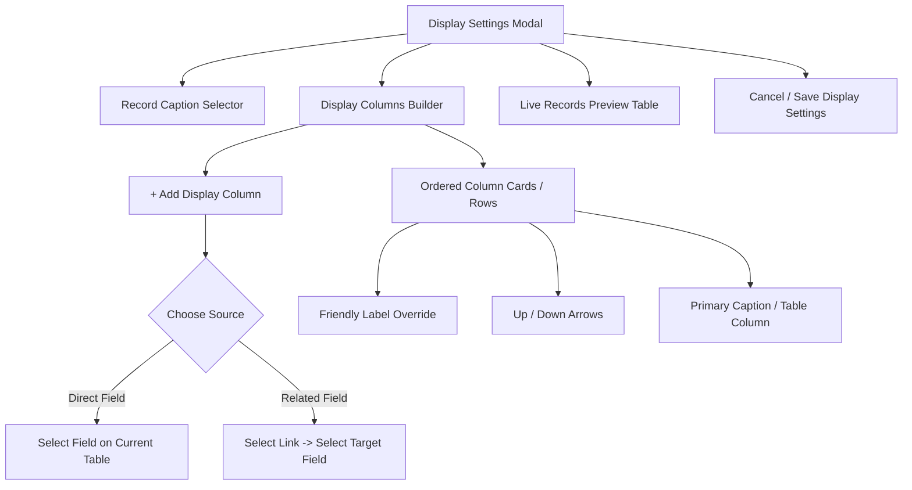

# Implementation Plan: Configurable Display Fields and Cross-Table Field References

## Executive Summary

This document specifies the technical architecture, database migrations, backend services, frontend user interfaces, and rollout steps for supporting **configurable display fields and cross-table references** across our multi-tenant Fraud Detection System.

The capability allows organizations to configure which fields represent their entities—including fields traversed from declared parent relationships (such as displaying `merchants.merchant_name` and `merchants.merchant_category` alongside `transactions.amount` and `transactions.channel`)—and cleanly exposes those representations across **Decisions**, **Cases**, **Investigation Profiles**, and other application modules without entity-specific hardcoding.

---

## Architectural Principles & Constraints

1. **Shared Database Architecture (`AGENTS.md`):**
   * All services share the same logical PostgreSQL instance. Metadata lives in `core`, while physical ingested records live in isolated tenant schemas (`<schema_name>.<table_name>`).
   * No cross-service writes; `data-model-service` owns the metadata and query projection engine for display representations.
   * Atomic transactions must remain short; no network calls inside transactions; advisory locks must be scoped strictly to the table being configured.
2. **Stable Record Identity:**
   * Business record lookups and navigation continue to rely on the immutable `object_id TEXT` (and internal surrogate `id UUID`).
   * Display fields provide presentation layers and never replace stable identifiers.
3. **Cardinality & Data Integrity:**
   * Cross-table field references are strictly restricted to declared relationships ([`core.model_links`](file:///c:/Users/T%20H%20I%20N%20K/Documents/Dev/Work/ITC/marble/New-fraud-system/backend/data-model-service/internal/migrations/metadata/000001_init.up.sql#L43-L52)) where the parent field has a unique constraint (`pf.is_unique = true`). This guarantees $N:1$ or $1:1$ joins that **can never produce duplicate rows** or distort pagination counts.
4. **Zero N+1 Queries & Bounded Reads:**
   * Record resolution occurs in batches ($1 \le N \le 100$) grouped by `object_type`.
   * For a page of records of a given object type, exactly **one** SQL query is executed, using `WHERE r.object_id = ANY($1::text[])` and indexed `LEFT JOIN`s to parent tables.
5. **Data Freshness:**
   * Values represent **live, current ingested data**, ensuring investigators see current merchant/user attributes. Rule execution evidence snapshots remain preserved in `core.rule_executions` and `core.decisions.request_body`.
6. **Schema Evolution Resilience:**
   * Automated PostgreSQL triggers clean up display settings when referenced fields or links are deleted or archived.
   * Stale configuration writes are blocked using optimistic concurrency (`display_version`).

---

## Master Checklist

### Phase 1: Database Schema & Migration (`core` schema)
- [x] Create migration `backend/data-model-service/internal/migrations/metadata/000007_display_columns.up.sql`
  - [x] Add `display_columns JSONB NOT NULL DEFAULT '[]'::jsonb` to `core.table_options` with schema validation check.
  - [x] Create `core.validate_display_options_v1()` trigger function validating that all column entries reference active, same-tenant fields and unique parent links.
  - [x] Update `core.clean_field_display_v1()` trigger to clean removed/archived fields from `display_columns`.
  - [x] Update `core.clean_link_display_v1()` trigger to clean removed links from `display_columns`.
  - [x] Create `000007_display_columns.down.sql` for rollback readiness.

### Phase 2: Domain Model & Validation (`data-model-service`)
- [x] Update `backend/data-model-service/internal/display/model.go`
  - [x] Define `DisplayColumn` struct supporting `direct` (table field) and `relation` (link + target field) column kinds.
  - [x] Extend `Link` to carry target table fields (`TargetFields []Field`).
  - [x] Extend `Settings` and `SaveRequest` with `DisplayColumns []DisplayColumn`.
  - [x] Implement `validate()` verifying:
    - At most 12 total displayed columns.
    - Direct fields belong to the table and are not archived.
    - Related fields belong to declared, active links pointing to unique parent keys.
    - Column labels are trimmed and capped at 100 characters.
    - Distinct column identifiers and order sequence.
    - Optimistic lock check against `display_version`.

### Phase 3: Query Projection Engine (`data-model-service`)
- [x] Update `backend/data-model-service/internal/display/store.go`
  - [x] Enhance `load()` to batch-fetch eligible target fields for all declared parent links.
  - [x] Rewrite `resolveActiveColumns()` and `recordQueryWithColumns()`:
    - Deduplicate parent table joins (multiple fields from same parent link share a single `LEFT JOIN` alias `p0`).
    - Project direct fields (`r."channel"`, `r."amount"`).
    - Project related fields with fallback (`coalesce(nullif(p0."merchant_name", ''), r."merchant_id"::text)`).
    - Map enum values to friendly labels for direct and parent enum fields.
  - [x] Maintain the 10-second bounded timeout and read-only repeatable read transaction.

### Phase 4: HTTP API & Handlers (`data-model-service`)
- [x] Handlers and endpoints in `backend/data-model-service/internal/httpapi/handlers/display.go` support `DisplayColumns`.
- [x] Verify Docker build: `docker compose build data-model-service data-model-migrate` passes with 0 errors.

### Phase 5: Frontend API Client & Types (`frontend`)
- [x] Update `frontend/src/lib/data-model-api.ts`
  - [x] Define `DisplayColumn` type (`id`, `type`, `field_id`, `link_id`, `target_field_id`, `label`).
  - [x] Update `DisplaySettings` type to include `display_columns` and eligible link `target_fields`.
  - [x] Update `RecordDisplays` type to handle dynamic column definitions and values.
  - [x] Update `saveDisplaySettings` to send `display_columns`.

### Phase 6: Display Settings Configuration UI (`frontend`)
- [x] Update `frontend/src/components/data-model/display-settings.tsx`
  - [x] Replace single-column caption replacement with a multi-column **Display Column Builder**:
    - **Add Column Selector:** Grouped dropdown to select a direct field OR expand a declared relationship to pick a parent field.
    - **Column Properties:** Friendly column label input and reordering buttons (↑ / ↓).
    - **Validation & Error Handling:** Immediate client-side validation (max 12 columns, duplicate prevention) and stale version conflict reload prompt.

### Phase 7: Decisions Module Integration (`frontend`)
- [x] Update `frontend/src/components/detection/decision-display.tsx`
  - [x] Export reusable `useRecordDisplays` hook that dynamically renders direct and cross-table columns.
- [x] Verify `frontend/src/components/detection/detection-workspace.tsx`
  - [x] Table renders direct and related columns cleanly with formatting and fallback chips.

### Phase 8: Cases Module Integration (`frontend`)
- [x] Update `frontend/src/components/cases/case-object.tsx`
  - [x] Render rich business entity cards displaying resolved related fields (e.g. Merchant Name, Product Name) in the entity profile banner.
- [x] Update `frontend/src/components/cases/case-detail.tsx`
  - [x] Integrate `useRecordDisplays` into `CaseDecisionsEvidence` to resolve and display meaningful record captions instead of internal IDs alone.

### Phase 9: Verification & Production Build
- [x] Backend compilation verified via Docker container build (`data-model-service` & `data-model-migrate`).
- [x] Frontend compilation verified via Next.js production build (`npm run build`) with static generation passing 19/19 routes with 0 TypeScript/lint errors.

---

## Detailed Technical Specifications

### 1. Database Migration: `000007_configurable_cross_table_display.up.sql`

```sql
-- Migration 000007: Configurable display columns and cross-table references
ALTER TABLE core.table_options
  ADD COLUMN IF NOT EXISTS display_columns JSONB NOT NULL DEFAULT '[]'::jsonb;

-- Trigger validation for display columns
CREATE OR REPLACE FUNCTION core.validate_display_columns_v1() RETURNS trigger LANGUAGE plpgsql AS $$
DECLARE
  col JSONB;
  col_count INTEGER;
  col_type TEXT;
  f_id UUID;
  l_id UUID;
  tf_id UUID;
BEGIN
  col_count := jsonb_array_length(NEW.display_columns);
  IF col_count > 12 THEN
    RAISE EXCEPTION 'at most 12 display columns are allowed' USING ERRCODE = '23514';
  END IF;

  FOR col IN SELECT * FROM jsonb_array_elements(NEW.display_columns) LOOP
    col_type := col->>'type';
    IF col_type = 'direct' THEN
      f_id := (col->>'field_id')::uuid;
      IF NOT EXISTS (
        SELECT 1 FROM core.model_fields f
        WHERE f.id = f_id AND f.table_id = NEW.table_id AND f.tenant_id = NEW.tenant_id AND NOT f.archived
      ) THEN
        RAISE EXCEPTION 'direct display field % does not exist or is archived on table %', f_id, NEW.table_id USING ERRCODE = '23514';
      END IF;
    ELSIF col_type = 'relation' THEN
      l_id := (col->>'link_id')::uuid;
      tf_id := (col->>'target_field_id')::uuid;
      IF NOT EXISTS (
        SELECT 1 FROM core.model_links l
        JOIN core.model_tables pt ON pt.id = l.parent_table_id AND pt.tenant_id = NEW.tenant_id AND NOT pt.archived
        JOIN core.model_fields pf ON pf.id = l.parent_field_id AND pf.table_id = pt.id AND pf.is_unique AND NOT pf.archived
        JOIN core.model_fields cf ON cf.id = l.child_field_id AND cf.table_id = NEW.table_id AND NOT cf.archived AND cf.data_type = pf.data_type
        JOIN core.model_fields tf ON tf.id = tf_id AND tf.table_id = pt.id AND NOT tf.archived
        WHERE l.id = l_id AND l.child_table_id = NEW.table_id AND l.tenant_id = NEW.tenant_id
      ) THEN
        RAISE EXCEPTION 'related display field % through link % is invalid or points to an unindexed/archived target', tf_id, l_id USING ERRCODE = '23514';
      END IF;
    ELSE
      RAISE EXCEPTION 'invalid display column type: %', col_type USING ERRCODE = '23514';
    END IF;
  END LOOP;

  RETURN NEW;
END $$;

DROP TRIGGER IF EXISTS validate_display_columns ON core.table_options;
CREATE TRIGGER validate_display_columns
  BEFORE INSERT OR UPDATE OF display_columns ON core.table_options
  FOR EACH ROW EXECUTE FUNCTION core.validate_display_columns_v1();

-- Lifecycle triggers: Clean display_columns when fields or links are deleted or archived
CREATE OR REPLACE FUNCTION core.clean_display_columns_on_field_v1() RETURNS trigger LANGUAGE plpgsql AS $$
BEGIN
  IF TG_OP = 'DELETE' OR (NEW.archived AND NOT OLD.archived) THEN
    -- Remove direct fields matching OLD.id or relation fields whose target_field_id is OLD.id
    UPDATE core.table_options
    SET display_columns = (
      SELECT coalesce(jsonb_agg(elem), '[]'::jsonb)
      FROM jsonb_array_elements(display_columns) elem
      WHERE NOT (elem->>'field_id' = OLD.id::text OR elem->>'target_field_id' = OLD.id::text)
    ),
    updated_at = clock_timestamp()
    WHERE tenant_id = OLD.tenant_id
      AND (table_id = OLD.table_id OR display_columns @> jsonb_build_array(jsonb_build_object('target_field_id', OLD.id::text)));
  END IF;
  RETURN NULL;
END $$;

DROP TRIGGER IF EXISTS clean_display_columns_on_field ON core.model_fields;
CREATE TRIGGER clean_display_columns_on_field
  AFTER DELETE OR UPDATE OF archived ON core.model_fields
  FOR EACH ROW EXECUTE FUNCTION core.clean_display_columns_on_field_v1();

CREATE OR REPLACE FUNCTION core.clean_display_columns_on_link_v1() RETURNS trigger LANGUAGE plpgsql AS $$
BEGIN
  UPDATE core.table_options
  SET display_columns = (
    SELECT coalesce(jsonb_agg(elem), '[]'::jsonb)
    FROM jsonb_array_elements(display_columns) elem
    WHERE elem->>'link_id' IS DISTINCT FROM OLD.id::text
  ),
  updated_at = clock_timestamp()
  WHERE table_id = OLD.child_table_id AND tenant_id = OLD.tenant_id;
  RETURN NULL;
END $$;

DROP TRIGGER IF EXISTS clean_display_columns_on_link ON core.model_links;
CREATE TRIGGER clean_display_columns_on_link
  AFTER DELETE ON core.model_links
  FOR EACH ROW EXECUTE FUNCTION core.clean_display_columns_on_link_v1();
```

---

### 2. Go Domain Models & Structs (`internal/display/model.go`)

```go
package display

import (
	"github.com/google/uuid"
)

type ColumnType string

const (
	ColumnTypeDirect   ColumnType = "direct"
	ColumnTypeRelation ColumnType = "relation"
)

type DisplayRole string

const (
	RolePrimaryCaption DisplayRole = "primary_caption"
	RoleTableColumn    DisplayRole = "table_column"
	RoleAttribute      DisplayRole = "attribute"
)

type DisplayColumn struct {
	ID            uuid.UUID   `json:"id"`
	Type          ColumnType  `json:"type"`
	Role          DisplayRole `json:"role"`
	Order         int         `json:"order"`
	Label         string      `json:"label"`
	// Direct column properties
	FieldID       *uuid.UUID  `json:"field_id,omitempty"`
	FieldName     string      `json:"field_name,omitempty"`
	// Relation column properties
	LinkID        *uuid.UUID  `json:"link_id,omitempty"`
	LinkName      string      `json:"link_name,omitempty"`
	TargetTable   string      `json:"target_table,omitempty"`
	TargetFieldID *uuid.UUID  `json:"target_field_id,omitempty"`
	TargetField   string      `json:"target_field,omitempty"`
	DataType      string      `json:"data_type"`
}

type LinkWithFields struct {
	ID          uuid.UUID `json:"id"`
	FieldID     uuid.UUID `json:"field_id"`
	FieldName   string    `json:"field_name"`
	Name        string    `json:"name"`
	TargetTable string    `json:"target_table"`
	TargetField string    `json:"target_field"`
	Fields      []Field   `json:"target_fields"`
}

type Settings struct {
	TableID        uuid.UUID        `json:"table_id"`
	TenantID       uuid.UUID        `json:"-"`
	Name           string           `json:"name"`
	Schema         string           `json:"-"`
	Version        int64            `json:"version"`
	Caption        string           `json:"caption_field"`
	DisplayColumns []DisplayColumn  `json:"display_columns"`
	Fields         []Field          `json:"fields"`
	Links          []LinkWithFields `json:"links"`
}

type SaveRequest struct {
	Version        *int64          `json:"version"`
	Caption        string          `json:"caption_field"`
	DisplayColumns []DisplayColumn `json:"display_columns"`
}
```

---

### 3. Query Generation Algorithm (`internal/display/store.go`)

```go
// recordQuery constructs a bounded, projected SQL query joining parent tables
// without generating duplicate joins or N+1 queries.
func recordQuery(s Settings, columns []DisplayColumn) string {
	caption := "r.object_id"
	for _, f := range s.Fields {
		if f.Name == s.Caption && f.Type == "string" {
			caption = "coalesce(nullif(r." + quote(f.Name) + ",''), r.object_id)"
		}
	}

	projection := []string{"r.object_id", caption}
	joins := []string{}
	linkAliasMap := make(map[uuid.UUID]string) // link_id -> alias

	for _, col := range columns {
		if col.Type == ColumnTypeDirect {
			projection = append(projection, "r."+quote(col.FieldName))
		} else if col.Type == ColumnTypeRelation {
			alias, exists := linkAliasMap[*col.LinkID]
			if !exists {
				alias = fmt.Sprintf("p%d", len(linkAliasMap))
				linkAliasMap[*col.LinkID] = alias
				joins = append(joins, fmt.Sprintf(
					"LEFT JOIN %s %s ON %s.%s = r.%s",
					quoteSchemaTable(s.Schema, col.TargetTable),
					alias,
					alias,
					quote(col.TargetField),
					quote(col.LinkName), // foreign key column on child
				))
			}
			// Fallback expression: if parent row or field is null, fall back to child foreign key value
			expr := fmt.Sprintf(
				"coalesce(nullif(%s.%s::text, ''), r.%s::text, '—')",
				alias,
				quote(col.TargetField),
				quote(col.LinkName),
			)
			projection = append(projection, expr)
		}
	}

	return fmt.Sprintf(
		"SELECT %s FROM %s r %s WHERE r.object_id = ANY($1::text[])",
		strings.Join(projection, ", "),
		quoteSchemaTable(s.Schema, s.Name),
		strings.Join(joins, " "),
	)
}
```

---

### 4. Frontend Component Design: Column Builder (`display-settings.tsx`)

The updated modal replaces the rigid table with a dynamic, intuitive builder:



---

## Rollout & Operational Procedures

### Prerequisites
1. Zero application downtime.
2. The shared database must not be locked during migration backfill. `ALTER TABLE core.table_options ADD COLUMN display_columns` requires only a momentary catalog lock.
3. Apply migration `000007` before upgrading service binaries.

### Deployment Sequence
1. **Apply Migration:**
   ```powershell
   docker compose run --rm --no-deps data-model-migrate
   ```
2. **Deploy Backend Services:**
   ```powershell
   docker compose up -d --no-deps data-model-service data-model-worker
   ```
3. **Deploy Frontend:**
   ```powershell
   docker compose up -d --no-deps frontend
   ```
4. **Verification Step:**
   * Open **Your Data Model** $\rightarrow$ select a table (e.g. `transactions`) $\rightarrow$ open **Display settings**.
   * Add direct fields (`amount`, `channel`) and linked fields (`merchants.merchant_name`, `products.product_name`).
   * Save settings and verify live display in both **Decisions** and **Cases**.

---

## Verification & Acceptance Criteria

| Area | Requirement | Verification Method |
|---|---|---|
| **Data Integrity** | No duplicate rows from $N:1$ joins | Automated unit test joining against parent table with multiple records. Verify child count remains unchanged. |
| **Performance** | Bounded batch execution under load | `EXPLAIN ANALYZE` on 50k source + 50k parent rows; verify $< 2.5\text{ms}$ execution and index usage. |
| **Security** | Strict tenant isolation | Multi-tenant test verifying tenant A cannot query or link to tenant B's schemas. |
| **Lifecycle** | Stale field/link auto-cleaning | Delete a parent field or link; verify triggers clean `display_columns` and bump version. |
| **Decisions UI** | Dynamic column injection | Verify Decisions table displays parent columns when filtered to trigger object. |
| **Cases UI** | Business context in queues/details | Verify Case Queue and Case Object view render merchant/product names instead of internal IDs alone. |
