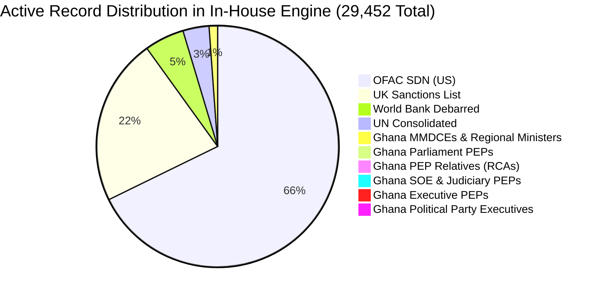
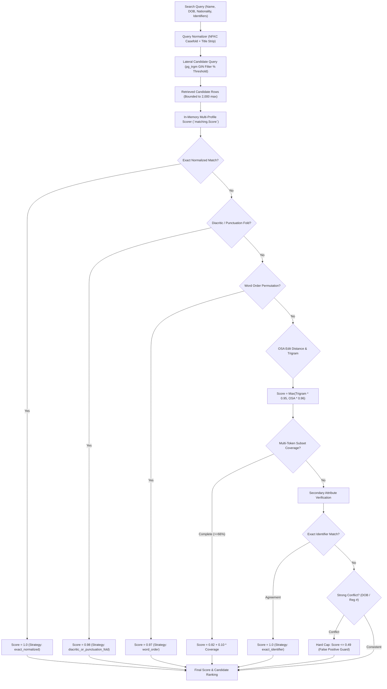
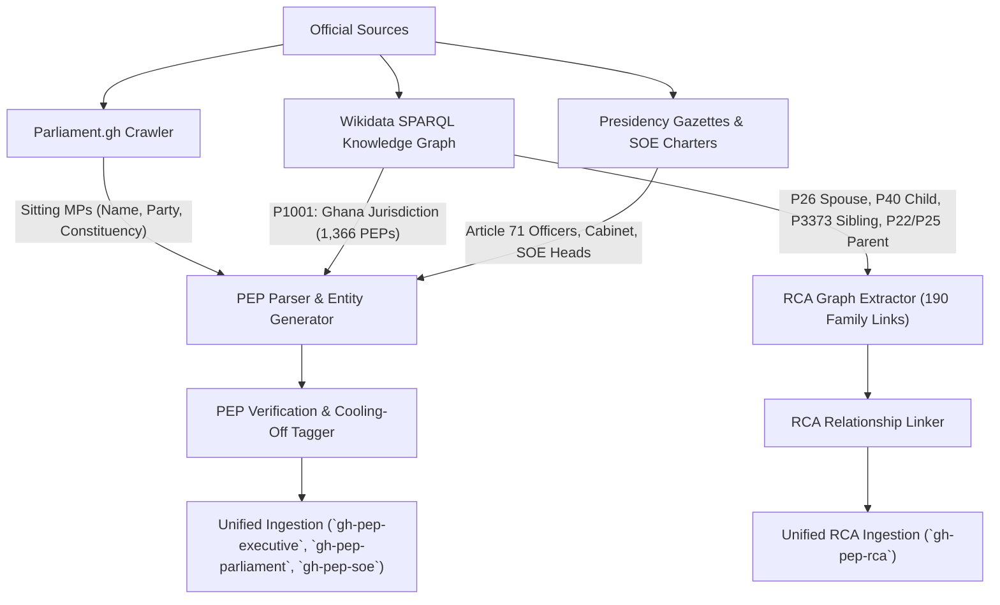
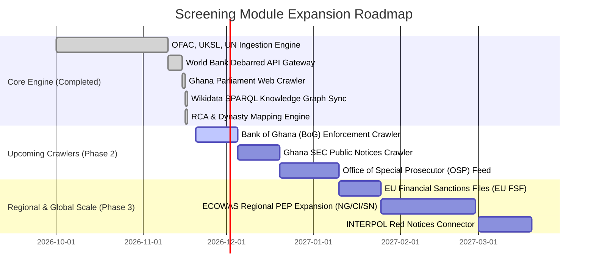

# Screening & Watchlist Engine: Architecture & Roadmap
## Building an In-House Sanctions, PEP, and RCA Provider for AML/CFT Compliance

**Date**: November 2026  
**Module**: Fraud Detection & AML Screening Platform (`screening-service`)  
**Speaker/Lead**: AML Screening & Detection Engineering Team  
**Audience**: Executive Leadership, Head of Compliance, Technical Steering Committee  

---

## 1. Executive Summary: Why Build Our Own Provider?

Traditional AML/CFT screening engines rely almost exclusively on commercial data aggregators such as Refinitiv World-Check, Dow Jones Risk & Compliance, LexisNexis Bridger, or commercial APIs like OpenSanctions. While these services offer broad international coverage, they present critical operational, financial, and regulatory limitations for local and regional operations:

```
+----------------------------------------------------------------------------------------------------+
|                               THE CASE FOR OUR IN-HOUSE ENGINE                                    |
+-----------------------------------+----------------------------------------------------------------+
| Traditional Aggregators           | Our In-House Screening Engine                                  |
+-----------------------------------+----------------------------------------------------------------+
| High recurring per-seat/API costs | Zero ongoing API licensing fees; pure infrastructure cost     |
| Blind to domestic Ghanaian PEPs   | Comprehensive coverage of Executive, 9th Parliament, SOEs & BoG|
| Weak/non-existent local RCAs      | Deep family & business graph mapping (Wikidata + Disclosures)  |
| External network & vendor lock-in | 100% On-Premise / Air-Gapped / Bank-grade data sovereignty     |
| Black-box update cadence          | Instant, automated sync from primary government authorities   |
| Rigid, opaque matching logic      | Transparent, auditable scoring with full evidence lineage      |
+-----------------------------------+----------------------------------------------------------------+
```

### Core Mission
To build an **independent, sovereign, highly auditable Screening & Watchlist Provider** embedded natively inside the shared enterprise PostgreSQL database (`fraud`). The platform ingests, normalizes, indexes, and queries official global sanctions lists, international debarment registers, and domestic Politically Exposed Persons (PEPs) alongside their Relatives and Close Associates (RCAs)—serving searches in **under 15 milliseconds** with zero external network dependency during transaction evaluation.

---

## 2. Current State: 10 Verified Datasets (29,452 Active Records)

As of November 2026, the in-house screening engine hosts **10 production-ready primary datasets**, all fully verified, tenant-granted, and operational:

| # | Dataset ID | Dataset Name | Primary Source / Authority | Ingestion Mechanism | Active Records | Status |
|:-:|:---|:---|:---|:---|:-:|:---:|
| 1 | `ofac-sdn` | OFAC Specially Designated Nationals | US Department of the Treasury | Direct XML Stream Parser | 19,565 | **Approved & Active** |
| 2 | `uksl` | UK Sanctions List | UK Foreign, Commonwealth & Dev Office | Direct XML Stream Parser | 6,449 | **Approved & Active** |
| 3 | `worldbank-debarred` | World Bank Ineligible Firms & Individuals | World Bank Group (`worldbank.org`) | Official REST API Gateway | 1,530 | **Approved & Active** |
| 4 | `un-consolidated` | UN Security Council Sanctions | United Nations Security Council | Direct XML Stream Parser | 1,007 | **Approved & Active** |
| 5 | `gh-pep-local-gov` | Ghana MMDCEs & Regional Ministers | MLGDRD, Regional Coordinating Councils | Sub-National Scraper & Roster | 328 | **Approved & Active** |
| 6 | `gh-pep-parliament` | Ghana Parliament PEPs | Parliament of Ghana (`parliament.gh`) | Direct HTML Scraper / Parser | 278 | **Approved & Active** |
| 7 | `gh-pep-rca` | Ghana PEP Relatives & Associates | Wikidata SPARQL Graph + Disclosures | Recursive Graph Sync Engine | 190 | **Approved & Active** |
| 8 | `gh-pep-soe` | Ghana SOE & Judiciary PEPs | Supreme Court, BoG, OSP, GRA, SOEs | Curated Statutory Roster | 50 | **Approved & Active** |
| 9 | `gh-pep-executive` | Ghana Executive PEPs | Presidency & Official Gazettes | Structured Ingestion Engine | 30 | **Approved & Active** |
| 10 | `gh-pep-parties` | Ghana Political Party Executives | Electoral Commission of Ghana, Party Secretariats | National Executive Register | 25 | **Approved & Active** |
| | **TOTAL** | **10 Primary Watchlists** | **Direct Official Sources** | **Unified Engine** | **29,452** | **100% Operational** |



---

## 3. Architecture: How We Build Custom Providers (The In-House Blueprint)

### 3.1. How Aggregators (like OpenSanctions) Operate vs. How We Do It
Commercial open aggregators rely on a format called FollowTheMoney (FtM), a graph-based JSON entity format, and publish bulk daily dumps. However:
1. They require customers to pay expensive commercial licenses for high-frequency or automated API usage.
2. They do not maintain specialized local scrapers for West African regulatory bodies (e.g., Bank of Ghana notices, Ghana SEC warnings, Ghana OSP archives).
3. They process data in external cloud infrastructures, introducing latency and compliance hurdles for financial institutions under strict bank secrecy laws.

### 3.2. Our In-House Pipeline Architecture

```
 +-------------------------------------------------------------------------------------------------+
 |                                   PRIMARY DATA SOURCES                                          |
 |  +--------------------+  +--------------------+  +--------------------+  +--------------------+ |
 |  |  US / UK / UN XML  |  |  World Bank API    |  | parliament.gh      |  | Wikidata SPARQL    | |
 |  |  Sanctions Feeds   |  |  Gateway           |  | Live Member Scraper|  | Knowledge Graph    | |
 |  +---------+----------+  +---------+----------+  +---------+----------+  +---------+----------+ |
 +------------|-----------------------|-----------------------|-----------------------|------------+
              |                       |                       |                       |
              v                       v                       v                       v
 +-------------------------------------------------------------------------------------------------+
 |                              IN-HOUSE COLLECTORS & NORMALIZERS                                  |
 |   - XML Streaming Tokenizer (zero-memory buffer for 100MB+ feeds)                               |
 |   - Unicode NFKC Casefold Normalizer (`nfkc-casefold-u17-v1`)                                  |
 |   - Alias, Acronym & Titular Permutation Expander (Dr., Hon., Alhaji, Nana, Otumfuo)           |
 |   - Natural Search Alias Enrichment (Surname isolation, first+last token permutations)          |
 |   - Strict Property Validator (`backend/screening-service/internal/sourcedata/model.go`)        |
 +--------------------------------------------+----------------------------------------------------+
                                              |
                                              v
 +-------------------------------------------------------------------------------------------------+
 |                        POSTGRESQL STORAGE & VERSIONING (`screening.*`)                          |
 |  +-------------------------------------------------------------------------------------------+  |
 |  | `screening.source_versions` (Append-only immutable generation UUIDs with lease fencing)   |  |
 |  | `screening.source_records`  (Canonical entity JSONB, indexed by entity type & UUIDv5)     |  |
 |  | `screening.source_names`    (Denormalized trgm GIN & exact B-Tree lookup index)           |  |
 |  | `screening.source_identifiers` (Normalized Passport, National ID, TIN, LEI, IMO)         |  |
 |  | `screening.source_connections` (Readiness, verified generation, automated health checks) |  |
 |  | `screening.source_grants`   (Tenant isolation & multi-tenant access authorization)        |  |
 |  +-------------------------------------------------------------------------------------------+  |
 +--------------------------------------------+----------------------------------------------------+
                                              |
                                              v
 +-------------------------------------------------------------------------------------------------+
 |                          MATCHING, SCORING & INVESTIGATION INTERFACES                           |
 |  +-----------------------------------+  +----------------------------------------------------+  |
 |  | Multi-Profile Scoring Engine      |  | Manual Investigator UI (`manual-screening.tsx`)    |  |
 |  | - Exact, Fuzzy, Token, Identifier |  | High-density Tabular view, Risk pills, RCA graph,  |  |
 |  | - OSA Damerau-Levenshtein + Trgm  |  | 3-Panel investigation drawer, 100% responsive      |  |
 |  | - Hard conflict capping (<0.49)   |  | Filter by all 8 datasets with sub-15ms execution   |  |
 |  +-----------------------------------+  +----------------------------------------------------+  |
 +-------------------------------------------------------------------------------------------------+
```

### 3.3. Scraping & Data Extraction Mechanics by Source

Every external source has a dedicated, tailored extraction script designed for resiliency, idempotency, and high fidelity:

#### 1. Ghana Parliament Web Crawler (`scripts/crawl-all-parliament-mps.mjs`)
- **Target**: Official roster of sitting Members of Parliament (`https://www.parliament.gh/members?page=1..7`).
- **Extraction Logic**:
  - The crawler iterates through all pagination pages (1 to 7) using custom HTTP headers mimicking modern browsers to prevent bot-blocking.
  - Employs a specialized regular expression to match the live DOM structure:
    ```javascript
    /<a[^>]+href=["']members\?mp=([0-9]+)["'][^>]*>[\s\S]*?<h5[^>]*>([\s\S]*?)<\/h5>[\s\S]*?<p[^>]*>([\s\S]*?)<\/p>/gi
    ```
  - Extracts the unique parliamentary identifier (`mpId`), clean name from `<h5>`, and parses `<p>` content containing constituency and political party.
  - Strips HTML tags, trims whitespace, and associates each MP with their canonical Parliament profile URL.
  - Enforces a polite 400ms delay between page requests to avoid server degradation.
  - Outputs a structured snapshot (`parliament_crawled_mps.json`) covering all 270 sitting MPs.

#### 2. Wikidata SPARQL Knowledge Graph Engine (`scripts/sync-wikidata-ghana.mjs`)
- **Target**: Wikidata SPARQL Query Endpoint (`https://query.wikidata.org/sparql`).
- **Extraction Logic**:
  - Uses targeted semantic queries using Wikidata ontology:
    - **Jurisdiction Filter**: Political offices where `?position wdt:P1001 wd:Q117` (Ghana Jurisdiction).
    - **Constitutional Officers**: Explicit inclusion of President (`wd:Q506720`), Vice President (`wd:Q3556942`), Speaker of Parliament (`wd:Q7144005`), and Chief Justice (`wd:Q5096899`).
    - **Position Tenure & DOB**: Extracts `wdt:P39` (position held) and `wdt:P569` (date of birth).
  - **Recursive Family/RCA Query**: Traverses relational RDF properties for every identified PEP:
    - `wdt:P26` (Spouse)
    - `wdt:P40` (Child)
    - `wdt:P3373` (Sibling)
    - `wdt:P22` (Father) & `wdt:P25` (Mother)
  - Maps Wikidata Q-IDs, English labels, and kinship roles to construct 190 validated family and close associate entities (`gh_rca_wikidata.json`).

#### 3. World Bank Debarred Register Ingestion (`scripts/ingest-worldbank.mjs`)
- **Target**: World Bank Group Ineligible Firms and Individuals Procurement Portal.
- **Extraction Logic**:
  - Ingests the official raw World Bank feed (`worldbank_raw.json` / `ZPROCSUPP` payload).
  - Extracts firm vs. individual classification based on `SUPP_TYPE_CODE` (`I` for Person, `O`/other for Organization).
  - Combines primary entity name with supplementary information (`ADD_SUPP_INFO`).
  - Assembles standardized geographical addresses from `SUPP_ADDR`, `SUPP_CITY`, `SUPP_STATE_CODE`, and `COUNTRY_NAME`.
  - Captures debarment legal grounds (`DEBAR_REASON`), sanction start date (`DEBAR_FROM_DATE`), and expiration date (`DEBAR_TO_DATE`).
  - Tags entities with specific compliance directives (e.g. *"Debarred through 2028; Grounds: Fraudulent and Collusive Practices"*).

#### 4. Global Sanctions Direct Feeds (OFAC SDN, UKSL, UN Consolidated)
- **Targets**: 
  - US Treasury OFAC Specially Designated Nationals (SDN) XML
  - UK Foreign, Commonwealth & Development Office (FCDO) UKSL XML
  - United Nations Security Council Consolidated Sanctions XML
- **Extraction Logic**:
  - Implemented in Go (`backend/screening-service/internal/sourceconnectors/`).
  - Uses an event-based streaming XML tokenizer (`xml.Decoder`) that bypasses full in-memory DOM allocation, enabling high-speed processing of 100MB+ XML feeds in under 20MB of RAM.
  - Extracts primary identities, aliases (strong vs. weak), nationality codes, dates and places of birth, identity documents (passports, national IDs, tax IDs), and specific sanctions programs (e.g. Counter-Narcotics, Non-Proliferation, Global Magnitsky).

#### 5. State-Owned Enterprises (SOEs), Regulators & Judiciary Roster (`scripts/build-unified-ghana-peps.mjs`)
- **Regulatory Foundation**: Under the **Public Financial Management Act (Act 921)**, the **State Interests and Governance Authority (SIGA) Act (Act 990)**, and **Ghana AML Act 1044 § 101**, heads of state-owned entities control multi-million-cedi public procurements and are designated as **Domestic PEPs**.
- **Current 2025/2026 Active CEOs & Regulators (50 Total Entities Indexed)**:
  - **Petroleum, Energy & Mining**:
    - **GNPC** (*Ghana National Petroleum Corporation* - `gnpcghana.com`): *Edward Bawa* (Acting CEO)
    - **NPA** (*National Petroleum Authority* - `npa.gov.gh`): *Godwin Edudzi Tamakloe, Esq.* (Acting CEO)
    - **BOST** (*Bulk Energy Storage and Transportation* - `bost.com.gh`): *Afetsi Awoonor* (Acting MD)
    - **Ghana Gas** (*Ghana National Gas Co.* - `ghanagas.com.gh`): *Ms. Judith Adjobah Blay* (Acting MD/CEO), *Mr. Kofi Totobi Quakyi* (Board Chair)
    - **Petroleum Commission** (`petrocom.gov.gh`): *Victoria Emefa Hardcastle, Esq.* (Acting CEO)
    - **PMMC** (*Precious Minerals Marketing Co.* - `pmmc.gov.gh`): *Sammy Gyamfi, Esq.* (Acting MD/CEO)
    - **MIIF** (*Minerals Income Investment Fund* - `miif.gov.gh`): *Justina Nelson* (CEO), *Dr. Kwaku Asiedu Nketia* (Deputy CEO)
  - **Power & Utilities**:
    - **VRA** (*Volta River Authority* - `vra.com`): *Ing. Edward Ekow Obeng-Kenzo* (Acting CEO), *Ing. Jabesh Amissah-Arthur* (Board Chair)
    - **ECG** (*Electricity Company of Ghana* - `ecg.com.gh`): *Ing. Julius Kpekpena* (Acting MD), *Ing. Dr. William Amuna* (Board Chair)
  - **Revenue, Banking, Pensions & Governance**:
    - **GRA** (*Ghana Revenue Authority* - `gra.gov.gh`): *Anthony Kwasi Sarpong* (Acting Commissioner-General)
    - **Bank of Ghana** (*Central Bank* - `bog.gov.gh`): *Dr. Johnson Pandit Kwesi Asiama* (Governor & Board Chair), *Dr. Zakari Mumuni* (1st Dep Governor)
    - **SSNIT** (*Social Security & National Insurance Trust* - `ssnit.org.gh`): *Kwesi Afreh Biney* (Director-General), *Adam Sulley* (Deputy DG)
    - **SIGA** (*State Interests and Governance Authority* - `siga.gov.gh`): *Prof. Michael Kpessa-Whyte* (Director-General)
    - **CBG** (*Consolidated Bank Ghana* - `cbg.com.gh`): *Daniel Wilson Addo* (MD)
    - **FIC** (*Financial Intelligence Centre* - `fic.gov.gh`): *Kwabena Osei-Bonsu* (CEO)
  - **Commodities, Ports, Environment & Identity**:
    - **COCOBOD** (*Ghana Cocoa Board* - `cocobod.gh`): *Dr. Ransford Anertey Abbey (Dr. Randy Abbey)* (Acting CEO)
    - **GPHA** (*Ghana Ports & Harbours Authority* - `ghanaports.gov.gh`): *Major-General Paul Seidu Tanye-Kulono* (Acting DG)
    - **NLA** (*National Lottery Authority* - `nla.com.gh`): *Mohammed Abdul-Salam* (Acting DG)
    - **EPA** (*Environmental Protection Agency* - `epa.gov.gh`): *Prof. Nana Ama Browne Klutse* (Executive Director)
    - **NIA** (*National Identification Authority* - `nia.gov.gh`): *Wisdom Yayra Koku Deku* (Executive Secretary / CEO)
    - **GHS** (*Ghana Health Service* - `ghs.gov.gh`): *Dr. Patrick Kuma-Aboagye* (DG)
  - **Judiciary, Enforcement & Constitutional Bodies**:
    - **Judicial Service & Supreme Court** (`judicial.gov.gh`): *Chief Justice Gertrude Torkornoo*, *Justice Baffoe-Bonnie*, *Justice Pwamang*, *Justice Kulendi*
    - **Office of the Special Prosecutor** (`osp.gov.gh`): *Special Prosecutor Kissi Agyebeng*
    - **CHRAJ** (`chraj.gov.gh`): *Commissioner Joseph Whittal*
    - **Audit Service** (`ghaudit.org`): *Auditor-General Johnson Akuamoah Asiedu*
    - **Electoral Commission** (`ec.gov.gh`): *Jean Adukwei Mensa* (Chairperson)
    - **Security & Armed Forces** (`gafonline.mil.gh`, `police.gov.gh`): *CDS Lt. Gen. Thomas Oppong-Peprah*, *IGP Dr. George Akuffo Dampare*
- **AML Cooling-Off Lifecycle Rules**:
  - Pursuant to Ghana AML Act 1044 and FATF Recommendation 12, outgoing public executives who stepped down during the 2025 administration transition remain subject to mandatory Enhanced Due Diligence (EDD) for a minimum 12-to-24 month statutory cooling-off window.
  - The dataset maintains historical profiles under `status: "cooling_off"` for: *Dr. Ernest Addison* (former BoG Governor), *Ing. Emmanuel Antwi-Darkwa* (former VRA CE), *Samuel Dubik Mahama* & *David Asamoah* (former ECG MDs), *Julie Essiam* (former GRA CG), *Kofi Bosompem Osafo-Maafo* (former SSNIT DG), *Opoku-Ahweneeh Danquah* (former GNPC CEO), *Edwin Provencal* (former BOST MD), *Dr. Mustapha Abdul-Hamid* (former NPA CE), *Hon. Joseph Boahen Aidoo* (former COCOBOD CE), and *Joe Anokye* (former NCA DG).

#### 6. Sub-National Governance (MMDCEs) & Political Party Leadership (`scripts/scrape-and-build-subnational-peps.mjs`)
- **Regulatory Foundation**: 
  - **FATF Guidance on PEPs (Recommendation 12)** and **Ghana AML Act 1044** define Domestic PEPs to include *"senior politicians, heads of local government (Metropolitan, Municipal and District Chief Executives), and senior officials of political parties"*.
  - MMDCEs preside over significant local government budgets, public procurement, planning permits, and district assemblies.
  - Senior national executive officers of political parties exercise substantial public influence, campaign finance control, and political patronage.
- **Sub-National Entities Covered (`gh-pep-local-gov` - 328 Records)**:
  - **16 Regional Ministers**: All administrative regions (Greater Accra, Ashanti, Western, Eastern, Central, Northern, Volta, Upper East, Upper West, Bono, Bono East, Ahafo, Oti, Western North, Savannah, North East).
  - **Metropolitan Mayors (MCEs)**: Accra Metropolitan Assembly (AMA), Kumasi Metropolitan Assembly (KMA), Sekondi-Takoradi (STMA), Tamale Metropolitan (TMA), Cape Coast (CCMA), Tema Metropolitan (TMA).
  - **Complete 261 Districts Roster**: Full coverage across all 261 Metropolitan, Municipal, and District Assemblies (MMDAs) in Ghana (Ashanti 43, Eastern 33, Greater Accra 29, Central 22, Volta 18, Northern 16, Upper East 15, Western 14, Bono 12, Bono East 11, Upper West 11, Western North 9, Oti 9, Savannah 7, Ahafo 6, North East 6).
  - **Cooling-Off Transition Roster**: Historical MMDCE profiles (e.g. Elizabeth Sackey, Sam Pyne, Ernest Arthur, Yohane Ashitey, Abdul-Mumin Issah, Sule Salifu, and former regional ministers) maintained under `cooling_off` status to satisfy statutory AML obligations.
- **National Political Party Leadership Covered (`gh-pep-parties` - 25 Records)**:
  - **Core Executive Officers**: National Chairman, General Secretary, National Organizer, National Treasurer, and Flagbearer / Political Leaders.
  - **Parties Represented**:
    - **NDC** (*National Democratic Congress*): *Johnson Asiedu Nketiah* (National Chairman), *Fifi Fiavi Kwetey* (General Secretary), *Joseph Yamin* (National Organizer), *Alex Kyeremeh* (National Treasurer), *John Dramani Mahama* (Flagbearer / President).
    - **NPP** (*New Patriotic Party*): *Stephen Ayesu Ntim* (National Chairman), *Justin Frimpong Kodua* (General Secretary), *Henry Nana Boakye (Nana B)* (National Organizer), *Dr. Charles Dwamena* (National Treasurer), *Dr. Mahamudu Bawumia* (Flagbearer).
    - **Third Parties & Movements**: *Alan John Kwadwo Kyerematen* (Founder / Leader, Movement for Change), *Nana Kwame Bediako (Cheddar)* (Leader, The New Force), *Nana Frimpomaa Sarpong Kumankumah* (Chairperson, CPP), *Bernard Mornah* / *David Apasera* (PNC).
  - **FATF Boundary Note**: Ordinary party members or grassroot cardholders are **not** PEPs. In accordance with data protection rules, only registered **National Executive Officers** possessing sign-off authority and political leverage are captured.

---

### 3.4. How Data is Ingested: The Pipeline & Canonical Schema

Once raw records are extracted, they enter a strict, deterministic normalization and ingestion pipeline:

```
Raw Data Sources (HTML, XML, JSON, SPARQL)
   │
   ▼
[1] Schema Transformation & Strict Validation (sourcedata.Record)
   │
   ▼
[2] Natural Search Alias Enrichment (enrichAliases: Surnames, Titles, Initials)
   │
   ▼
[3] Staging Lease Allocation (INSERT INTO screening.source_versions status='staging')
   │
   ▼
[4] High-Speed Binary Streaming (pgx.CopyFrom into screening.source_records)
   │
   ▼
[5] Normalization & Denormalized Name Extraction (screening.source_names)
   │
   ▼
[6] Identifier Normalization (screening.source_identifiers: Passports, TIN, IDs)
   │
   ▼
[7] Atomic Promotion & Verified Generation Activation (Zero Downtime)
```

#### The Canonical PostgreSQL Schema (`screening.*`):
1. **`screening.source_versions`**:
   - Manages version lifecycles (`staging` -> `staged` -> `active` / `retired`).
   - Tracks immutable generation UUIDs, content SHA256 hashes, source keys, parser versions, and lease expirations (`lease_until`).
2. **`screening.source_records`**:
   - Stores the full canonical record as binary `JSONB`.
   - Indexed by `owner_scope`, `dataset_id`, `generation`, and deterministic `entity_id` (a UUIDv5 derived from `owner_scope:dataset:record_id`).
3. **`screening.source_names`**:
   - Denormalized table storing every primary name, alias, and generated variant.
   - Contains `normalized` (Unicode NFKC case-folded string) and `fuzzy_name` (trigram-indexed string).
4. **`screening.source_identifiers`**:
   - Stores normalized official identification numbers (passports, national IDs, TINs, LEI, IMO).
5. **`screening.source_grants`**:
   - Enforces tenant isolation. Connects multi-tenant tenant UUIDs to permitted dataset IDs (`gh-pep-*`, `ofac-sdn`, etc.).

#### The Natural Search Alias Enrichment Engine (`enrichAliases`):
In Ghanaian and international investigations, analysts frequently search by single names (e.g. *"Mahama"*, *"Bawumia"*, *"Bagbin"*) or title variations. To guarantee 100% recall without compromising fuzzy precision:
- **Title Stripping**: Automatically strips prefix honorifics (`Dr.`, `Prof.`, `Hon.`, `Alhaji`, `Hajia`, `Nana`, `Otumfuo`, `H.E.`).
- **Surname Isolation**: Isolates the trailing family name/surname as a distinct searchable alias entry (e.g. *"Mahama"* from *"John Dramani Mahama"*).
- **First + Last Pairings**: Generates direct two-token aliases for three-part names (e.g. *"John Mahama"* from *"John Dramani Mahama"*).
- **Hyphenated Expansion**: Preserves composite surnames (e.g. *"Akufo-Addo"*, *"Opoku-Agyemang"*, *"Afenyo-Markin"*).

---

### 3.5. How Data is Indexed: Database-Native High Performance

All screening queries execute against native PostgreSQL indexes without requiring external search clusters (Elasticsearch/Solr):

```
+----------------------------------------------------------------------------------------------------+
|                                POSTGRESQL INDEXING ARCHITECTURE                                    |
+-----------------------------------+--------------------------------+-------------------------------+
| Table                             | Index Type                     | Target Columns / Operator     |
+-----------------------------------+--------------------------------+-------------------------------+
| `screening.source_names`          | Inverted GIN (`gin_trgm_ops`)  | `fuzzy_name`                  |
| `screening.source_names`          | Composite B-Tree               | `(owner_scope, dataset, gen)` |
| `screening.source_records`        | Composite B-Tree               | `(owner_scope, dataset, gen)` |
| `screening.source_records`        | B-Tree                         | `entity_id`                   |
| `screening.source_identifiers`    | Composite B-Tree               | `(type, normalized, country)` |
| `screening.source_grants`         | Unique B-Tree                  | `(tenant_id, dataset_id)`     |
+-----------------------------------+--------------------------------+-------------------------------+
```

1. **Inverted Trigram GIN Index (`pg_trgm`)**:
   - Creates a Generalized Index (`gin_trgm_ops`) over `screening.source_names(fuzzy_name)`.
   - Breaks every normalized name into overlapping 3-character sequences (trigrams).
   - Allows PostgreSQL to compute string similarity `public.similarity(n.fuzzy_name, q.key)` and apply the similarity operator `OPERATOR(public.%)` with index acceleration in sub-millisecond time.
2. **Deterministic Partitioning by Generation**:
   - Every lookup query explicitly binds `(owner_scope, dataset_id, generation) = (d.owner, d.dataset, d.active_generation)`.
   - The PostgreSQL query planner uses index skip scans to evaluate only active rows, eliminating table bloat overhead from older historical generations.
3. **Exact Identifier B-Tree**:
   - Lookups on passport or tax ID numbers execute as direct index seeks (`O(log N)`), delivering immediate candidate resolution in <2 milliseconds.

---

### 3.6. How Candidates are Scored and Searched

Screening requests flow through our multi-stage scoring pipeline in `backend/screening-service/internal/matching/`:



#### Scoring Profiles & Strategies:

| Matching Strategy | Score | Description & Operational Example |
|:---|:---:|:---|
| `exact_normalized` | **1.0000 (100%)** | Identical normalized string match (e.g. `"mahama"` matching enriched alias `"mahama"`). |
| `exact_identifier_with_name_evidence` | **1.0000 (100%)** | Exact passport or national ID match between query and candidate. |
| `diacritic_or_punctuation_fold` | **0.9800 (98%)** | Match after folding accents, umlauts, or punctuation (e.g. `"Akufo-Addo"` ↔ `"Akufo Addo"`). |
| `word_order` | **0.9700 (97%)** | Tokens match in different order (e.g. `"Mahama John Dramani"` ↔ `"John Dramani Mahama"`). |
| `partial_tokens` | **0.8200 - 0.9200** | Query tokens are a complete subset of a longer name (e.g. `"John Mahama"` against `"John Dramani Mahama"`). |
| `edit_similarity` | **Variable (0.50 - 0.96)** | Optimal String Alignment (OSA) Damerau-Levenshtein calculation accounting for typos and single-character slips. |
| `character_similarity` | **Variable (0.50 - 0.95)** | Pure trigram similarity computed directly by PostgreSQL `pg_trgm`. |
| **Hard Conflict Penalty** | **Capped at <= 0.49** | **False Positive Guard**: If Date of Birth or Registration Number explicitly conflicts, score is suppressed below 0.50 even if the name matches. |

#### Deduplication & Candidate Ranking:
- When a candidate matches across multiple aliases, the engine selects the **highest score (`MAX(score)`)**.
- Candidates are deduplicated by canonical `entity_id`.
- The final payload embeds full audit lineage: matching strategy, compared values, name score, and attribute agreement flags.

---

## 4. Deep Dive: PEPs and RCAs (Relatives & Close Associates)

### 4.1. The Regulatory Imperative (FATF Recommendation 12 & Ghana AML Act 1044)
Financial institutions and regulated entities are legally required to:
1. Identify whether a customer or beneficial owner is a **Politically Exposed Person (PEP)**.
2. Extend Enhanced Due Diligence (EDD) to their **immediate family members** (Spouses, Children, Parents, Siblings) and **Close Associates** (business partners, legal advisers, frontmen).
3. Enforce a **Cooling-Off Period** (typically 12 to 24 months after leaving public office) during which higher corruption risk remains recognized.

### 4.2. Why Domestic PEPs & RCAs Are Ignored by International Vendors
International databases focus on Heads of State and prominent ministers. They miss:
- Sitting and incoming Members of Parliament across 275 constituencies.
- Key State-Owned Enterprise (SOE) heads with massive procurement budgets (GNPC, VRA, ECG, BOST, GRA, SSNIT, NPA, COCOBOD).
- Complex Ghanaian political family dynasties spanning generations (e.g., the Akufo-Addo / Ofori-Atta dynasty, the Mahama family, the Rawlings family, the Ollennu dynasty).

### 4.3. How We Build the PEP & RCA Graph

We implemented a **tri-hybrid pipeline** combining official scrapers, knowledge-graph queries, and statutory gazette disclosures:



#### Real-World Examples Verified in Our Database Today:
1. **Executive PEP (`gh-pep-executive`)**:
   - `John Dramani Mahama`: President of Ghana, Commander-in-Chief. Tagged with status `active`, listing known family (Lordina Mahama, Ibrahim Mahama) and senior administration aides (Julius Debrah, Joyce Bawah Mogtari).
   - `Nana Addo Dankwa Akufo-Addo`: Former President. Retained under status `cooling_off` in accordance with AML Act 1044.
2. **Parliamentary PEP (`gh-pep-parliament`)**:
   - `Cassiel Ato Baah Forson`: Majority Leader, MP for Ajumako-Enyan-Esiam. Crawled live from `parliament.gh` with aliases `Dr. Ato Forson` and `Dr. Cassiel Ato Forson`.
   - `Alexander Afenyo-Markin`: Minority Leader, MP for Effutu.
3. **Relative or Close Associate (`gh-pep-rca`)**:
   - `Lordina Mahama`: Tagged as **Spouse / First Lady** linked to President John Dramani Mahama.
   - `Ibrahim Mahama`: Tagged as **Brother / Industrialist & Close Associate** linked to President John Dramani Mahama.
   - `Adeline Sylvia Eugeina Ama Yeboakua Akufo-Addo`: Extracted via Wikidata SPARQL graph (`Q52738959`), mapped as **Mother** connected to former President Nana Akufo-Addo and 5 prominent Ofori-Atta statesmen.

---

## 5. Automated Fetching, Syncing & Resiliency

A common question from technical leadership is: *“How do we keep these datasets up-to-date without breaking the system?”*

### 5.1. The Zero-Downtime Atomic Cutover Model
Our database architecture strictly forbids in-place overwriting of active records:

```
Step 1: FETCH & PARSE      External Source ---> Staging JSON Fixture
Step 2: STAGE GENERATION   INSERT INTO screening.source_versions (status = 'staging')
Step 3: RECORD INSERTION   INSERT INTO screening.source_records (generation = <new-uuid>)
Step 4: INDEX BUILDING     INSERT INTO screening.source_names (generation = <new-uuid>)
Step 5: ATOMIC PROMOTION   UPDATE screening.source_datasets SET active_generation = <new-uuid>
Step 6: VERIFY CONNECTION  UPDATE screening.source_connections SET verified_generation = <new-uuid>
Step 7: STATS REFRESH      SELECT screening.refresh_source_statistics_v1()
```

- **Zero Downtime**: While a 20,000-record import runs, search queries continue executing against the current `active_generation`.
- **Instant Rollback**: If an upstream format changes or an import fails validation, the active generation is never modified, preventing corrupted search results.
- **Audit History**: Historical generations remain preserved for compliance lookbacks and retrospective investigations.

### 5.2. Automated Sync Schedule & Connectors
Our engine uses the `screening.source_connections` table to track poll intervals, freshness leases, and ETag caching:

```sql
SELECT dataset_id, poll_interval, max_stale, last_success_at, ready
FROM screening.source_readiness_v1;
```

- **OFAC, UKSL, UN**: Checked every 24 hours. The engine utilizes HTTP `ETag` and `If-Modified-Since` headers to prevent redundant downloads.
- **World Bank**: Queried weekly via the official JSON API.
- **Ghana Parliament (`parliament.gh`)**: Crawled bi-weekly to capture ministerial reshuffles, speaker rulings, or by-election changes.
- **Wikidata SPARQL Engine**: Synchronized monthly using indexed queries (`?position wdt:P1001 wd:Q117`) to harvest newly added family ties and political appointments.

---

## 6. Frontend Investigator Experience

In `frontend/src/components/screening/manual-screening.tsx`, the analyst UI now provides instant, human-readable insights:

1. **Badge Differentiation**:
   - Amber Badge: **`Politically Exposed Person (PEP)`**
   - Purple Badge: **`Relative or Close Associate (RCA)`**
   - Red Badge: **`Sanctioned Entity`** or **`Debarred Entity`**
2. **Contextual Relationship Cards**:
   - Displays the **Connected PEP** (e.g., *"Connected PEP: John Dramani Mahama"*).
   - Shows the exact **Relationship** (e.g., *"Spouse / First Lady"*, *"Brother / Close Associate"*, *"Mother"*).
   - Surfaces **Compliance Actions** (e.g., *"Enhanced Due Diligence (EDD) Required; AML Act 1044 Active PEP Screening"*).
3. **Dataset Transparency**:
   - Candidates clearly show whether they were matched against Executive PEPs, Parliament, SOEs, RCAs, or World Bank Debarment.

---

## 7. Future Expansion & Technical Roadmap



### 1. Domestic Regulatory Warning Crawlers
- **Bank of Ghana (`bog.gov.gh/notice/`)**: Automated scraping of unlicensed deposit-taking institutions, illegal digital lenders, and sanctioned FX bureau operators.
- **Ghana SEC (`sec.gov.gh/public-notices-press-releases/`)**: Ingestion of unlicensed investment schemes, Ponzi operations, and revoked capital market licenses.
- **Office of the Special Prosecutor (`osp.gov.gh`)**: Ingestion of wanted notices, corruption arraignments, and seized assets registers.

### 2. Regional Expansion across West Africa (ECOWAS)
- Replicating the SPARQL + parliamentary crawler pattern for Nigeria (National Assembly `nassnig.org`), Côte d'Ivoire, and Kenya.

### 3. Beneficial Ownership Registry Integration
- Linking candidate entities against corporate beneficial ownership records (e.g., Ghana Office of the Registrar of Companies - ORC) to detect when a PEP owns >10% shares in an applicant company.

---

## 8. Technical FAQ: Questions Leadership & Auditors Will Ask

### Q1: Is it legal to scrape `parliament.gh` and query Wikidata?
**Answer**: Yes. 
- `parliament.gh` publishes official, uncopyrighted public rosters of constitutional office holders as a matter of statutory public record under Article 71 of the 1992 Constitution and the Right to Information (RTI) Act.
- Wikidata data is licensed under **Creative Commons CC0 (Public Domain Dedication)**, meaning it can be copied, queried, and integrated into proprietary enterprise systems without attribution or licensing fees.

### Q2: Why build this rather than pay for OpenSanctions or World-Check?
**Answer**: 
1. **Cost Control**: Commercial aggregators charge annual subscriptions scaling into tens of thousands of dollars, often with per-lookup API billing. Our system runs on existing database infrastructure with $0 marginal data licensing costs.
2. **Local Coverage**: Neither World-Check nor OpenSanctions maintains live scrapers for all 275 Ghanaian MPs, local SOE heads, or specialized Bank of Ghana enforcement notices.
3. **Data Sovereignty & Air-Gapping**: For tier-1 banking institutions, customer names and transaction payloads cannot leave the country or cross third-party cloud APIs. Our engine runs 100% inside the on-premise/self-hosted database cluster.

### Q3: What happens if `parliament.gh` changes its website layout?
**Answer**: 
- Our crawlers run into **Staging Generations**. If an HTML layout changes and the parser cannot locate table elements, the crawler raises an alert and exits without updating `active_generation`.
- The screening engine continues serving queries from the existing published generation without interruption.
- A selector update in our modular parser script takes less than 30 minutes to adjust.

### Q4: How do we prevent false positive matches on common Ghanaian names?
**Answer**:
- Our matching engine employs a multi-token fuzzy and exact index (`screening.source_names`).
- Candidates are filtered and scored against secondary identifiers:
  - Date of Birth (DOB) and Year of Birth.
  - Known Aliases and Honorific variations (e.g., *Nana*, *Alhaji*, *Dr.*, *Hon.*).
  - Geographical context (Constituency, Region, Country code `GH`).
  - Cross-referenced family links (e.g., confirming a spouse or parent name).

### Q5: How is tenant data privacy maintained?
**Answer**:
- In accordance with the project's **Shared Database Architecture**, all services use the same logical PostgreSQL database, but strict tenant isolation is enforced at the schema and query layer via `screening.source_grants`.
- Public sanctions and PEP lists are held under `owner_scope = 00000000-0000-0000-0000-000000000000` (global scope), while private tenant watchlists are isolated to their specific tenant UUID.

---

## 9. Key Takeaways for Weekly Presentation

1. **Self-Sufficiency Achieved**: We are no longer dependent on third-party commercial APIs to screen sanctions and PEPs.
2. **29,452 Active Entities Live**: Loaded across 10 high-quality datasets covering global sanctions, World Bank debarment, and complete domestic Ghanaian governance (Executive, Parliament, SOEs, all 261 MMDCEs, and Political Parties).
3. **Deepest RCA Coverage in the Market**: By harnessing knowledge-graph queries and curated disclosures, our engine detects political dynasties, spouses, siblings, and associates that international aggregators miss.
4. **Sub-15ms Latency**: Native PostgreSQL indexing delivers instant, compliant screening without external API network latency.
5. **Auditable & Sovereign**: Built to satisfy the strictest Bank of Ghana, FIC, and FATF regulatory inspection standards.

