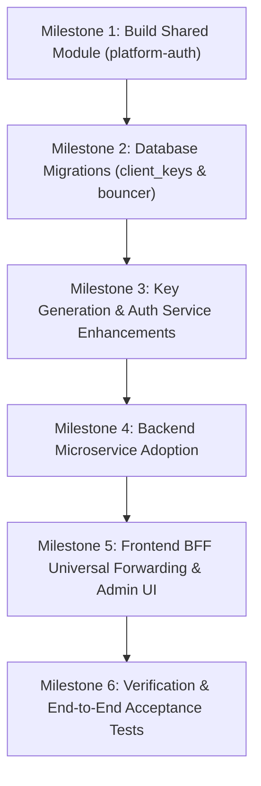

# Authentication & Authorization Standardization Roadmap

**Document Status**: Active Working Document
**Objective**: Standardize AuthN and AuthZ across all current and future microservices without compromising hardened audit pathways or over-complicating high-throughput paths.

**Progress terminology**: “Completed / Agreed” below refers to design discussion, not implemented or verified runtime behavior. The refinements below supersede earlier examples where they differ.

**Final review status**: Approved for implementation, including Section 3.5, with one overriding clarification: Tenant Administrators receive all tenant-scoped human capabilities, including operational permissions and sensitive-scope approval. Principal restrictions, tenant isolation, transactional safeguards, and the separate-human approval rule still apply. Implementation progress is tracked separately from approved design.

---

## 1. Architectural Principles

1. **Shared Database & Tenant Isolation**: All services operate on the logical `fraud` PostgreSQL database. Identity and membership tables are owned strictly by the `identity` schema. Tenant boundaries must be cryptographically and transactionally non-negotiable.
2. **Right-Sized Tiering (No Universal Blanket)**:
   - **Tier 0 (High Throughput / Ingestion)**: Stateless machine verification, zero database authorization round-trips or authorization locks. Business data writes retain their required database transactions.
   - **Tier 1 (Standard API Management & Reads)**: Stateless RS256 JWT verification (60s TTL for users, 15m for clients), zero per-request database authorization round-trips.
   - **Tier 2 (Hardened / Legal / Investigation Mutations)**: Stateful cryptographic verification + transactional row/advisory locks in PostgreSQL.
3. **Defense-in-Depth BFF**: Browsers only ever hold opaque, secure, `HttpOnly` session cookies. Microservices only accept signed Bearer JWTs or verified Service Credentials.
4. **Single Source of Truth**: Centralize role and permission contracts in the `identity` domain and provide an idiomatic, shared Go package for all services.
5. **Originator Provenance**: Every cross-service call preserves the true originator context (Human Actor, External API Client, or Autonomous Worker) and Tenant ID across all hops.
6. **Zero Network Calls Under DB Locks**: In Tier 2 hardened operations, all locking, verification, and mutation happen strictly inside the single database transaction. Never hold database locks across HTTP/network calls.
7. **Unified Capability Model**: Human roles and external machine scopes resolve to the exact same uniform `Capability` tokens at the endpoint layer.
8. **Principal Typology**: All tokens unambiguously declare `principal_type` (`user`, `client`, or `service`), allowing one-line human-only or machine-only route enforcement.

---

## 2. Roadmap & Progress Tracker

| Stage | Focus Area | Status | Deliverables |
| :--- | :--- | :--- | :--- |
| **Phase 1.1** | **Cluster A**: Human Interactive & Platform Auth Transport | **Completed / Agreed** | Universal JWT forwarding via BFF; stateless Tier 1 verification in-memory |
| **Phase 1.2** | **Cluster B**: Machine-to-Machine (M2M) & Internal Services | **Completed / Agreed** | Asymmetric external clients (DEC-13); self-signed internal M2M; originator propagation |
| **Phase 1.3** | **Cluster C**: High-Assurance Investigation & DB Isolation | **Completed / Agreed** | Single SQL bouncer contract; shared Go `ExecuteHardenedAction` pipeline |
| **Phase 1.4** | **Cluster D**: RBAC, Permissions & Policy Matrix | **Agreed design; implementation pending** | Predefined and tenant-custom capability bundles without inheritance; Tenant Administrator alone manages roles and assignments; declarative route policies |
| **Step 2** | **End-to-End Synthesis & Cohesion Check** | **Design reviewed; runtime verification pending** | Unified human, external client, and internal worker journeys traced in design |
| **Step 3** | **Shared Module Specification** | **Completed / Agreed** | Package design, structs, middleware APIs, hardened pipeline, and SQL contracts |
| **Step 4** | **Rollout & Migration Plan** | **Completed / Agreed** | 6-Milestone execution plan, migration ordering, test strategy |

---

## 3. Step 3: Shared Module Specification

### 3.1 Go Package Architecture (`backend/platform-auth`)

Evolving the existing `backend/investigator` into a first-class shared module referenced by all services via `go.mod`:

```text
backend/platform-auth/
├── go.mod
├── claims.go        # JWT claims, Principal structs, PrincipalType enum
├── capabilities.go  # Capability catalog and explicit role-to-capability contracts (no inheritance)
├── verifier.go      # RS256 public key ring, in-memory validation, clock leeway
├── middleware.go    # Gin HTTP middlewares: RequireCapability, RequireHuman, RequireService
├── context.go       # Request context extraction: PrincipalFromContext, TenantFromContext
├── hardened.go      # ExecuteHardenedAction pipeline (advisory locks, idempotency, audit)
├── signer.go        # M2M service token self-signer (Option B)
├── client_keys.go   # Client public key validator (RFC 7523 private_key_jwt)
└── test_helpers.go  # TestPrincipal context injection for fast standalone unit tests
```

---

### 3.2 Core Structs & Typology (`claims.go`)

```go
package auth

import (
    "github.com/golang-jwt/jwt/v5"
    "github.com/google/uuid"
)

type PrincipalType string

const (
    PrincipalUser    PrincipalType = "user"    // Human operator in browser
    PrincipalClient  PrincipalType = "client"  // External banking/enterprise API client
    PrincipalService PrincipalType = "service" // Internal microservice / background worker
)

// PlatformClaims defines the standard RS256 JWT claims structure.
type PlatformClaims struct {
    jwt.RegisteredClaims
    PrincipalType PrincipalType `json:"principal_type"`
    TenantID      uuid.UUID     `json:"tenant_id"`
    Roles         []string      `json:"roles,omitempty"`          // Human role metadata; endpoints check capabilities
    Capabilities  []string      `json:"capabilities,omitempty"`   // Human grants resolved by auth-service
    Scopes        []string      `json:"scopes,omitempty"`         // For PrincipalClient
    SessionID     *uuid.UUID    `json:"sid,omitempty"`            // For PrincipalUser
    AuthzVersion  int64         `json:"authz_version,omitempty"`  // For PrincipalUser
    OrigType      PrincipalType `json:"orig_type,omitempty"`      // For PrincipalService
    OrigID        string        `json:"orig_id,omitempty"`        // For PrincipalService
}

// Principal represents the authenticated and authorized caller in request context.
type Principal struct {
    Type         PrincipalType
    Subject      string
    TenantID     uuid.UUID
    SessionID    *uuid.UUID
    AuthzVersion int64
    Roles        []string
    Capabilities map[string]bool
    OrigType     PrincipalType
    OrigID       string
}

func (p Principal) Can(capability string) bool {
    return p.Capabilities[capability]
}

func (p Principal) IsHuman() bool { return p.Type == PrincipalUser }
func (p Principal) IsService() bool { return p.Type == PrincipalService }
func (p Principal) IsClient() bool { return p.Type == PrincipalClient }
```

---

### 3.3 Declarative Middleware API (`middleware.go`)

```go
package auth

import (
    "net/http"
    "github.com/gin-gonic/gin"
    "github.com/google/uuid"
)

// Authenticate extracts and cryptographically verifies Bearer token in-memory.
func Authenticate(v Verifier) gin.HandlerFunc {
    return func(c *gin.Context) {
        tokenStr := extractBearer(c.GetHeader("Authorization"))
        if tokenStr == "" {
            c.AbortWithStatusJSON(http.StatusUnauthorized, gin.H{"error": "authorization_required"})
            return
        }
        principal, err := v.Verify(tokenStr)
        if err != nil {
            c.AbortWithStatusJSON(http.StatusUnauthorized, gin.H{"error": "invalid_or_expired_token"})
            return
        }
        c.Set(contextPrincipalKey, principal)
        c.Next()
    }
}

// RequireCapability verifies tenant parameter matches caller tenant AND capability is granted.
func RequireCapability(capability string) gin.HandlerFunc {
    return func(c *gin.Context) {
        p := PrincipalFromContext(c)
        if p == nil {
            c.AbortWithStatusJSON(http.StatusUnauthorized, gin.H{"error": "unauthorized"})
            return
        }
        if paramTenant := c.Param("tenantId"); paramTenant != "" {
            tenantUUID, err := uuid.Parse(paramTenant)
            if err != nil || tenantUUID != p.TenantID {
                c.AbortWithStatusJSON(http.StatusForbidden, gin.H{"error": "tenant_access_denied"})
                return
            }
        }
        if !p.Can(capability) {
            c.AbortWithStatusJSON(http.StatusForbidden, gin.H{"error": "insufficient_permissions"})
            return
        }
        c.Next()
    }
}

// RequireHuman rejects any machine caller (client or service).
func RequireHuman() gin.HandlerFunc {
    return func(c *gin.Context) {
        p := PrincipalFromContext(c)
        if p == nil || !p.IsHuman() {
            c.AbortWithStatusJSON(http.StatusForbidden, gin.H{"error": "human_operator_required"})
            return
        }
        c.Next()
    }
}

// RequireService rejects human and external client callers (internal M2M only).
func RequireService() gin.HandlerFunc {
    return func(c *gin.Context) {
        p := PrincipalFromContext(c)
        if p == nil || !p.IsService() {
            c.AbortWithStatusJSON(http.StatusForbidden, gin.H{"error": "internal_service_required"})
            return
        }
        c.Next()
    }
}
```

---

### 3.4 Agreed Refinements and Role Design

1. **Capability vocabulary**: Use one `resource:action` naming convention for capabilities and external client scopes, with a 1:1 mapping. Maintain a central catalog describing which capabilities may be granted to clients, which require operator approval, and which operations are restricted to humans or internal services. Reject unknown or ungranted scopes. The complete capability inventory remains to be defined against actual routes.
2. **Client proof replay protection — current deployment**: Retain the planned process-local, in-memory used-`jti` cache for the current single auth-service instance. Proof consumption must be concurrency-safe, and cache entries must cover the full acceptance window, including clock skew. This is token-exchange state; receiving services continue verifying access tokens in memory.
   - **Known limitation**: A restart loses the replay cache, so a previously consumed proof may be accepted again while it remains valid. Independent instances would also have independent replay state.
   - **Future consideration**: Before introducing multiple auth-service instances, replace local replay state with shared atomic storage, such as an identity-owned PostgreSQL table with a unique `(client_id, jti)` constraint and bounded expiry cleanup. This shared storage is not part of the current implementation plan.
3. **Per-service signing keys**: Generate a separate private signing key for each calling service identity instead of a shared `service-private.pem`. Mount each private key only into its owning service/worker; receivers receive public verification material. Bind trusted keys to permitted issuers, principal types, and service identities, and validate receiver audience, lifetime, required claims, and granted capabilities. A service key must never authenticate a human or external client token. Originator claims preserve provenance and do not independently grant the originator's permissions.
4. **Explicit route policies**: Protected-route registration must require a capability policy and install authentication, tenant checks, and principal restrictions. Missing/unknown policies must fail closed; public routes require explicit registration. Middleware alone does not enforce policy completeness: add route-coverage verification. The Section 3.3 functions are building blocks, not the complete registration contract.
5. **Role composition**: Replace inheritance with explicit capability bundles. Provide stable predefined roles and tenant-created custom roles. Each tenant account has exactly one assigned bundle; assigning another role replaces it. Its effective capabilities are that role’s explicit capabilities within the current tenant. Auth-service resolves and embeds those capabilities when issuing human JWTs; ordinary endpoints check capabilities rather than role names. Hardened actions revalidate current grants transactionally. Standard requests may retain previous grants until their JWT expires. New capabilities require explicit grants; wildcard grants are not supported.
6. **Exclusive role administration**: Only the protected, built-in `tenant_admin` role may create, update, delete, or assign roles within its tenant. Reserve `roles:manage` and `roles:assign` exclusively for that role; these capabilities cannot be placed in any custom role or granted to clients or services. Hide them from custom-role selection and reject attempts to submit them directly to the API. Auth-service may emit these grants only for an actual built-in Tenant Administrator assignment. Custom role names/identifiers cannot impersonate or overwrite the built-in role, and custom-role editing cannot modify its reserved grants. Only an existing authorized Tenant Administrator may grant or revoke Tenant Administrator membership through the runtime role-assignment API; initial provisioning remains a separate trusted bootstrap operation. Role administration is human-only, tenant-scoped, audited, and transactionally authorized against current grants. No additional role-administrator role is introduced. Exact API and persistence contracts remain implementation work.

---

### 3.5 Final Review: Approved Closure Rules

These closure rules are approved design requirements. Documentation does not establish implemented or verified runtime behavior.

#### A. Human Roles, Role Changes, and Migration

- Keep the seven existing predefined role identities as stable, explicit capability bundles; add identity-owned tenant custom roles, capability assignments, and membership role assignments. All relationships must be tenant-consistent. Migrate existing memberships and pending invitations, including their validation and acceptance paths. Update all fixed-role SQL checks and service authorization adapters, not just HTTP middleware.
- Seed the Tenant Administrator with every tenant-scoped human capability, including identity/client/role administration, case/model/scenario operations, access across the tenant's inboxes, and sensitive-scope approval. Maintain explicit catalog grants without role inheritance or wildcard tokens. Catalog upgrades include corresponding Tenant Administrator grants. Service-only and cross-tenant control-plane authority are not human capabilities.
- Auth-service resolves current grants into human JWTs. Role edits must also affect already-assigned members: subsequent token issuance resolves the updated bundle, and hardened operations check current role grants under compatible locks. Do not rely only on membership versions when a shared role definition changes. Previously issued standard JWTs retain their grants until expiry plus configured clock leeway; no database authorization calls are added to normal reads.
- Reject deletion of a role referenced by memberships or pending invitations until those references are explicitly reassigned or removed. Reject removal/deactivation of the final active Tenant Administrator. Use optimistic versions for edits, bounded indexed lookups, audited transactions, and consistent lock ordering. Serialize only the administrative changes that require a shared invariant, not unrelated investigation work.
- Build a route-to-capability inventory and predefined-role matrix from actual APIs before replacing their guards. Preserve intended distinctions between reads, draft editing, publishing, investigation, inbox administration, and integration callbacks. No role-name checks in ordinary endpoints, inheritance, wildcard grants, or automatic grants for newly introduced capabilities.

#### B. Sensitive Client Access and Resource Boundaries

- An active human with the predefined, tenant-scoped `platform_admin` or `tenant_admin` role receives an explicit `clients:approve-sensitive` capability. A different human from the requester must approve sensitive client scopes, with an audited decision. This does not create a platform-wide operator identity: Tenant Administrators still control role assignments within their tenant.
- An approved `cases:read` client must also have explicit, Case-Manager-owned inbox grants. Approval does not mean access to every inbox in the tenant. Add tenant-consistent client/inbox relationships and bounded, indexed filtering to case reads; client access to records/exports must preserve the corresponding resource boundaries. Case Manager owns inbox access mutations; use its contract rather than arbitrary cross-service writes. Keep investigation mutation routes human-only.
- Clients remain bound to exactly one tenant. Tenant Admins manage registration, keys, and normal scopes; sensitive grants require the approval path. Reject grants for human-only/internal-only capabilities. Allow at most two active client keys, with concurrency-safe registration and rotation, and audit registration, key changes, approvals, and revocation.
- Resource-ID routes such as `/tables/:tableId/fields`, `/index-jobs/:jobId`, and `/upload-logs/:id` require owner-controlled, indexed tenant checks even though the path has no `tenantId`. For body-scoped callbacks, validate tenant-bearing payload fields against the signed tenant before mutation. Authentication in memory does not remove domain authorization or permit global tenant listing through a tenant-scoped credential.

#### C. BFF Bootstrap, Token Trust, and Internal Calls

- Give the server-side frontend BFF its own service signing identity. Replace `AUTH_PROXY_TOKEN` with narrowly scoped service JWTs for auth-service transport. Login start/completion and opaque-session resolution need an explicit auth bootstrap policy because no human access token exists yet; only those control-plane operations may omit tenant context. The service credential does not substitute for validating the opaque session, OIDC response, invitation, or human's current authority.
- Auth-service administrative APIs authenticate the human and enforce current capability grants. Ordinary BFF proxies forward the human JWT. Preserve origin checks, cookie protections, body limits, redirect restrictions, and private/no-store responses. Frontend visibility and actions use resolved capabilities so custom roles work without duplicated role mappings.
- Human JWTs use a platform API audience accepted by the participating APIs. External client tokens use one fraud-system audience (`urn:fraud:system`) and may carry approved scopes across APIs. Internal service tokens remain receiving-service-specific. Explicitly validate RS256, trusted key ID/issuer, principal type, subject, audience, tenant, required time claims, maximum lifetime, and the permitted capabilities for that issuer/service. A trusted service key must not mint arbitrary capabilities or authenticate as another principal or service.
- Internal tenant-scoped calls carry one tenant per token. Derive that tenant from authenticated requests or trusted persisted work, not arbitrary caller-supplied headers. Dedicated provisioning/control-plane operations require their own narrow service policy, not a general cross-tenant bypass for tenant administrators.
- Persist originator identity and tenant with asynchronous jobs/outbox records, and mint a fresh service token for each delivery attempt. Do not enqueue expiring access tokens or hold database locks while delivering. Autonomous work identifies its originating service; missing historical provenance must be documented rather than fabricated as a human identity. Originator information does not independently authorize human-only operations.
- Never send internal credentials to customer-configured webhook/provider destinations or redirects. Provider credentials, OIDC client secrets, invitation signing material, and external callback signatures retain their separate contracts; they are not static platform bearer credentials to remove indiscriminately.

#### D. Operational Defaults and Known Limits

- User access tokens: up to 60 seconds. Client assertions: up to 60 seconds and single-use within the lifetime of the current replay cache. Client access tokens: 15 minutes by default, never configured above 60 minutes. Internal service tokens: 60 seconds, freshly issued for retries. Document and test configured clock leeway; actual stateless revocation bounds include that leeway. Enforce token lifetimes in receivers rather than trusting arbitrary token expiry values.
- Revoking a client/key or reducing its scopes prevents future issuance but does not immediately invalidate previously issued stateless access tokens. They remain usable until expiry plus configured leeway. Keep the agreed single-instance replay-cache limitation, including lost history on restart; shared replay storage stays future work.
- Initial key lifecycle: load verification keys into memory at startup; rotation uses an overlap window and controlled process restarts. Distribute old/new public keys to receivers before switching signers; retire old public keys after outstanding token lifetimes plus leeway. No hot-reload subsystem is included initially. Store private files with restrictive permissions and mount only the private key owned by that service identity. Invalid or incomplete production auth configuration fails startup; no disabled-auth runtime fallback.
- Preserve existing hardened idempotency receipts, expected-version conflicts, domain audit history, and rollback behavior while moving them into the shared pipeline. Keep domain authority in owner contracts and owner writes in the same short transaction; add role-grant and inbox/client-access checks using a consistent lock order. Generic shared helpers do not imply a Case Manager lock for unrelated domains.

#### E. Required Implementation and Acceptance Artifacts

- The six milestones must include role storage/migration, role CRUD and assignment APIs, role administration UI, client registration/key/approval APIs and UI, client inbox access, all service callers/workers, and auth-aware setup/provisioning tools. Key registration alone is not a complete external-client lifecycle.
- Produce the capability/route/principal/tier matrix, architecture and new-route guide, migration/rotation/recovery instructions, and a removal inventory in this repository. Update Compose, gateway contracts, EC2 setup/configuration, Docker build contexts, tests, and smoke/provisioning scripts together. Work remains on the existing `auth-standardization` branch.
- Verify reserved Tenant Administrator grants cannot enter custom roles via direct API calls, machine tokens, invitation acceptance, identifier/name collisions, or stale administrative tokens. Test same-tenant custom-role assignment, cross-tenant rejection, last-admin protection, shared-role revocation, concurrent edits/key rotation/proof replay, hardened rollback/idempotency, resource-ID ownership, inbox-filtered client reads, and asynchronous provenance/retries.
- Use only isolated disposable databases for destructive integration setup. Run appropriate service/module tests, frontend lint/type/build and browser checks, migration compatibility tests, and local/EC2 configuration contracts. Verify new authorization queries with representative data and query plans, including queue reads and role resolution; report unexecuted tests and deployment limitations honestly.

---

## 4. Step 4: Rollout & Migration Plan



### Milestone 1: Create `backend/platform-auth` Shared Module
1. Build `backend/platform-auth` using the specification in Section 3.
2. Include unit test helpers (`WithTestPrincipal`) so domain services can unit-test endpoints without cryptographic RSA overhead.
3. Configure `go.mod` replace directives across backend services:
   `replace github.com/Kwasi-itc/New-fraud-system/backend/platform-auth => ../platform-auth`
4. Run `go test ./...` from `backend/platform-auth` (the repository uses separate Go modules).
5. Implement protected/public route registration and its policy-coverage verification, issuer/key/principal bindings, and the central capability catalog. Human role composition is owned by auth-service; receiving services consume resolved grants.

### Milestone 2: Execute Shared Database Migrations
Respecting sequential ordering across the shared PostgreSQL database:
1. **`auth-service` Migration**:
   Add identity-owned role definitions/capability bundles, tenant membership role assignments, external clients, public keys/rotation status, and sensitive-scope approvals. Migrate existing memberships and pending invitations. Provide a capability-based current-authority SQL contract so custom roles work in hardened operations, with explicit service database grants and safe lock ordering.
2. **`case-manager-service` Migration**:
   Create `case_manager.authorize_case_access_v1` and, tenant-consistent external client inbox-access storage/contracts. Update investigator authority to consume identity's current capability contract. Extend job/outbox schemas where durable provenance is needed, under their owning services.
3. Apply migrations in dependency order via the documented runners or CLI. Coordinate identity version guards, cross-schema function dependencies, runtime database grants, worker payloads, and the migration runners' independent histories. Verify first against isolated databases; applying to the application database is a separate operational step.

### Milestone 3: Key Generation & Auth Service Enhancements
1. Update `backend/auth-service/scripts/setup-platform.mjs`:
   - Generate the platform private key (`platform-private.pem`), a separate private key for each calling service identity, and the public verification key ring (`public-keys.json`) with trusted issuer/principal/service bindings. Mount private keys only into their owning processes.
2. Update `auth-service`:
   - Add `principal_type: "user"` in session resolution.
   - Resolve explicit predefined/custom role bundles into human token capabilities. Add role catalog, CRUD, assignment, invitation compatibility, reserved-grant enforcement, current-authority SQL, and audited concurrency/version handling.
   - Implement `POST /oauth/token` (RFC 7523 private_key_jwt assertion exchange) for external enterprise clients.
   - Implement tenant admin client key management endpoints: `GET`, `POST`, `DELETE` `/v1/tenants/:tenantId/client-keys`.
   - Include complete client registration, scope management, approval, disable/revoke, key rotation, and bounded list contracts, not only key endpoints. Implement concurrency-safe bounded in-memory assertion replay tracking.
   - Migrate BFF-to-auth bootstrap transport to the BFF service identity with explicit control-plane policies.

### Milestone 4: Backend Microservice Adoption (Order of Adoption)
Migrate backend services cleanly to declarative middleware:
1. **`case-manager-service`**:
   - Replace legacy `userMiddleware` and `authMiddleware` with `auth.Authenticate`, `auth.RequireCapability`, `auth.RequireHuman`, `auth.RequireService`.
   - Update hardened review actions to call `auth.ExecuteHardenedAction`.
2. **`screening-service` & Workers**:
   - Protect screening routes with capabilities.
   - Update `screening-case-delivery-worker` to sign M2M tokens using `auth.Signer`.
3. **`decision-engine-service`**:
   - Remove ad-hoc authoring token headers (`X-Workflow-Authoring-Token`, `X-Screening-Authoring-Token`).
   - Protect workflow authoring and evaluation endpoints with standard capabilities.
4. **`ingestion-service`**:
   - Protect `/v1/tenants/:tenantId/ingest/...` with `auth.RequireCapability("ingest:write")`.
   - Replaces static shared secret with verified external client access tokens.
5. **`data-model-service`**:
   - Migrate route protection to standard `auth.RequireCapability("models:...")`.
6. **All callers and workers**:
   - Migrate every internal client, resource-scoped endpoint, and configured integration path, including callbacks lacking a tenant path parameter. Persist verified provenance across queues, renew service tokens for retries, and preserve external-provider credential contracts. Remove role-name-based authorization in domain adapters while retaining owner resource and inbox rules.

### Milestone 5: Frontend Server BFF, Role Administration & Client Admin UI
1. Update Next.js Server Proxies:
   - Universally forward `Authorization: Bearer <platform_jwt>` across human proxy routes in `frontend/src/lib/server/auth.ts` and `frontend/src/lib/server/platform-proxy.ts`; use the BFF service identity only for its designated auth bootstrap transport.
   - Remove custom token swapping and proprietary header injections.
2. Build External Client Admin UI:
   - Create `/administration/api-clients` page in Next.js.
   - Allows Tenant Admins to register external clients, paste public key PEMs, and select approved scopes.
   - Include client/key rotation and revocation, and the approved sensitive-scope/inbox-access workflow.
3. Build Tenant Administrator role creation/editing/assignment UI with reserved grants excluded and protected-role behavior. Update existing member/invitation editors, capability-based page guards, navigation, and action visibility to support custom roles.

### Milestone 6: Verification & End-to-End Acceptance Testing
1. Run backend tests: `go test ./...` in all service directories.
2. Run frontend type & build checks: `npm run build` and `npm run lint`.
3. Execute end-to-end acceptance scenarios:
   - **Interactive Journey**: Investigator login ➔ queue list ➔ approve/decline case review with idempotency check.
   - **External Client Journey**: Client signs 60-second proof ➔ exchanges at `auth-service` for 15-minute token ➔ submits transaction to `ingestion-service` ➔ verifies tenant boundary enforcement.
   - **Internal Service Journey**: Screening worker polls outbox ➔ self-signs service token ➔ delivers callback to Case Manager.
   - **Security Bounds**: Verify that machine tokens are rejected on `RequireHuman` routes, and foreign tenant requests are rejected with 403.
4. Execute the expanded acceptance cases and documentation/configuration checks in Section 3.5.E. Remove `backend/investigator` only after all consumers, images, and relevant test fixtures use `platform-auth`. Record remaining gaps rather than treating module-level tests as end-to-end acceptance.

---

## 5. Decision Log

| ID | Topic | Decision | Rationale |
| :--- | :--- | :--- | :--- |
| **DEC-01** | Scope Strategy | Phased Clustering (A -> B -> C -> D -> Synthesis -> Shared Module) | Ensures high-risk paths remain hardened while eliminating unnecessary database overhead. |
| **DEC-02** | Cluster A Forwarding | Universal Human JWT Forwarding via BFF | Removes inconsistent service token swapping and custom header hacks in the frontend proxy. |
| **DEC-03** | Cluster A Read Verification | Stateless RS256 verification (60s human TTL) | Removes per-request identity authorization queries; revocation is bounded by token expiry plus configured clock leeway, while domain resource checks remain. |
| **DEC-04** | RBAC Separation | Move RBAC to dedicated Cluster D | Decouples authentication & transport mechanics from complex permission matrices, inheritance, and scoping. |
| **DEC-05** | Header Standardization | Deprecate all custom ad-hoc headers | All machine and human calls use standard `Authorization: Bearer <token>`. |
| **DEC-06** | External Machine Access | Tenant-scoped clients with capabilities; original API-key mechanism superseded by DEC-13 | External access stays bound to one tenant; authentication uses private-key proofs and issued access tokens. |
| **DEC-07** | Context Propagation | Standard Originator Context | Preserves originating actor identity and tenant across multi-hop internal service calls. |
| **DEC-08** | Internal M2M Issuance | Option B (Self-Signed Service JWTs) Baseline | Zero network hop on internal worker/service communication; resilient to auth-service downtime. |
| **DEC-09** | Encapsulated DB Authority | Single Domain SQL Bouncer | Eliminates raw cross-schema SQL while preventing stored-procedure proliferation. |
| **DEC-10** | Shared Hardened Pipeline | Generic `ExecuteHardenedAction` in Go | Standardizes row locks, advisory padlocks, and SHA-256 idempotency across all services. |
| **DEC-11** | Unified Capability Model | Scopes Map 1:1 to Capabilities | External machine scopes and human roles resolve to the exact same capabilities at the endpoint. |
| **DEC-12** | Endpoint Declaration | Declarative Route Middleware | `auth.RequireCapability(...)` placed directly on route definitions in Go router. |
| **DEC-13** | Asymmetric Client Auth | RFC 7523 Private Key JWT Client Auth | Eliminates shared secret theft; enables 100% in-memory verification for high-throughput ingestion. |
| **DEC-14** | Shared Module Location | `backend/platform-auth` | Consolidates and evolves `backend/investigator` into standard cross-service Go module. |
| **DEC-15** | Direct Migration | Clean-Cut Migration (No Dual-Auth Fallback) | Appropriate for active development phase; avoids legacy tech-debt and dual-mode complexity. |
| **DEC-16** | Unit Test DX | In-Memory `WithTestPrincipal` Helper | Allows fast standalone Go unit tests without needing cryptographic key generation or live Postgres. |
| **DEC-17** | Capability Vocabulary | One `resource:action` catalog; client scopes map 1:1 | Avoids inconsistent names and centralizes client eligibility and principal restrictions. |
| **DEC-18** | Client Assertion Replay State | Keep in-memory replay tracking for the single-instance deployment | Shared atomic replay state is future work before horizontal scaling; process restarts lose current replay history. |
| **DEC-19** | Service Signing Key Ownership | Separate private key per calling service identity | Prevents holders of one service key from signing as another service or principal type when receivers enforce key bindings. |
| **DEC-20** | Route Policy Completeness | Require explicit protected-route policies and explicit public routes | Makes missing authorization policies detectable and enforces fail-closed registration. |
| **DEC-21** | Role Composition | Explicit capability bundles without inheritance | Supersedes the earlier role hierarchy; DEC-22 and DEC-23 define configuration and exclusive management authority. |
| **DEC-22** | Role Configuration | Stable predefined roles plus tenant-created custom capability bundles | Auth-service resolves explicit grants into human JWTs; services enforce capabilities without local role mappings or wildcard grants. |
| **DEC-23** | Role Administration Authority | Built-in Tenant Administrator exclusively creates, edits, deletes, and assigns roles | Reserved `roles:manage` and `roles:assign` grants cannot be delegated through custom roles or machine scopes; enforce in the API and token issuer. |
| **DEC-24** | Final Approval | All closure rules approved; Tenant Administrators receive all tenant-scoped human capabilities | Overrides the proposed restriction of Tenant Administrators to identity administration. Role management remains exclusive to the built-in role. |


## 6. Implementation Status — 20 November 2026

The approved design is implemented in the working tree. The current contracts and operational procedures are documented in [the authentication guide](docs/authentication/README.md), with [verification evidence and limitations](docs/authentication/verification.md).

| Milestone | Status |
| --- | --- |
| 1 — Shared authentication module | Implemented in `backend/platform-auth`; the old investigator module is removed. Typed tokens, bounded replay tracking, capability catalog, explicit route registries, per-service signing and protected action adapters are in place. |
| 2 — Owner database contracts | Implemented: identity v5 structure/seed, Case Manager 15 authority/client ACLs, Screening 24 provenance, normalized tenant roles/assignments/invitations and coordinated migration dependencies. Validated in disposable test databases and subsequently applied to the retained local database during the Docker follow-up. |
| 3 — Keys and auth-service | Implemented: distinct service keys, startup trust binding, BFF bootstrap, short-lived human issuance, client proof exchange, role/client/key administration, approval/revocation and audited current-authority checks. Single-instance replay limitations remain the approved baseline. |
| 4 — Backend adoption | Implemented across APIs, internal clients, workers, outbox/River provenance and receiving boundaries. All 341 registered routes have explicit policies. Human domain mutations use authenticated actors; declared ordinary reads use signed capability snapshots, with owner resource checks preserved. |
| 5 — Frontend | Implemented: opaque-session BFF transport, universal human JWT forwarding, capability-aware pages, custom-role/member/invitation editing, and client key/scope/approval/inbox administration. |
| 6 — Verification | Focused auth, PostgreSQL, browser and real process/worker journeys pass. Initial broader checks had a host Screening Unicode mismatch, stale manual-screening browser tests, repository-wide lint errors and an unavailable container runtime; the subsequent Docker results are recorded below. See the verification report for exact scope. |

The final approved role rule is enforced: Tenant Administrators receive every tenant-scoped human capability; only the built-in role can create/edit/delete/assign roles, and its reserved grants cannot be added to custom roles or machine scopes. There is no inheritance, wildcard permission or cross-tenant Tenant Administrator bypass.

The initial implementation stage did not migrate or deploy an application database; the subsequent local Docker deployment is recorded below. No production deployment has been performed. The configured Compose/setup paths use the shared logical PostgreSQL database and per-process private keys. Image execution, restored-database migration timing, restricted runtime database grants, full browser/OIDC/container acceptance and actual key rollout still need operational verification. Shared replay storage remains future work before multiple auth-service instances.


### Local Docker follow-up — 20 November 2026

The local stack has now been rebuilt, migrated and started at `http://localhost:8088` using the retained `fraud-detection-system_postgres_data` volume. Identity v5, Screening 24 and Case Manager 15 are applied; the two tenants and five existing identities/memberships are preserved. All 16 runtime services run and all API readiness checks pass. Live signed boundaries and real OIDC/BFF/Tenant Administrator administration checks pass; the temporary test identity was removed. Frontend non-root key access and the default Turbopack container build are verified. The saved `root` password was rejected by Keycloak and was left unchanged. See the verification report for the current evidence and remaining broader acceptance gaps.

The Screening sourcedata unit suite also passes under the Go 1.27.4 Docker builder, resolving the earlier Unicode mismatch for the container toolchain. The full controlled-watchlist and broader browser/lint suites have not all been rerun.


### Approved client audience revision — 20 November 2026

At the user's direction, external clients authenticate to the fraud system as one product. A single registered customer key pair creates proofs for the public token endpoint, which issues one `urn:fraud:system` access token carrying the requested approved scopes across APIs. The audience request parameter may be omitted to select this default. Per-API client audiences and the corresponding scope filter are removed. This supersedes the earlier client audience restriction in Section 3.5.C; internal per-service signing keys/audiences, human-only routes, client eligibility/approval, tenant isolation and resource/inbox permissions remain enforced.


## Account experience and single-role follow-up — 21 November 2026

The approved account experience is implemented in the working tree: My account, Users & invitations, Roles & capabilities, and API clients, using the detection-page tab styling with account-specific labels. My account contains profile, one role tag, Manage sign-in, and sessions. Custom role creation/editing uses full pages with categorized capabilities, filters, and an explicit copy-from-role snapshot. Tenant Administrator keeps every tenant-scoped human capability and exclusively manages/assigns roles.

Identity schema v6 enforces exactly one role per membership and pending invitation, including API validation and human token verification. The migration preserves the exact effective capability set: it chooses an existing equivalent role (Tenant Administrator where applicable), otherwise creates a tenant-specific explicit migrated bundle. It audits conversions, preserves authorization versions and mail generations, retains historical nonpending invitation records, and is transactional/idempotent. It adds optimistic own-profile updates and session-bound provider metadata. All receiving APIs must be rebuilt and restarted together because old multi-role human JWTs are rejected. This supersedes earlier multi-role design assumptions in this roadmap. Runtime deployment and verification evidence are recorded separately in docs/authentication/verification.md.
