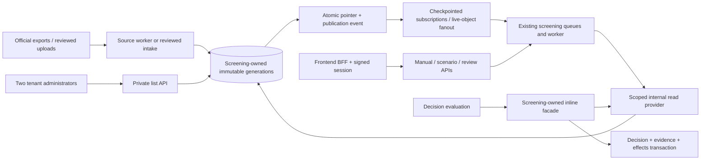

# Internal screening provider design

## Phase 8 acceptance update — 2026-11-15

The [acceptance register](INTERNAL_PROVIDER_ACCEPTANCE.md) is the definitive current gate record. All 21 browser failures are repaired: **134 full-suite passes, zero failures, one dedicated skip**, plus a separate real API/PostgreSQL/worker **1/1 pass**. Final screening regression is **138/288**, auth **33/60**, decision **260/423**, case **90/157**, investigator **1/1** (top-level / including subtests). Name quality remains unaccepted; separate identifier engineering calibration is documented. The complete sustained workload measured **87.487 decisions/s, p95 290.738 ms**, below target. Migration 22, actual restricted logins, restored-clone binding, logical restore/worker replay and operational alert contracts pass disposable checks. Source permissions, representative quality/capacity, production security/recovery/alerting and explicit activation remain open. Existing frontend lint (20 errors/74 warnings) reproduces on HEAD and is recorded separately. **No production-ready claim or activation is made.**

See [matching](INTERNAL_PROVIDER_MATCHING_EVALUATION.md), [browser investigation](INTERNAL_PROVIDER_BROWSER_REVIEW.md), [source approvals](INTERNAL_PROVIDER_SOURCE_APPROVALS.md), [performance](INTERNAL_PROVIDER_PERFORMANCE.md), [security](INTERNAL_PROVIDER_SECURITY_ACCEPTANCE.md), [recovery](INTERNAL_PROVIDER_RECOVERY.md), [activation runbook](INTERNAL_PROVIDER_ACTIVATION.md) and [Phase 8 machine manifest](evidence/internal-provider/2026-11-14/phase8/manifest.json). Earlier dated measurements below remain historical where explicitly superseded by this update.

Updated 2026-11-15 UTC, PostgreSQL main base 18c6e5d plus the uncommitted implementation. This pack supersedes the earlier Phase 1/2 status prose. PostgreSQL is the shared application database; MySQL data is preserved separately. **Development engineering is delivered across the approved workstreams; production readiness is not accepted.** No application DB migrations, production source activation, tenant grants for actual official data, credential changes, commit or push occurred.

## Architecture

Keep one shared PostgreSQL database with independently tracked owner migrations. Collection is a separate bounded executable in the screening module; it is not a new customer-facing service or application database.

## Scoped provider contract

Search, Enrich, GetCatalog, GetFreshness and GetDatasetDelta accept a server-created AuthorizedScope. Distinct scopes cover a verified human, proven scenario execution, subscribed saved-query target, persisted continuous object, canonical live inline config or global operator. The latter never reads tenant-private datasets. Registry resolution is strict and shared by APIs/workers. No unknown-provider, default synthetic or cross-provider fallback exists; omitted legacy provider retains its named OpenSanctions meaning.

Version 2 selection requires 1–10 unique global/own-tenant dataset refs and a supported profile. The provider checks current authorization, grants, enabled sources, rights/freshness and active immutable generations. All selected datasets must be available; a missing source is an error, not a narrower successful search. Catalog metadata exposes category and readiness, not source URLs/tokens/config. The supported visible dataset bound is 500; overflow fails explicitly. Opaque cursors bind scope, selection and relevant versions/permissions.

Entity types are Person, Organization, Vessel and Aircraft internally; named legacy adapters retain their own capabilities. Names are required in the current request shape. Exact typed-ID retrieval can still find candidates when the supplied name has no overlap. Local IDs require a jurisdiction or issuer; values are text, with punctuation/leading zeros preserved and no fuzzy or numeric coercion. A candidate with a differently scoped ID is not agreement. Multiple passports may coexist; a different passport does not erase name evidence. Conflicting LEI/IMO or strong date/registration evidence is visible and conservatively caps the ID profile.

Profiles are exact-name-v1, name-fuzzy-v1, name-token-v2, and the separate identifier-evidence-v1. The identifier profile now has synthetic calibration/evaluation evidence, while independent production quality acceptance remains open. Frozen name scorers and engineering corpora are unchanged. Source categories are properties of explicitly selected datasets: sanctions, PEP evidence, regulatory warnings, corporate information, proceeding notices, controlled fixtures and private watchlists are not interchangeable. No legal identity or risk class is inferred from a name score.

## Data model and publication

Screening migrations 11–22 own datasets/grants, immutable versions/records/names/typed-ID projections, cursors, publication events, source connections/import runs, original artifacts, monitoring attempts, private reviews, inline evidence, maintenance checkpoints, reviewed-notice holds and normalization revision. Records preserve source IDs and original provenance; cross-source identities are not merged. Raw original XML/attachments are restricted ingestion evidence and are stripped from ordinary search/enrichment DTOs.

Import validates a bounded complete snapshot before a parent-revision-fenced publication. Staging leases prevent an expired producer publishing after recovery. Record hashing uses canonical JSONB in stable source-ID order, so input ordering alone is not a content change. The normalizer revision is also part of publication identity: Unicode 17 uses nfkc-casefold-u17-v1. Older Unicode-15 projections remain immutable/historically readable but are unavailable for current search. An identical raw snapshot still creates a new publication when its normalizer changes; source collection bypasses 304 caching to rebuild it. Runtime table-version checks reject an unreviewed library/table upgrade. Rollback to an older normalizer remains unavailable for current matching until a deliberate current-normalizer publication is reviewed. Publication, active pointer, event and any review finalization commit together. An unchanged complete snapshot creates no event; failures retain the last good generation. Network/provider work runs outside mutation locks. Rollback creates a new generation/event from retained evidence; it never rewrites an old publication or decision.

## Lifecycle and rescreening

Saved-query monitoring is explicit and creator-owned. It stores the immutable original query and selected datasets, including old no-hits. Publication fanout uses 200-row checkpoints and unique receipts, and attempts have independent screening IDs/idempotency keys. Currentness compares the latest successful complete result with current generations/grants/readiness immediately, before fanout completes. Failed or partial results cannot replace that pointer. Automatic retries are bounded to five attempts; a current authorized creator can explicitly retry an exhausted target. History is paged at 50 entries with monitor-bound cursors; per-attempt evidence is retained.

Continuous objects use the existing operator-owned configuration/queue contract. Version-2 field maps contain explicit provider_config and fields; legacy maps are not silently upgraded. An enabled current config/object/tenant plus current dataset grants authorizes execution, not a tenant string in a queue. The worker re-reads the live ingestion record, captures the config snapshot and revalidates the persisted continuous run. Publication fanout is checkpointed at 200 objects, skips superseded publications and atomically queues pending objects/receipts. Ordinary historical decisions are not automatically recomputed. Continuous active status means enrollment, not proof that an older clean screening is current; version evidence remains authoritative.

Legacy external-provider maintenance drains every delta page and every joined object page, with persisted lease/fence/cursors and page-level queue atomicity. It retains its global operator boundary and does not invent tenant-private authority. Internal source publication uses its separate selection-aware fanout.

## Retention and recovery

Legal hold defaults to true. Explicit per-dataset failed/staged age policies permit bounded cleanup of unreferenced unpublished projections and failed/rejected artifacts only. Active/published/quarantined versions, investigation/decision evidence, pending reviews and explicit holds are protected. Published evidence is retained indefinitely pending an approved expiry policy. Cleanup skips locked rows and retains audit/hash metadata. Source, private and notice recovery fences abandoned leases/receipts; a global collector never repairs another tenant's private import. Real process-kill/restart behavior is tested on disposable PostgreSQL.

## Private tenant-list management

Both importer and approver must currently hold tenant_admin, and they must be different people. The signed session injects tenant and actor; current membership/version/session checks run at reads and under mutation locks. UTF-8 CSV is bounded to 5 MiB/10,000 records with strict headers, unique source IDs, typed identifiers and fixed tenant_watchlist category. Review binds operation identity, full content hash, parent generation and exact source. Snapshot/clear/archive/restore are explicit audited commands. Approval, source publication, metadata/archive changes and audit commit atomically. Idempotent replays cannot rebind an operation to different data. Historical source access remains owner/grant checked after archiving.

The separate private writer pool is two connections and must target the same logical primary database. No service/operator-token fallback grants private publication. The frontend uses capability-gated BFF routes and offers upload, validation/review, diff, retained download, paged import history, restore and recovery.

## Official connectors and reviewed notices

Automatic XML connectors enforce authoritative HTTPS host/redirect allowlists, private/loopback/metadata DNS rejection, TLS, no environment proxy, 90-second download bounds, 64 MiB decompressed artifacts, response completeness, strict XML roots/limits/counts and no DTD/XXE/XInclude. Original bytes/hashes are retained before parsing. Per-source leases/fences, conditional generation-bound 304 checks, persisted backoff/jitter and retry exhaustion prevent duplicate or endless collection. Validation/large-drop anomalies quarantine the source; retry does not approve changed content or rights.

Reviewed Ghana notices use an uploaded PDF/captured text plus strict structured CSV. Global DB operator privileges and a current human identity are both required; a tenant administrator alone is insufficient. A second human reviews the exact snapshot. Source category is fixed by the registry, attachments/hashes are held and withdrawals are new reviewed publications. Content approval is distinct from rights approval and tenant grants. FIC is reference-only to the independent UN feed; ORC is contract-required; neither becomes a fabricated bulk API.

## Decision-time enforcement — Gate E

The screening module exposes a narrow Go read facade used by the decision module; there is no source HTTP/mutation in lookup and no dependency cycle. It checks the live canonical config, current grants/readiness, pinned generations and the current object/query-scoped exclusion snapshot. The result is one of no_candidates, candidates, failed, timed_out or incomplete; partial data is never clean.

The approved failure policy is **error only**. The feature stays disabled unless explicitly configured. Failure, timeout, incomplete data or changed authority aborts evaluation and saves no successful decision or dependent effects. No Block and Review failure fallback is offered. Hits can force the strongest configured review/block-and-review/decline outcome without changing rule score. Workflow/scoring/async execution creation sees the final outcome.

Successful evidence binds request/config, source/generation/profile, applied exclusions and policy/version/outcome. It is saved atomically with decision/executions/queues/outbox through the screening-owned persistence contract. Inline-enabled multi-scenario requests stage every evaluation before a single write transaction, so one failed lookup prevents partial successful decisions. Workers do not re-search or overwrite saved inline evidence. Ordinary analyst review can evolve separately while original machine evidence remains immutable. Existing decision API retry/idempotency contracts are not expanded implicitly.

## Operations

The source worker uses four DB connections; administration/import tools use two; private writes use a separate two-connection pool. API/queue replicas must fit a reviewed database-wide budget, using explicit pool limits (including DSN pool_max_conns where applicable). The optional Compose profile exposes no ports, runs without root, uses a read-only root/tmpfs, drops capabilities and has resource bounds. Secret files are supported; no dotenv/default DB is selected by source tools. Diagnostics expose aggregate backlog/failure/age counters and worker heap/pool observations without names, queries, tenant IDs or credentials. See the [runbook](INTERNAL_PROVIDER_PROGRESS.md#operator-and-test-runbook).
