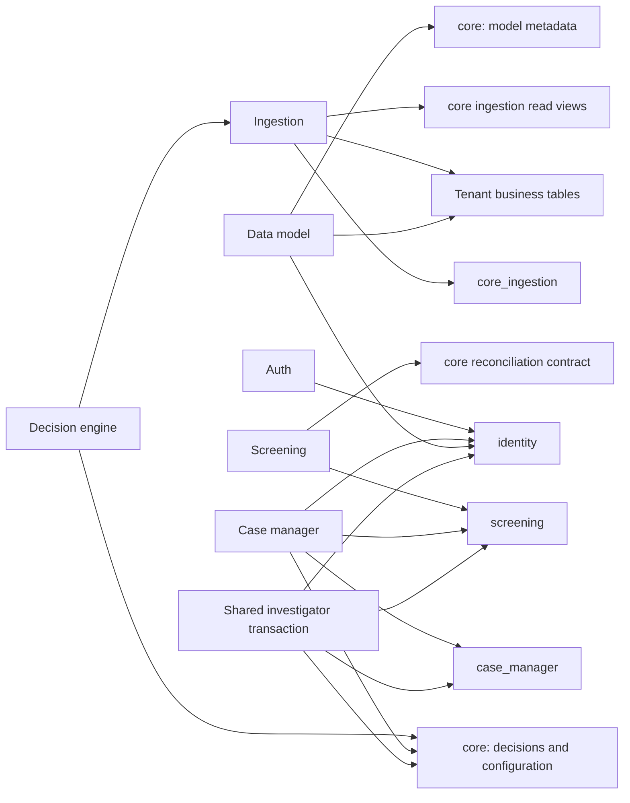

# Database architecture and data model

## Ownership and shared database

The supported architecture is one logical application database. Root Compose selects `fraud`; namespace separation does not imply separate databases. Shared SQL reads and owner-defined SQL mutation contracts are part of the implementation, not accidental coupling to remove automatically. PG-03, PG-06, PG-15, PG-17 and PG-18 describe those contracts.

Arrows summarize source contracts, not every runtime request. All database boxes above live in the same configured database. HTTP tenant reads in decision-engine can be configured as direct SQL instead. External provider databases are not shown because their internals are unknown.

## Object inventory and migration lineages

[14_schema_object_index.md](14_schema_object_index.md) enumerates original table columns, defaults and inline constraints, followed by every discovered up-migration ALTER/index/function/trigger/view location. [12_schema_source_catalog.md](12_schema_source_catalog.md) preserves all 119 SQL files, including rollback scripts and provider provisioning. These appendices are the exhaustive source-level schema inventory; do not infer final definitions from `000001` alone. No schema was instantiated for this audit.

| Owner / namespace | Table families and persisted responsibility | Source migration extent |
|---|---|---|
| Data-model / `core` | tenants; model_tables, model_fields, model_links; pivots; table_options; schema_changes; tenant_schema_migrations; index_jobs; field_enum_values; navigation_options; ingestion_contracts. UUID keys, JSONB metadata, array display/index fields, tenant/model relationships. | 8 up/down pairs, through `000008_field_alias`; [initial](../backend/data-model-service/internal/migrations/metadata/000001_init.up.sql) |
| Ingestion / `core_ingestion` | ingestion_audit, outbox_events, idempotency_keys, upload_logs, deferred_ingests. JSON payloads/responses/errors; BYTEA upload payload; UUID IDs; tenant/key composite dedupe PK. | 2 pairs; [initial](../backend/ingestion-service/internal/migrations/metadata/000001_init.up.sql) |
| Decision / `core` | scenarios, scenario_iterations/publications, rules, decisions/rule_executions; test_runs and phantom results; workflows and structured workflow_rules/conditions/actions/executions; snoozes, outbox, scheduled/async executions; screening configs/executions; scoring configs/requests; custom lists/entries, record tags, risk snapshots, IP flags; investigator reviews and authoring events. | 23 pairs through screening authoring audit; [initial](../backend/decision-engine-service/internal/migrations/metadata/000001_init.up.sql) |
| Screening / `screening` | screenings, matches, comments, whitelist, files, continuous configs, monitored objects, dataset update jobs; case_event_outbox; continuous_runs; investigator_reviews; execution_projection_queue; object exclusions/events/applications. | 10 pairs through exclusion history indexes; [initial](../backend/screening-service/internal/migrations/metadata/000001_init.up.sql) |
| Cases / `case_manager` | inboxes/users/events; cases; decision/screening/tag/file/contributor links; case_events; AI reviews; suspicious activity reports; outbox; intake_receipts; evidence_uploads; screening_intake_routes. Later type constraint admits manual screening. | 14 pairs through manual screening; [initial](../backend/case-manager-service/internal/migrations/metadata/000001_init.up.sql) |
| Auth / `identity` | users, external_identities, memberships, sessions, login_transactions, audit_events, invitations, invitation_delivery, schema_migrations. Application role/session state; no password table in these definitions. | Embedded schema/schema_v2/schema_v3; ledger latest expected version 3 |
| Data-model DDL + ingestion DML / tenant namespace | Runtime model-defined tables, not fixed SQL migrations. Base `id UUID PK`, `object_id TEXT NOT NULL`, updated_at, valid_from default NOW, valid_until default INFINITY. Object_id unique index added by TableService. Model types bool/int/float/string/timestamp/IP map to BOOLEAN/INTEGER/DOUBLE PRECISION/TEXT/TIMESTAMPTZ/INET. | [SchemaManager](../backend/data-model-service/internal/tenantdb/postgres/indexing.go#L14); archive renames physical columns; metadata describes logical model |
| River / default namespace and `case_queue` | Dependency-owned jobs, queues and supporting state. App source configures schemas and job contracts; full installed DDL/version not captured here. | Independent River migrators; mixed dependency versions |
| Optional Keycloak / `keycloak` | Provider-owned identities, credentials, realm/client/session state. Source supplies provisioning and realm import, not all provider tables. | Keycloak 26.8.0 image in Compose; provider handles its migrations |

Migration ledger names: data-model uses golang-migrate default `schema_migrations`; ingestion `schema_migrations_ingestion`; decision `schema_migrations_decision_engine`; screening `schema_migrations_screening_service`; cases `schema_migrations_case_manager_service`; identity has its own schema ledger. Preserve independent ownership in MySQL. These are code definitions, not observed applied versions.

## Relationships and correctness constraints

Cases migration 000002 adds `(tenant_id,id)` uniqueness and composite FKs between inboxes, cases and children; 000003 ties inbox/tag tenant IDs to `core.tenants`. Later migration 000012 makes a decision belong to only one case per tenant. A screening link may represent either a concrete candidate or legacy screening-only association: migration 000004 uses two different partial unique indexes for nullable match_id. Replacing them with one nullable composite unique index would admit duplicate legacy links.

Identity memberships reference tenants/users; sessions reference the tenant/user membership pair. Issuer/subject binds external identity to a local user. Role arrays have a nonempty allowed-value check; later upgrades expand allowed platform roles without granting them automatically. Invitations have one pending entry per tenant/email, a unique digest, and immutable generation/lease expectations for delivery.

Screening continuous_runs uses tenant-consistent references to screening/config/monitored object. Exclusion scope is `(tenant_id,object_type,object_id,provider,query_fingerprint,entity_id)`. Its latest operation and audit-event relationships are checked at commit. Reviews and exclusion audit triggers reject mutation/deletion of history and validate source relationships. Candidate IDs are text, frequently entity-ID plus screening UUID, so a blanket UUID conversion would corrupt keys.

Model links/pivots describe relationships for evaluation and navigation; they are not evidence that every dynamic tenant field has a physical FK. The physical AddField implementation only selects a type; model nullable/enum metadata can be enforced at ingestion rather than by identical SQL constraints. Preserve this distinction and profile invalid historical rows before stronger target constraints. Some metadata references use only globally unique ID; tenant consistency also relies on application and trigger checks. There is no basis to claim universal database-enforced tenant isolation.

Decision scenarios and iterations form a reference cycle (live iteration is added after iterations exist). Load in two passes when needed: base scenario with nullable live reference, iterations, then restore live pointer. Cross-owner runtime functions can reference tables installed by later services: decision 000019 explicitly delays resolution of screening tables until invocation. Readiness must wait for all dependent migrations.

## Index and data representation dependencies

Partial indexes cover active names/tags, unassigned/open cases, recoverable screenings, pending invitations, nonempty execution idempotency keys and live workflow rules. Expression indexes include lowercased names, case queue ordering flags and manual history actor extraction. Decision prefix lookup uses `text_pattern_ops`. Ordinary composite B-trees support tenant+time/id pagination, object lookups and relationship joins. Each predicate and sort order is cataloged in 12/14; target index existence alone is insufficient validation.

JSONB is used for durable request/result evidence and executable rule/workflow metadata, not merely opaque payloads. Arrays carry roles, ordered display IDs, index columns and match texts. BYTEA stores uploaded content and cryptographic digests. Timestamp infinity occurs in dynamic tenant storage. Tenant updates change existing rows in place: valid_from/valid_until do not establish a complete slowly changing history. No application serial/sequence-based business key was found in hand-written schema files; River/test fixtures are separate.

## Lifecycle and resource constraints

Pools are created per API/worker process, sometimes with separate ingestion read and worker pools. A zero environment max often leaves the pgx default; it does not mean zero connections. Compute the deployment budget as the sum of all instantiated pool limits across replicas plus migrations, provider, operational and failover headroom. Current replica counts, effective defaults and server limits were not measured.

Most mutation adapters use default pgx transaction options. Case rollback cleanup explicitly survives request cancellation; some other adapters call rollback with the request context. A MySQL port must define cleanup ownership, deadlines and retry boundaries consistently. The application uses a mixture of single-statement snapshots, multi-statement transactions, savepoints, advisory locks and row locks; a blanket isolation change is unsafe.
